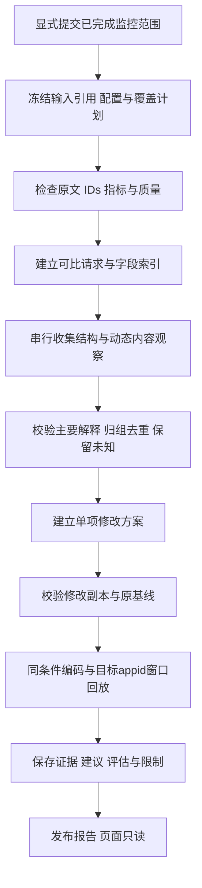

# 异常分析首期流程与范围

> 2026-10-31修订：以[范围纠偏与探测依据](EVIDENCE_AND_SCOPE_REVISION_20261031.md)为当前依据；撤回旧固定探测顺序，配置/模板参与检查下沉内部能力；明确低命中与Token内容候选、已知cch清理及同集合工具稳定排序。本文未冲突部分继续作为讨论稿。

版本：v0.3讨论稿，2026-10-30。用户已明确首期聚焦低命中率、Token内容分析和离线修改评估；Loop等过程分析保留。根据用户提供的PrefixLens报告优化，PrefixLens只作参考；本稿不启动编码，不冻结API。

阅读入口：[产品总览](PRODUCT_PROPOSAL.md) → 本文 → [结果与证据字段](RESULT_FIELDS_DRAFT.md) → [展示样例](DISPLAY_EXAMPLES.md)。[参考核对与取舍](../../research/implementations/PREFIXLENS_HUAWEI_REVIEW_2026-10-30.md)记录借鉴及纠正项；现场报告已按原字节保存，未独立运行远端代码。v0.2见[历史快照](../../../achieve/2026-10-30/analysis-v0.2/README.md)。

## 1. 首期对象与明确边界

报告绑定一个已完成监控运行、一个appid及模型服务/编码身份，使用该运行的有效请求、原文、J/P/H/C/O、输入IDs、轻量证据和缓存配置。缺少模型服务绑定时保留原运行模型，不猜服务名。缓存范围沿用用户侧appid隔离；不把MA的UUID共享缓存结果混入本报告。

| 首期内容 | 具体交付行为 | 数据限制下的表达 |
| --- | --- | --- |
| 低命中内容差异 | 查找可比请求，识别动态值、工具顺序/定义差异、稳定内容之前的变化，复核模板后前缀 | 没有session时称结构对照，不称相邻turn；未确认进入模板的原字段不能成为缓存归因 |
| Token内容 | 大字段、重复内容、工具Schema/返回、重复包装/序列化；结合P/C定位值得检查的请求 | 字节大小与精确Token归属分开；不以大等同无用 |
| 离线修改评估 | 创建单项修改副本，校验、统一编码、按相同规则重放，对比J/P/H/C | 属于静态输入反事实；不承诺业务等价、未来O/调用数或实际缓存/时延收益 |
| 原因解释与建议 | 区分输入事实、缓存影响和业务适用性，提供修改示意及验证步骤 | 窗口冷起点、块/MTP规则、首次出现等列为解释，不生成虚假的优化项 |

首期不要求session/turn新增为必填；工具执行失败/重试、任务增长、Loop、分支冗余等进入保留清单，不据当前快照给过程结论。O只作为源计数背景；没有响应正文时不分析输出冗长或思考内容。

## 2. 输入检查与覆盖

分析开始先读取原运行身份、有效集合、模型/资产/模板与配置签名、原文及IDs可用性。JSON Pointer、字符串字节/字符/摘要来自已有source_fields；详细offset来自显式复核，不代表原JSON精确归属。

原运行不可读、模型/资产不匹配或基础指标校验不一致时，阻断相应分析/评估。没有工具字段只是相关探测器不适用，不阻断文本内容检查。前缀缓存关闭时解释H=0，不报动态字段导致低命中；内容分析和P变化评估仍可进行。

范围分为三个集合：

- **报告范围**：用户所选appid的原运行有效请求，默认全范围。
- **深查范围**：在预算内完成字段对照/模板定位的请求，记录选择方式和未查数量。
- **回放范围**：仅目标appid在明确分析窗口内的有效请求，按模型服务/编码身份隔离；默认沿用该appid原运行窗口，不要求其他appid或自创建以来历史。自选窗口可在同起点重算修改前后，不冒充原监控H/C。

可从长P、高C、低复用和大字段候选优先深查，但必须记录阈值或Top-N及实际覆盖。没有全量扫描时，已观察模式只按样本计数。时间片筛选不改变原H/C的历史条件；评估完整回放后可另给所选片段指标，但不得把片段从空缓存重算后与原值直接比较。

原文、结构和Token计数分别比较。J相等不是JSON相等，P相等不是IDs相等；JSON canonical化仅作比较视图，不能先规范化原文再重算J，也不能将工具/消息数组无序化来抹掉差异。字段是否进入模板，须结合适配器、选项和模板后证据确认。

## 3. 分析流程

1. **冻结与检查**：确定源run、记录集合、编码/缓存身份和分析版本；检验H+C=P及请求引用，记录原运行读入/有效/跳过信息。
2. **建立对照**：优先可靠已有关联；否则在同appid/服务/配置内先查共享历史前缀，再查工具/消息结构和稳定说明相近的历史候选。掩码形状仅作候选召回，需回查原字段与模板后证据，不将最近时间、形状哈希或最高相似度当同session/语义等价证明。
3. **串行检测**：按适用性读取同一不可变输入，收集全部适用观察；在观察之后校验模板参与、位置和替代解释。只有规则/完整输入错误才阻断依赖子项，某探测器失败不清空其他发现；未运行/预算耗尽单列。
4. **归并发现**：同位置、机制、工具/结构版本的观察可形成一张卡片，两个方向引用同一证据。每条观察记录当前请求与对照引用；涉及数量只对当前请求键取并集，对照不额外计入。保留次要变化和冲突证据，再给总览选主要解释；主要解释不代表全部C归因于它。
5. **修改评估**：满足前提的发现进入首期离线评估。初次分析可在明确预算内自动形成规则明确的候选；用户也可另行显式选择已有候选评估。无法机械定义修改时保留建议并显示原因，不编造方案。
6. **发布**：报告可包含成功发现、未检出、不适用、未完成与失败的子项。单项评估失败不抹掉已保存证据，报告明确部分可分析；页面读取不继续探测或重放。

### 3.1 业务探测与内部校验

此前固定次序无现场频率、收益和执行成本依据，已撤回；不以结构优先的工程直觉决定业务优先级。context_check与format_visibility下沉为内部输入校验/字段定位，不作为业务异常或要求用户修改模型配置。

低命中候选：动态元数据污染、工具排列不稳定、工具定义/集合漂移、历史前缀改写、输入序列化不确定。Token内容候选：工具定义负担、大工具返回注入、同一大载荷重复搬运、历史工具结果负担。逐项来源、判定边界、所需输入和建议见[证据矩阵](EVIDENCE_AND_SCOPE_REVISION_20261031.md)。

只保留输入校验→比较→候选核验→副本修改→计量评估的依赖。探测器读取同一原始输入，不首个命中即停；各自版本、适用性和失败独立。内部执行次序留待测量成本和覆盖后确定，不决定主要原因或因果收益。业务展示可按已评估的同范围P/C改善排序，未评估项不虚构收益。

### 3.2 前缀证据的生成边界

先对原字段建立差异，再以模板后IDs确认实际变化；可得时通过统一详细编码定位模板后片段。原字段映射若不可靠，保留字段差异与模板后断点两个独立事实，不画两者之间未经证实的精确连线。

共同前缀长度和首个不同Token是请求对的属性，H是缓存账本、P−1上限、块对齐与MTP的结果，二者不得混名。比较样例不是实际缓存唯一来源。向未来请求对照只能解释模式，不能用于证明当前请求已经有可用历史。

新增参照状态：`no_history`仅指原可见历史内没有更早有效请求；`no_clean_reference`表示有历史但候选不合格；`ambiguous`表示候选证据冲突；预算耗尽为`not_inspected`，读取/分析失败为`error`。这些都不等于内容语义唯一或不可优化。片段包含匹配、多处相同文本、掩码后相等都不能独立升级为精确来源或安全性结论。

### 3.3 重算量的规则解释与分析覆盖

对当前缓存启用的full-block规则，读取原事件的退块前匹配量M，并从同一配置得到可查上限U：`U=floor(max(P−1,0)/B_eff)×B_eff`。可核对`C=(P−U)+(M−H)+(U−M)`，分别展示边界保留、MTP实际退块、未匹配前缀三部分。计数来自原监控事实/规则；H不直接作为首个不同Token的位置。

缓存关闭时单列C=P；事件/相容口径不足时保留C总量，分解未知，不从H反推M。U−M也包含首次出现和未找到历史前缀，不叫“可挽回损失”。分析覆盖可按当前请求的no_history/有对照观察/no_clean_reference/未完成等互斥状态分组，计数与总量可核对；这些是证据覆盖分类，不是多原因因果贡献图。

## 4. 首期离线修改评估

### 4.1 候选修改

| 修改类型 | 可定义的副本操作 | 必须保留的条件 |
| --- | --- | --- |
| 动态字段调整 | 在指定消息字段内移到后部，或仅对明确元数据作替换/移除 | 原值、来源与功能依赖记录；移出模型输入只是假设方案，已确认误入模型输入的cch元数据按业务信息无损清理；其他动态业务字段按用途判断 |
| 工具稳定排列 | 对相同、无重复身份的工具集合按明确名称/版本键稳定排序 | 不改定义、不合并权限；名称歧义拒绝该方案；相同集合/定义仅固定排列，按稳定化修复处理 |
| 工具结果裁剪 | 指定字段保留前缀、限制条目或保留指定子字段 | 明确裁剪规则、引用/继续读取方式；保留调用配对和必要结构，不删除消息/调用ID来制造收益 |
| 重复包装减少 | 对明确重复位置删除一份，或解开特定重复序列化层 | 指定位置和预期结构；未确认模型消费方式时标假设方案 |

首期离线评估不调用模型生成摘要、不重新执行业务agent或工具。摘要、分页与按需读取可作为建议，但没有确定的修改副本时不填量化收益。候选在隔离副本上评估；不修改真实网关、原CSV或已封存结果。

所有发布收益的首期操作作用于原请求的明确结构字段，再走同一适配器和模板。禁止直接删Token IDs或在整个模板后文本上正则删除来绕过结构/控制Token校验。正则仅用于召回和确定字段内匹配；必须保存具体位置、原值条件和未改部分。工具身份用明确名称/版本/定义及数量验证，保留多重性；身份冲突不能用排序掩盖。

### 4.2 基线与变更校验

1. 使用原资产、模板选项及配置复核基线；与原IDs/P、相同范围H/C一致后才发布前后收益。源资产不可用或摘要不一致时为`blocked`，不是零收益。
2. 方案明确选择规则和实际目标记录，生成逐请求变更前后摘要与字段差异。保留未修改部分；若重新序列化改变其他字节，单独记录，不能把J变化全部归给目标字段。
3. 校验修改后的请求仍符合原模型适配器、工具结构和编码要求；所选目标修改失败时阻断该方案，不静默跳过失败记录后仍用旧分母发布收益。合法不适用记录保留不变，并计数。
4. 对结构性/业务等价尚未核实的方案允许做假设评估，但显著标`requires_business_review`；“能编码”不等于业务正确。

### 4.3 回放与统计

基线和修改方案各使用独立空账本，按原appid范围、原时间与记录序号顺序重放完整输入；其余参数、有效集合和窗口一致。修改规则涉及多个请求携带的同一内容时，明确作用于哪些记录；没有session不能声称保证全部历史语义一致。

默认报告整个回放范围的前后总量，包含修改对后续未修改请求缓存可用性的影响；同时可列出直接修改记录的统计。两者命名为`replay_scope`和`modified_requests`，不能相加。若完整历史不可得或预算不足，评估保持未完成/受阻，不发布“全窗口收益”。

指标为J/P/H/C总量、R=ΣH/ΣP、命中率百分点变化、`C前−C后`及`P前−P后`。J前后使用各自原文/修改副本文本，不能对基线先规范化。O只保留源值背景，不复制为修改后输出预测。P为零时R不可用而非0；负收益或无变化照常发布。

静态裁剪可改变后续模型决策，因此量化名称统一为“离线输入评估”，而非预计真实省费/提速。每项收益关联具体方案、数据和配置；组合收益需独立回放。

组合前先核对目标路径、范围与操作顺序，重复删除或一项移走另一项目标时标冲突，不静默合并。没有实际组合回放就显示“组合未评估”，不能用单项和作为上界：同一首块中的两个变化可能各自单改都无收益、合改才有收益；也可能两个方案高度重叠。结果保留已评估范围与未评估原因。

## 5. 结果发布与业务阅读

结果保留报告、探测记录、发现、证据、修改方案与评估，字段详见[草案](RESULT_FIELDS_DRAFT.md)。报告增加逐请求解释状态与规则记账；发现保存逐条观察，再聚合去重。探测覆盖与评估状态分开；同一报告可以既有已核实事实，也有受阻的修改评估。

业务页顶部显示应用/服务、数据范围、原监控指标、已检查/可比数量和报告时间。两类tab的卡片显示事实标题、业务位置、涉及请求数及分母、建议和评估状态。详情分为事实与对照、修改说明、离线结果、业务验证待办；技术字段可展开。

首屏按“可进行离线评估/需业务复核/需补证据/仅解释现状”组织行动；只有同范围已完成收益才按P或C改善排序。显示主要变化与关联变化，提供不同结构/位置的代表证据，不能用一条示例证明整个组。所有主题和去重请求数可展开，Top-K仅是首屏取舍，显示被折叠数量；不继承参考项目的双层隐含百分比门槛。

检测、可评估性和首屏可见性分别记录。满足修改/数据条件但未在首屏的方案仍可显式评估；不能以display=false跳过候选后又宣称全范围已评估。片段限长/脱敏独立于计算，证据缺失或不便展示时保留摘要和原因；已确认误注入cch清理按业务信息无损处理，同集合/定义工具排序按稳定化修复处理；不泛化到任意字段删除或工具集合修改。

精确来源不足时显示原文字段大小和相关片段；过程数据不足时显示保留项入口及缺口。未检出、不适用、未完成和失败分别呈现，不用空列表表示一切正常。样例数字与真实分析严格分开，见[展示样例](DISPLAY_EXAMPLES.md)。

## 6. Loop 等过程分析补充数据

| 保留场景 | 最少数据 | 建议补充数据 | 当前输入下可给出的上限 |
| --- | --- | --- | --- |
| 上下文增长 | session/agent_run、请求引用、顺序、父子分支 | turn、压缩事件、任务边界 | 同请求内容与结构差异，不能称会话增长 |
| 工具失败重试 | 唯一tool_call事件、请求/任务关联、名称、参数摘要、结果/错误状态、attempt/retry关联 | 起止时间、错误可重试类别、幂等键 | 输入历史里的重复/错误线索，不能计实际重试次数 |
| 无进展Loop | 以上关联，加任务目标、状态变化、完成/停止原因 | 预算、合法轮询规则、外部状态版本、人工确认 | 疑似重复内容，不确认死循环 |
| 子agent冗余/互相转交 | agent/parent_run/任务、handoff与结果关系 | 角色/工具版本、共享状态及任务语义 | 名称或请求量线索，不能证明重复工作 |
| 超时/取消后执行 | 唯一事件、取消/完成状态、各操作生命周期 | 取消传播与副作用幂等结果 | 无可靠判断，不能由处理开始时间补造时间线 |

补充材料还需标明：事件ID是否全局唯一、采样/丢失/去重规则、时区与时钟、历史快照还是实际事件、输出是否截断/脱敏、跨模型与分支如何关联。request/hash_id只能作来源线索，不能默认承担全部关联身份。

先核对少量连续脱敏样例能否闭合“模型请求→工具调用→结果→下个请求→终止”，再确定正式输入形式。该工作不要求现在接入新日志系统，也不阻断首期三个已确定方向。

## 7. PrefixLens 参考与后续收敛

已收到用户提供的华为PrefixLens报告，原件与[核对取舍](../../research/implementations/PREFIXLENS_HUAWEI_REVIEW_2026-10-30.md)分开保存。借鉴历史参照、结构化证据、业务行动与未知状态；不采用首命中停止、块数收益换算、安全删除默认值、累积掩码唯一归因或组合求和。未导入源码，不增加运行依赖。

待收敛项缩小为候选/深查预算与阈值、各修改方案的机械规则、公共证据接入方式及字段草案；首期包含离线修改评估已由用户明确，不再列为可选增强项。输入不足的单项有降级路径，不以等待PrefixLens为由暂停产品设计。
