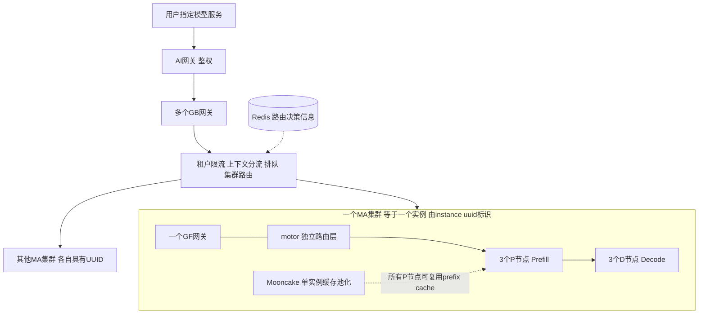

# MaaS 架构与监控概念参考

更新日期：2026-10-30。依据用户在 Token监控V2 产品讨论中提供的生产架构、字段说明和查询示例整理。

本文描述 MaaS 的组件关系、请求生命周期及监控数据含义，作为产品讨论的共同参考，不是 TokenScope V2 的详细设计或接口契约。**监控消费已有数据库记录；不负责建设埋点、记录或生产路由系统。V2 明确要求以 MA 集群的 UUID 为单位统计理想命中率和真实命中率。**

## 1 组件与关系

### 1.1 总体结构



图中展示逻辑组成和处理阶段；GF 与 motor 的具体调用接口、P/D 配对与传输细节不在本参考中规定。

| 组件或对象 | 含义与职责 | 关系 |
| --- | --- | --- |
| AI网关 | 请求鉴权 | 鉴权后的请求进入GB |
| GB网关 | 租户并发限流、上下文分流、排队、集群路由 | 部署多个GB以分摊负载；多个GB可以向同一MA集群发送请求 |
| Redis | 为GB提供集群路由决策信息 | GB按所用策略读取决策信息；不规定这些信息的写入实现 |
| MA集群／实例 | 一个完整模型服务实例 | **MA集群就是一个实例**，由instance uuid区分；当前组成是GF＋motor＋3P3D |
| GF网关 | 集群内请求入口，参与具体P节点选择；提供模型侧计时打点 | 与MA集群一对一 |
| motor | 独立的路由层，用户说明其已开源 | 属于MA集群组成，承担路由职责；不是将其视为GF内部模块 |
| P节点 | Prefill处理节点 | 一个MA集群有3个P节点；P节点不等于一个MA实例 |
| D节点 | Decode处理节点 | 一个MA集群有3个D节点；具体P/D调度关系不在本轮展开 |
| Mooncake | 已实现的单实例缓存池化 | 同一MA实例内所有P节点均可复用prefix cache；不据此推断跨UUID共享 |

用户已明确：同一UUID内不同appid可以共享prefix cache，所有P节点均在该实例的共享复用范围内。这不等于每次请求都能命中，也不将共享范围扩展到不同UUID。

### 1.2 模型服务与模型规格

| 概念 | 数据库字段 | 示例 | 用途 |
| --- | --- | --- | --- |
| 模型服务 | common_name | Qwen-V3.6-27B、DeepSeek-V4-Flash、GLM-V5.2 | 用户请求中指定的模型名称 |
| 模型规格 | model_standard_name | Qwen-V3.6-27B-32K | GB按上下文长度分流后的服务标签；用于后续集群和实例路由 |

用户不必感知32K、64K、128K等具体规格。GB对原始JSON请求做 **不套用chat template** 的tokenization，再进行上下文分流。不同规格的部署方案相同、流量长度不同；在路由和监控比较中应保留规格差异，可以将它们看作不同模型对象。

规格标签不等于当前请求的精确输入Token数。GB分流长度与模型实际模板后的prompt_tokens也不是同一计量对象。GB处理的原始JSON是否与GF转换后保存的request_input逐字一致，本轮未作确认。

## 2 一条请求的生命周期

| 阶段 | 处理过程 | 结果或分支 |
| --- | --- | --- |
| 1 用户发送 | 指定模型服务common_name，并提交请求正文 | 进入AI网关 |
| 2 鉴权 | AI网关进行身份鉴权 | 鉴权通过后进入GB；鉴权失败响应细节不在本轮定义 |
| 3 租户限流 | GB检查租户并发限额 | 超限部分返回403，不进入后续处理；未超限则继续 |
| 4 上下文分流 | GB对模板前原始JSON做tokenization | 确定model_standard_name，如64K规格 |
| 5 排队与准入 | 每个GB×模型规格分别有等待队列和运行队列 | 模型可用并发不足时等待；VIP优先、局部FCFS，全局不保证FCFS |
| 6 集群路由 | GB依据路由策略及Redis决策信息，将运行队列中的请求发往集群 | 选定以instance uuid标识的MA实例 |
| 7 集群内路由 | 请求进入该集群的GF，由GF与独立motor路由层完成内部路由职责 | 选定具体P节点；两者精确调用顺序不在本轮规定 |
| 8 Prefill | P节点处理模型输入，使用实例内池化缓存 | 可复用prefix cache；存在实际输入量与实际命中量 |
| 9 Decode与返回 | D节点执行Decode，形成输出并返回请求结果 | 统计输出Token、TTFT及TPOT；具体响应回传逐跳路径不作推断 |

hash_id在GB、GF、motor和P/D之间保持不变。流程图中的经过顺序不意味着监控需要逐层新建记录；TokenScope从已有数据库获取可用字段即可。

## 3 并发与SLO概念

### 3.1 并发上限

模型准出前，通过AISBench闭环压测寻找满足SLO的并发能力。闭环负载按设定并发补充请求：完成一条，再补一条；测试可使用64K、128K等不同输入长度。这里将B描述为测试并发设定，不把“始终严格小于B”作为逐时刻测量定义。

用户给出的容量示例为：单实例满足SLO的并发B=16，3个实例合计容量为48个在飞请求，包括Prefill和Decode阶段。按本轮澄清，实例指MA集群，不是其中单个P节点。

租户限额与模型容量是不同约束：多个租户各自未超限，合计仍可能超过模型容量，从而发生GB排队。多个GB分配固定额度；额度分配算法以及请求占用、释放额度的准确时点为 **pending，不作为当前架构讨论和监控产品收敛的前置要求**。

生产执行并发限制和粗粒度长短分流，但在飞请求的Token总量仍可能高于某次AISBench测试。并发请求数不能单独代表计算压力，也不能单凭并发低于压测设定就推导P90一定满足目标。

### 3.2 按上下文规格承诺的SLO

用户提供的示例目标如下，具体业务以对应规格的实际配置为准：

| 上下文规格 | P90 TTFT | P90 TPOT |
| --- | --- | --- |
| 32K | <12秒 | <32毫秒 |
| 64K | <27秒 | <30毫秒 |
| 128K | <30秒 | <40毫秒 |

当前关注的是按MaaS自身统计方式衡量的 **模型处理达标**，不把它等同于用户端到端感知达标。用户说明P90 TTFT不包含GB排队；model_handle_start_time与model_ttft由GF打点，从GF发出该请求开始计时。这一描述更新了此前笼统的“模型开始处理时间”。

以下细节保留待确认，不将用户原说明中的问号改写为确定事实：

- “包含GF等待”与“从GF发出开始”之间的边界：GF发出之前的等待和发出之后的下游等待需要区分。
- model_ttft的结束打点事件、单位，以及与对外SLO统计口径是否完全一致。
- model_tpot的单位和单请求内平均方式；P90 TPOT究竟对哪些观测值求分位数。

这些是解释已有指标所需的概念边界，不要求TokenScope承担新增埋点工作。

## 4 字段字典

数据来源表：`share_gateway_requests_logs`。下表记录用户提供的业务语义；精确列名仅采用已给出的SQL或表述，不另行定义数据库接口。

| 字段 | 业务含义 | 使用说明 |
| --- | --- | --- |
| common_name | 用户指定的模型服务 | 如Qwen-V3.6-27B；可作为源数据筛选条件 |
| model_standard_name | 上下文分流后的模型规格 | 如Qwen-V3.6-27B-64K；保留规格维度以解释流量与SLO |
| instance uuid（用户表述） | 唯一标识一个MA集群／实例 | V2集群统计的分组身份；两份SQL未选出此字段，准确数据库列名待补充，不擅自写成instance_uuid |
| hash_id | 唯一标识一条请求 | 跨GB、GF、motor、P/D保持不变；重复读取和重试细节留到采集讨论，不据此改变V1保留重复行的行为 |
| appid | 发出请求的租户 | 用于租户用量分析及切分 |
| request_time | 示例SQL中的时间窗口筛选字段 | 具体事件、时区尚未说明；不能直接认定为GF接收时间 |
| model_handle_start_time | GF发出请求的计时起点 | 按本轮说明由GF打点；不是GB到达或入队时间 |
| request_input | GF转换后的OpenAI原始JSON请求文本，含文本与工具信息 | 源头保存的是原始JSON文本；用于统一编码、组成统计和理想命中回放；不静默改写正文 |
| prompt_tokens | 套用chat template后的真实输入Token数 | 是实际输入长度；与GB模板前分流计量区别使用 |
| completion_tokens | 输出Token数 | 用户已纠正笔误，不是输入加输出总量；与V1口径一致 |
| cached_tokens | prefix cache实际命中的Token数 | 逐请求实际命中率为cached_tokens/prompt_tokens；零分母或缺值不能解释为正常零命中 |
| model_ttft | 该请求的TTFT | GF打点，按本节和SLO节理解；结束事件及单位待确认 |
| model_tpot | 该请求的平均TPOT | 单位与平均方式待确认；不能把单请求平均值直接称为整体P90 |

prompt_tokens、cached_tokens和model_tpot具体由引擎生成、网关测量还是落库计算，本轮未知。监控先依据已有字段含义讨论能力；只有解释口径或质量问题确实需要时再核对来源，不将逐层记录机制调查作为默认任务。P节点ID与路由策略字段是否可用也未确认，不视为现有必备输入。

## 5 集群命中率的监控范围

**已明确的产品要求：以MA集群／instance uuid为单位，同时统计理想命中率和真实命中率。** 一个UUID涵盖其GF、motor与3P3D；同一UUID下所有P节点可通过Mooncake复用prefix cache，因此不能将各P节点当然视为彼此隔离的缓存范围。

| 概念 | 含义 | 与另一指标比较时的条件 |
| --- | --- | --- |
| 真实命中率 | 生产实际cached_tokens相对于prompt_tokens的比例 | 明确对应UUID、时间窗口和有值请求范围；区分缺失与零 |
| 理想命中率 | 监控在明确回放假设下计算的可复用输入比例 | 按模型规格×UUID统计，同UUID内跨appid共享；缓存初态、请求顺序等仍需后续产品讨论 |

V1现有基线仍是每CSV从空缓存开始、无限容量、按appid×模型回放。本轮要求扩展的是V2的集群统计目标，**不意味着把V1各租户结果直接拼合就已经得到池化集群的理想命中率**，也不冻结新的回放算法。

真实与理想命中比较需要使用相符的请求范围、输入Token分母和模型规格，并解释线上热缓存与窗口内冷启动的差异。同UUID内跨P、跨appid共享均已确认；不同UUID独立统计，不假设跨UUID共享。存在差距时，不直接归因于motor或GB策略。

### 5.1 两类界面的观察范围

用户已确认以下产品口径：

| 界面 | 数据层 | 统计与仿真范围 | 指标含义 |
| --- | --- | --- | --- |
| 用户侧 | GB | appid×模型服务common_name | 该租户在该模型服务下的请求复用潜力；不同appid分别统计 |
| 同事侧 | GF | 模型规格model_standard_name×instance uuid | 每个规格下每个实例独立统计理想与真实命中；同UUID内所有P、不同appid共享prefix cache |

GB侧租户服务级仿真与GF侧实例级仿真回答不同问题，不将前者当作某个生产实例的理想值。同事侧仿真需纳入同一规格×UUID内不同appid之间的复用机会，不能先按appid隔离回放再将结果相加冒充共享缓存仿真。用户侧的租户视角不改变生产实例跨租户共享的事实。两侧复用统一编码与计量能力，窗口、初态、容量和并发可用性等假设仍待产品讨论，未冻结算法。

### 5.2 访问入口

用户已确认采用统一内网地址访问V100上的服务，不要求每台电脑使用localhost，也不要求每位访问者手动建立SSH转发。具体内网IP或域名、端口、监听及网络发布方式留待后续设计与部署阶段确定；本轮仅确认访问目标，未改变V1配置或验证现场可达性。两个界面的划分不自动要求两个端口。

### 5.3 空缓存起步与MA历史窗口候选

用户最新暂定用户侧、同事侧都从空缓存开始，不单独引入持久热缓存仿真。提出将MA与用户监控CSV隔离：MA按模型规格采集，再按UUID划分小数据；每30min或1h采集一次，保留前一份数据，每次重放前一份＋当前份。具体周期与统计范围由[MA后端线](../tasks/monitoring/v2-ma/ENTRY.md)继续讨论，未冻结实现。

这里保留的是前一份数据，不等于跨任务持久保存仿真缓存状态。需要明确前份只作为预热并统计当前份，还是合并两份共同统计；真实值必须与选定统计集合对应。即使重放两份数据，线上仍可能命中更早的历史缓存，因此不能保证理想值始终≥真实值，也不为满足这个大小关系修改指标。

## 6 数据库查询参考

以下SQL按用户原样保留，用于说明现有数据来源与筛选维度，不是已确定的定时采集实现。

### 6.1 按模型服务读取正文与基础字段

```sql
SELECT
  hash_id,
  appid,
  model_handle_start_time,
  completion_tokens,
  request_input
FROM share_gateway_requests_logs
WHERE common_name = 'Qwen-V3.6-27B'
  AND request_time BETWEEN '2026-10-20 07:00:00' AND '2026-10-20 09:00:00';
```

### 6.2 按模型规格读取真实Token与时延字段

```sql
SELECT
  hash_id,
  appid,
  model_handle_start_time,
  prompt_tokens,
  completion_tokens,
  cached_tokens,
  model_ttft,
  model_tpot
FROM share_gateway_requests_logs
where model_standard_name = 'Qwen-V3.6-27B-64K'
  and request_time BETWEEN '2026-09-24 7:00:00' and '2026-09-24 9:00:00';
```

第一份示例按模型服务筛选，第二份按模型规格筛选，且日期不同，不构成同一请求集合的对照数据。两者均按request_time选窗口，不能将其与model_handle_start_time视为同一时间口径。两份示例都没有返回集群UUID；第二份也没有request_input，因此尚未单独覆盖“同一UUID下真实与理想命中对照”的全部输入。

数据库类型、时区、连续采集窗口边界以及重试补采处理留到自动采集产品讨论，不在此改写参考SQL或选择连接方案。

## 7 维护入口

- [Token监控入口](../tasks/monitoring/ENTRY.md)
- [V2产品讨论记忆](../../memory/tasks/monitoring.md)
- [V1验收与限制](../huawei/MONITORING_V1_ACCEPTANCE_20261030.md)

本参考中的架构以用户2026-10-30说明为依据；未将开源motor、Mooncake或vllm-ascend的其他版本能力自动套用到生产。后续澄清直接更新对应概念，V1冻结契约和原始验收证据保持原身份。
