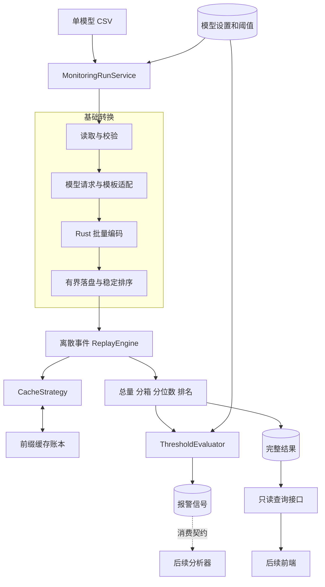
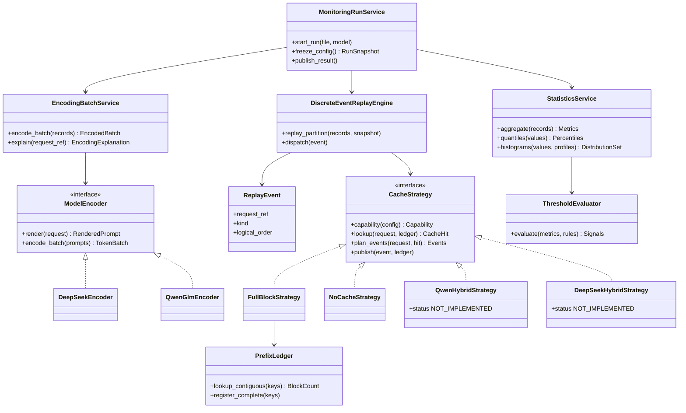
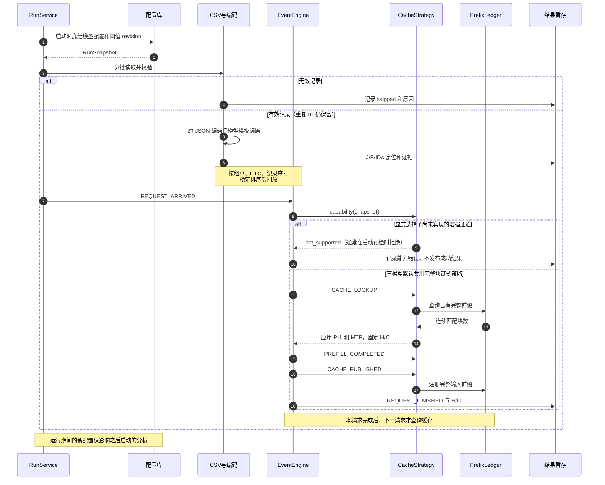
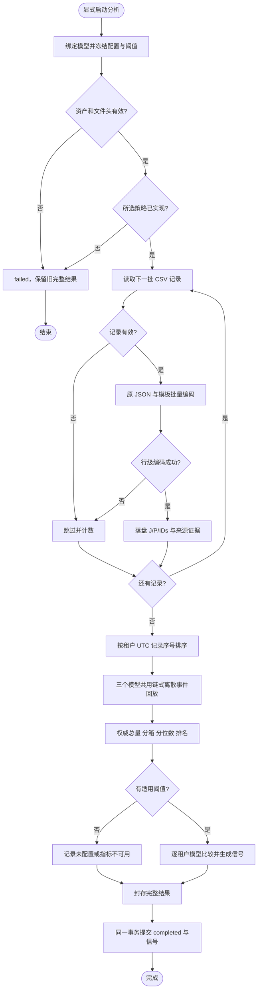

# TokenScope 第一版 Token 监控设计

版本：**v1.0-rc1，待用户审批**。日期：2026-10-26。负责人：Session 1。本文是当前设计依据，尚未批准业务实现或 fork。

依据本轮用户决定重写；[v0.2.2](../../archive/monitoring/DESIGN_v0.2.2.md)保留追溯。公共约定见[首版契约](../../contracts/MONITORING_V1_RC1.md)，源码/测试入口见 [CODEMAP](../../tasks/monitoring/CODEMAP.md)。审批副本由本文生成。

## 1. 首版范围与交付能力

接收三份用户提供的 CSV，每文件绑定一个模型：GLM-5.2、Qwen3.6-27B、DeepSeek-V4-Flash-0731。每文件空缓存，appid 独立，HBM 无限，前一请求的可缓存输入立即供后一请求使用。只模拟 CSV 可见输入；输出量单独统计。

先说明缩写：**H 是理想命中的输入 Token 数，C 是仍需计算的输入 Token 数**。若模板后输入有 1000 Token、其中命中 600，则 H=600、C=400；输出 Token 另算。下文 P 表示模板后输入数，J 表示原始 JSON Token 数。

**三个模型首版都复用普通链式前缀键与连续匹配，区别由 block size 等参数表达，并都输出命中率和输入重算量。** Qwen/V4 采用用户明确选择的链式近似；只有增强 hybrid 通道保留接口和类，不实现其状态注册/保存/恢复/部分页/COW。

| 能力 | GLM-5.2 | Qwen3.6-27B | DeepSeek-V4-Flash-0731 |
| --- | --- | --- | --- |
| 原始 JSON 与模型模板编码 | 实现 | 实现 | 实现 |
| J/P、输出量、请求量、两组长度分布 | 实现 | 实现 | 实现 |
| 默认缓存开启时命中量 H、重算量 C、命中率和重算分布 | 完整块链式路径，B=128 | 同一链式近似，B=1536 | 同一链式近似，B=32 |
| 显式关闭 prefix cache 的对照情景 | H=0、C=P | H=0、C=P | H=0、C=P |
| hybrid 扩展 | 不适用默认路径 | QwenHybridStrategy 占位 | DeepSeekHybridStrategy 占位 |

Qwen/V4 结果标记为 chained_approximation，表达选定参数、无限容量和立即可用假设下的近似上限，不宣称还原真实 hybrid 状态可用性。用户主动选择尚未实现的增强通道时，明确拒绝执行，不悄悄换策略。默认普通路径是已确认的首版功能，不是待定降级方案。

首版不做主动采集、跨 CSV 缓存/窗口协议、生产并发与耗时还原、模型前向、生成 Token 缓存、分析器内部算法、前端页面详细设计和自进化 Agent。华为完整 PrefixLens 不再是完成条件。下文工程接口、存储和 batch 是本次待审批提案，已确认业务决定优先。

## 2. 本轮决定与旧稿调整

| 已确认决定 | 设计落实 |
| --- | --- |
| 离散事件仿真 | 使用逻辑事件推进状态，不伪造 GPU 执行时间 |
| 模型参数可设置，下一次生效 | 任务启动时冻结配置；运行中修改仅影响之后启动的任务 |
| 默认 GLM B=128、Mamba B=1536、V4 B=32 | 三个值直接驱动首版共用的链式近似；不自行替换默认值 |
| 不要求生产镜像、TP/dtype 等身份 | 移除该前置条件；保留本工具使用的参数、算法和编码资产用于复算 |
| CSV UTC，看板北京时间 | 内部 UTC；展示 Asia/Shanghai（UTC+8） |
| 无效行跳过；重复 ID 每行独立 | 跳过无效行并计数；保留重复有效行，hash_id 只作业务标识 |
| 每 appid×model 独立阈值，三天数据后定值 | 建阈值表和比较/信号能力；初始不配置业务阈值，不提前学习基线 |
| 每文件两小时 | 单文件单模型端到端 <7200 秒，三文件可顺序运行 |
| PrefixLens 后续再调研 | 届时写华为 Agent prompt，仅回传一份内嵌关键源码和证据的 Markdown；当前不启动 |

Qwen 固定可配置 prefill 规则及 V4 增强恢复研究保留为后续依据，具体预算和合法边界不再阻塞首版。

## 3. 输入与质量规则

| CSV 列 | 首版规则 |
| --- | --- |
| hash_id | 非空；原样保存；重复不去重 |
| appid | 非空；租户隔离 |
| model_handle_start_time | UTC 日期时间，保留亚秒精度 |
| completion_tokens | 非负整数，仅作为输出数量 |
| request_input | GF 转换后、模板前的完整原始 OpenAI v1 JSON 文本 |

默认 UTF-8/UTF-8 BOM、有表头，正确解析字段内换行和 CSV 引号。JSON 保留 CSV 解码后的原字符串，不 parse 后重新 dumps。输入均为纯文本，包括工具定义、调用和文本工具返回。流式响应不改变输入边界。

接受 ISO 8601 和明确的 UTC 日期时间格式；无时区后缀依用户约定解释为 UTC，有 offset 则规范化至 UTC。纯数字时间戳不猜测秒/毫秒单位。文件→模型显式绑定，文件名只帮助人工区分；请求 model 字段按注册别名核对，冲突行跳过。

内部身份为 `(run_id, source_record_index)`。source_record_index 是表头后从 1 开始的 CSV 记录序号，不是文本物理行；另存物理行范围便于定位。重复 hash_id 的每条有效记录均参与计量、回放和请求数，重复数量仅提示。

行级错误（缺值、JSON/消息格式错误、时间/输出量非法、明确的请求编码错误）跳过，不进入有效指标和缓存。记录序号、错误码和字段定位；常规日志不复制完整请求正文。记录 read/valid/skipped/duplicate 计数，duplicate 指有效记录中相对于首次同 ID 额外的记录数。

缺表头、CSV 破损到无法确定下一记录边界、读文件失败是文件级错误；缺 tokenizer、配置非法、编码器内部异常、磁盘不足是系统错误。这些错误终止运行，不能伪装成大量坏行。全部无效时输出 `no_valid_rows`，分位数/命中率为 null，不报警。

## 4. 指标、命中率和分位数

对有效请求 i 定义 J_i=原始 JSON Token 数，P_i=模板后输入 Token 数，H_i=可复用输入数，C_i=P_i−H_i，O_i=completion_tokens。

| 指标 | 定义 |
| --- | --- |
| 模板前总量 | ΣJ；字段名、标点、空白和参数全部计入，不计 CSV 容器转义 |
| 模板后总量 | ΣP；含实际模板插入的文本和特殊 token |
| 理想命中量/输入重算量 | ΣH / ΣC；仅在策略可用时有值 |
| 输出量/请求数 | ΣO / 有效记录数，与输入重算分别统计 |
| appid×model 理想命中率 | **ΣH / ΣP**，只有这一个聚合值 |

“加权”只是说明聚合方法，不是增加指标。例如两个请求 P/H 分别为 100/0 与 900/900，整体命中率是 900/1000=90%；平均请求百分比得到的 50% 无法表达复用了多少输入 Token。分母为 0、策略未实现时返回 null 和状态。

分位数采用 **nearest-rank（最近秩/经验分布反函数）**，替代旧稿的线性插值建议：升序 `x[1..N]`，`Pq=x[ceil(q×N)]`。N=5 时 P50/P80/P90 分别取第 3/4/5 个值。重复值时保证至少 q 比例的样本“不大于”该值，不能保证恰好 q 比例严格小于。N=0 返回 null。

2026-10-26 用户澄清：要观察的是请求长度集中在哪些区间、是否有多个峰或长尾。**J/P/C 默认展示频数直方图：横轴为请求长度（Token），纵轴为请求数或请求占比；一柱代表一个长度区间。** P50/P80/P90 在这张图上是竖线，分位数从原始长度集合精确计算，不从分箱估计。不能预设为正态分布，分布形状本身也不能直接确定 Agent 行为原因。

当前 DEMO 提案：默认请求占比、4,000 Token 等宽分箱，可切换 2,000/8,000；1K=1,000 Token。区间左闭右开，边界覆盖全部有效请求（最大值恰好在边界时归入下一箱）。每箱 count/N 是请求占比，不按 Token 加权；空箱保留，零长度归入首箱。三图在同一租户/模型与分箱宽度下共享横轴范围，并可共享纵轴刻度便于对比。轮廓线仅连接箱中心的频数，不宣称概率密度估计或高斯拟合。此处具体默认分箱/显示方式仍是待用户评审的展示选择。

后端运行时预计算这些固定分箱配置及三组精确分位数，前端读取已有结果；切换视图不运行编码、缓存仿真或问题分析。每根柱可定位该长度区间内的请求。原独立降序序列保留为辅助明细视图，同长按 source_record_index 排序、一请求一点，用于定位最长请求。三个模型均提供三组分布；全部无效时 count=0、share/quantiles=null，不制造成功曲线。总量、分箱和排名使用同一有效集合。

全量保留计数、原始定位、编码配置/IDs 摘要，以及经验证适配器提供的特殊 token 区间和轻量来源索引；详细映射按需重放并校验 IDs 一致。P−J 是原始 JSON 与模型输入长度差，包含 JSON 外壳省略、格式变换、模板插入和分词变化，不称纯模板开销。字段分别编码再相加不是精确归因；混合边界/未知部分单列。原因判断留给长度分析。

## 5. 模型配置与生效时机

| 配置 | GLM 默认 | Qwen 默认 | V4 默认 |
| --- | --- | --- | --- |
| block_size | 128 | 1536 | 32 |
| block_size_unit | simulation_input_tokens | simulation_input_tokens | simulation_input_tokens |
| prefix_cache_enabled | true | true | true |
| MTP | true | true | true |
| cp_world_size | 1 | 1 | 1 |
| hybrid_enabled | false | false（扩展未实现） | false（扩展未实现） |
| cache_mode | full_block | full_block_approximation | full_block_approximation |
| prefill_policy | 普通路径无须逐步预算 | 增强路径 fixed_configurable 预留 | 增强路径 reserved |

三个 B 和 MTP 默认开启来自用户决定；1536 来自用户对启动日志的说明，日志原件未提供。CP=1 是本次工程提案。**128/1536/32 在首版直接表示仿真输入 Token 块长**，不将 V4 的 32 隐式乘压缩率或换成其他默认值。既有 Ascend 源码中的物理存储 block 同名参数可能有不同单位；本稿明确采用用户指定的简化语义，不能据此宣称与生产 page 粒度一一相同。后续增强通道再独立处理真实单位换算。

B、CP 校验为正整数，模式校验为允许枚举。三个模型默认均支持 FullBlockStrategy；hybrid_enabled=true 对应的增强类首版不可执行，应在启动前返回明确配置/能力错误。共用近似规则用 B_eff=B×CP，CP 默认 1，只影响情景的块粒度，不模拟通信。TP、KV/SSM dtype、镜像 digest 不作为首版必填，因为不计算真实物理容量或运行模型。

配置保存为不可变 revision。任务从 queued 进入 running 时冻结模型与阈值快照，全文件所有记录用同一快照。运行中修改只影响之后启动的分析，重跑会使用新配置，历史结果仍保留旧快照。前端可逐模型编辑参数，后端校验并保存；不扩展为首版多用户 RBAC 设计。

编码仍绑定实际选用的 tokenizer/template 摘要、模型参考 revision、适配器版本和有效模式。这是计算输入，不要求生产部署摘要。请求显式模式优先于模型默认值，记录最终模式；J 不因补默认值而被改写。缺省模板模式由所选资产配置明确，不能用 DeepSeek 默认值替代其他模型。

## 6. 组件设计

采用 Python 3.11 编排、成熟 Rust tokenizer 内核、项目内 SQLite 和分片文件。保留基础转换、命中仿真、数据统计三个业务模块，配置和运行服务提供支撑。首版不依赖 GPU 推理，不先重写 BPE。

| 组件 | 职责与边界 |
| --- | --- |
| MonitoringRunService | 文件模型绑定、快照、资源预算、运行状态和完整结果发布 |
| CsvBatchReader / RowValidator | 保留 JSON 原字符串、UTC 解析、坏行跳过、重复提示 |
| ModelEncoder | OpenAI 请求到模型 prompt/IDs；分模型适配，输出 J/P 和轻量证据 |
| EncodingBatchService | 条数与字节双预算批次、复用资产、Rust 批量编码和背压 |
| OrderedRequestStore | appid、UTC、记录序号排序；编码并行不能改变回放顺序 |
| DiscreteEventReplayEngine | 派发生命周期事件，先查询后发布，不模拟时长 |
| CacheStrategy / PrefixLedger | 规则、链式查询与注册；容量无限语义、可落盘存储 |
| StatisticsService | 精确总量/分箱/分位数/排名，统一有效集合与 null 状态 |
| ThresholdEvaluator | appid×model 独立规则比较、路由与幂等事件 |
| ResultRepository / QueryService | 持久化/只读分页，失败不覆盖上次完整结果，页面不触发分析 |

DeepSeek 采用固定 Recipe 的协议转换→Conversation→V4 render/encode：主包负责协议转换，core 提供对话/工具类型，encoding 提供 V4 模板和 Rust 编码。明确将 Flash-0731 别名绑定 V4，不能因 README 示例为 V4.1 而换编码器。仅使用输入路径，不运行推理、工具、图片下载或输出解析。

Qwen/GLM 使用各自固定模板和 tokenizer，完整传递 messages、tools、tool_calls、文本工具结果和思考/模板选项。J 对完整 JSON 按普通文本编码，不加模板或 BOS/EOS；特殊 token 的字面拼写按普通文本处理。P 按模型适配器的特殊 token 语义编码。Recipe special_ranges 不是完整字段归因。

一次运行加载一次资产；模板适配与 Rust 编码共享受控 CPU 预算，避免外层多进程和内层 Rayon 各自占满 CPU。禁用隐式 padding/截断，不任意按字符切单条输入。批次/线程配置只影响性能，不能改变 IDs 或缓存语义；现有绑定不足时才在 crates 增加薄批量接口。

## 7. 类图

图中是拟实现类型。hybrid 占位类明确返回未实现；Qwen/GLM 编码在代码中分别绑定自身资产，图中合并表示共用接口。

CacheStrategy 使用仿真输入 Token 单位，返回结构化 available/disabled/not_supported。三个模型的默认路由都指向 FullBlockStrategy，另存 full_block_rule 或 chained_approximation 语义标记。QwenHybridStrategy/DeepSeekHybridStrategy 仅在显式选择增强通道时被查询，首版拒绝执行。未来 Qwen 可增加固定 prefill/状态发布，V4 可增加组件可用性/部分页恢复，不改共用事件框架。

## 8. 离散事件与完整块算法

### 8.1 事件模型

每分区按 `(time_utc, source_record_index)` 排序，每请求有递增 local_event_seq，逻辑事件键为三者组成的元组。完成当前请求事件后才接纳下一请求；不同租户可独立并行。时间只影响顺序与展示，不用于生成虚构完成时刻/TTFT。

| 事件 | 状态变化 |
| --- | --- |
| REQUEST_ARRIVED | 绑定请求和快照，不改缓存 |
| CACHE_LOOKUP | 查询前序缓存，固定本请求 H/C |
| PREFILL_COMPLETED | 逻辑上剩余输入已算完，没有模拟持续时间 |
| CACHE_PUBLISHED | 批量注册允许缓存的完整输入前缀，不反改本请求 H |
| REQUEST_FINISHED | 保存结果，再推进下一请求 |

普通策略每请求只需常数个事件，一次发布一批块，不产生逐 Token/逐 block 全局事件。队列按需推进，避免预建全部事件。保留 hybrid 未来重复 prefill/publish 子事件的位置。

### 8.2 三模型共用：full-block-mtp-v1

该算法引用已核对的普通完整块源码规则，按用户要求用于三个模型的参数化上限仿真。GLM 使用完整块路径；Qwen/V4 明确是忽略状态限制的链式近似。模型之间不复制三套匹配算法。

1. `B_eff=block_size×cp_world_size`，CP=1 时三个模型分别为 128、1536、32。
2. 链式键包含前块摘要、本块 IDs 和分区/编码资产身份；固定序列化与摘要算法，不用 Python 随机 hash。请求模式通过实际 IDs 影响匹配，不额外用模式标签或 hash_id 拆分相同输入前缀。
3. 查询上限 `L_max=max(P−1,0)`，最多检查 `floor(L_max/B_eff)` 个完整块；从头连续匹配，首次缺失停止，得到 k。
4. MTP 开启则 `k=max(k−1,0)`；`H=k×B_eff`，`C=P−H`。
5. CACHE_PUBLISHED 注册本请求 `floor(P/B_eff)` 个完整输入块，尾部不满块不注册。MTP 影响查询回退，不永久删除最后完整输入块。
6. NoCacheStrategy 显式关闭缓存时 H=0/C=P，不查询或注册账本。

appids 不共享键。相同内容的重复记录仍各自经历生命周期，第二次可能命中。物理 RAM 不足可以使用磁盘索引/有界热查询缓存，但不因 RAM 限制淘汰逻辑缓存。优化须与简单参考实现差分一致。

### 8.3 请求生命周期时序图

NoCacheStrategy 直接返回 H=0，不调用账本；图中正常分支用于三个模型。增强通道的能力检查通常在文件处理前完成，图中保留防御检查，不生成假的 hybrid 状态轨迹。

## 9. 活动图：单文件分析

所有节点的系统异常通道统一进入 failed。零有效行单独输出 no_valid_rows，不执行命中/分位数/报警。无阈值不影响成功运行；显式选择未实现增强通道是启动能力错误，与三个模型均可执行的默认路径区分。

图中的校验和跳过针对批次内的单条记录；有效记录继续累积为有界编码批次，不因一条坏记录丢掉整批。

## 10. 数据、接口与存储

| 记录 | 最小内容 |
| --- | --- |
| RunSnapshot | run_id、来源摘要/模型绑定、配置 revision、编码摘要、算法版本、阈值快照、UTC 范围/质量 |
| EncodingRecord | request_ref/hash_id/appid/UTC、J/P/O、IDs offset/count/digest、轻量证据 |
| CacheReplayRecord | request_ref、strategy/status、H/C、有效 B、匹配/退块数、发布摘要；未实现时 null |
| GroupMetrics | appid/model、请求数、J/P/H/C/O 总量、命中率、三组分位数、能力/阈值状态 |
| HistogramBin | metric、bin_width/lower/upper、count/share、sample_count；完整分箱含空箱 |
| RankedPoint | rank、request_ref、长度，辅助读取完整降序序列 |
| AlarmSignal | event_id、结果引用、appid/model、指标/阈值/方向、规则 revision、route/status |

run_id/源摘要仅用于定位、复算和重试，不新增跨 CSV 采集窗口体系。有效时间范围从文件导出。

存储提案：原始 CSV 放 data/raw，字节不改；外部文件复制与摘要计入运行预算。每次运行在 `data/derived/monitoring/<run_id>/` 保存 SQLite 请求事实/聚合/排序索引，以及分片 uint32 little-endian IDs 文件和 offset/count。超出 uint32 的 ID 显式失败，不截断。配置库保存模型 revision、阈值、任务索引和报警 outbox，无需额外数据库服务。

编码结果落盘后按租户时间回放，不让全部文本/IDs 常驻内存。SQLite 排序索引提供三组排名及只读分页。运行先写临时状态，完成后封存结果；随后在配置库同一 SQLite 事务内提交 completed 索引及报警 outbox。未完成产物不替换旧结果，信号以稳定 event_id 幂等登记。事务前崩溃留下的封存文件尚不可见，可由恢复流程校验后重新提交；不能发布引用未完成结果的信号。

原 CSV、配置、IDs 和轻量证据至少保留至本轮验收及后续分析复核完成；首版不自动删除。详细映射按需生成，不全量保存巨大 Token 来源表；实际数据/生成产物默认不入 Git。

| 服务接口草案 | 行为 |
| --- | --- |
| GET /models/{id}/settings | 配置、默认值、revision、capabilities |
| PUT /models/{id}/settings | 校验并产生下一运行 revision；expected_revision 防并发覆盖 |
| POST /analysis-runs | 显式提交 file_ref/model_id，后台运行 |
| GET /analysis-runs/{id} | 状态、质量、耗时、快照 |
| GET /analysis-runs/{id}/metrics | 按 appid 读取已存汇总 |
| GET /analysis-runs/{id}/lengths | J/P/C 降序分页；可按长度区间筛选请求 |
| GET /analysis-runs/{id}/length-histograms | 读取预计算 J/P/C 分箱、count/share、范围及精确分位数；选择已有 bin_width |
| GET/PUT /threshold-rules | 独立规则查改；初始空表合法 |
| 内部 explain_encoding(request_ref) | 固定资产重放，校验 IDs；分析显式调用 |

同一服务层支持 CLI 和轻量 HTTP 包装；页面 GET 不触发分析。模型配置只选项目内已注册资产，不隐式下载远程模型。最终类型/接口 schema 在 B001 固化，前端布局由后续会话设计。

## 11. 阈值、报警与分析触发

每 appid×model 独立配置，多指标多行。首版实现表与执行逻辑，真实数值等用户连续分析三天稳态数据后确定，不预设通用阈值或自动学习基线。

| 字段 | 含义 |
| --- | --- |
| appid/model_id/rule_id | 规则身份 |
| metric/comparator/threshold | 指标、lt/le/gt/ge、同单位阈值 |
| enabled/revision | 启用状态和规则版本 |
| route | prefix_analysis / length_analysis / signal_only |
| measurement_signature | 关联计量口径，参数变化后识别是否适用 |

理想命中率默认建议 lt→前缀分析；J/P/C 长度分位数默认 gt→长度分析。Token 总量或请求数默认 signal_only，避免正常业务增长自动被当作长度异常；可在规则中显式选择路由。首版不做相对基线、复杂防抖或分析器内部判因。

无规则=unconfigured，指标不可用=metric_unavailable，不同口径阈值=needs_review，均不生成伪报警。B/MTP/CP 改动使 H/C 相关旧阈值待复核，J/P 不受影响；编码变化使相关 Token/长度阈值待复核，请求数不受缓存设置影响。

event_id 由文件摘要、模型、适用计量配置、appid、rule_id/revision、指标确定；同文件同配置重跑不重复触发，新配置/规则形成新事件。先封存完整结果，再在同一事务中提交 completed 索引及 outbox，重试幂等恢复。首版持久化信号，分析器未接入时 pending_consumer；后续消费者显式消费/确认。不会创建会话或代替分析器实现。

## 12. 环境与性能目标

参考 MemScope：CPython 3.11.16、uv 0.12.9；V100 来自用户说明。本轮未定位 CPU/RAM、驱动、CUDA 具体值，留待性能验收记录。监控走 CPU，不加载模型权重，CUDA 不是计量输入。详见[核对记录](../../research/implementations/MONITORING_V1_INPUT_ENV_REVIEW_2026-10-26.md)。

单文件单模型，从运行开始至完整结果和信号落盘 **<7200 秒**，含必要导入、读取、J/P 编码、排序、回放、统计和写盘。工具安装与初次模型资产准备在测试前完成，不混入每两小时的日常任务。三文件可顺序执行，不要求三者合计两小时。

逐阶段记录耗时，负载记录文件字节、请求数、J+P 总 Token、最长请求、appid 数、重复率；资源记录 CPU/RAM/磁盘和线程数。仅“万条”不能限定总工作量，必须用用户代表文件实测，不能引用外部 tok/s 作为达标证据。详细按需映射不在全量关键路径。

有界预读、Rust 批量、落盘排序、受控租户并行和批量块操作作为性能路径。不同批次/并发设置必须与串行计量/回放一致。超长请求不截断；资源不足明确失败，不发布不完整成功结果。

## 13. 开发 batch、代码要求与回退

自有代码在 src/tokenscope 的 ingestion/encoding/monitoring/必要 adapters，热点扩展在 crates。配置、编码、仿真、统计职责分开；两类分析复用同一实现。类型和单位明确，区分输入/配置/能力/系统错误，不吞异常返回 0。上游快照只读，必要修正在 src/crates 或 patches，依赖与资产锁定。

| Batch | 可检查交付 | 必要验证 | 回退 |
| --- | --- | --- | --- |
| B001 契约与运行骨架 | 类型/能力、默认配置/revision、存储 schema、CSV 质量和模型绑定 | 单位、下一运行生效、UTC、重复保留、坏行/坏文件 | 本批代码/schema，不动原始数据/旧结果 |
| B002 输入编码 | 三模型适配、批量编码、IDs 与轻量证据 | 官方参考模板/IDs、tools/思考/特殊拼写、多行 CSV、快慢路径一致 | 固定旧编码资产与适配器 |
| B003 离散事件仿真 | 三模型共用 FullBlock/NoCache、租户隔离、hybrid 占位 | 默认 128/1536/32、冷缓存、B 边界、MTP/CP、先查后写、增强路径拒绝 | 策略版本和旧配置快照 |
| B004 统计与报警 | 精确统计/分箱/nearest-rank/排名、阈值表、outbox | 分箱边界/计数守恒、重复值/空集、路由、未配置、事件去重/事务失败 | 禁用新规则，保留历史身份 |
| B005 整体验收 | 三文件报告、查询/设置接口、性能记录与交接 | 每文件 <7200 秒、批量并行一致、故障恢复、旧配置复算 | 已验收代码/配置，不全局 reset |

依赖 B001→B002→B003→B004→B005；纯统计算术可提前用固定 fixtures 验证。当前只形成计划，没有已完成业务 batch。日常本地开发测试，不反复构建镜像；打包镜像和交付包仍须另获用户同意。

## 14. 验收与本次审批点

验收要求：三文件全部输出编码、命中率、输入重算量和三组分布，坏行跳过与重复保留可复核；三模型共用链式算法且默认 B=128/1536/32，Qwen/V4 标明近似，显式增强模式被拒绝；参数下一次生效、历史可重放；后端分位数、分箱和排名一致，每组分箱 count 之和等于有效请求数，ΣC=ΣP−ΣH；阈值空表可运行、测试规则信号幂等；代表负载逐文件 <7200 秒。

已有证据仅包括固定源码/模型配置核对、DeepSeek 官方模板参考 4/4、布局算术、8 个隔离函数案例。它们不是首版实现、完整 Token IDs 对齐、真实 hybrid、部署或性能验收。实际词表资产和用户 CSV 尚未用于首版全链路验证。

本次审批提案：

1. 按已确认范围完成三模型共用链式近似和默认 128/1536/32；本次审批查看类/事件/组件设计及增强接口边界，不再把 Qwen/V4 是否计算命中率列为未决问题。
2. 唯一聚合命中率 ΣH/ΣP、nearest-rank 分位数、默认 CP=1，以及配置/接口/存储和 B001–B005 方案。
3. 实际阈值留待三天数据分析；首版只交付配置、比较与信号能力。

CPU/RAM/驱动/CUDA 记录、真实词表和 CSV 是后续验收输入，不要求现在完成生产部署审计。V4 增强规则、Qwen prefill 预算和完整 PrefixLens 均移出首版阻塞项。

审批通过后形成可交接版本；由用户另行发起或明确要求 fork。副会话维护监控实现，原会话转向展示；Session 2/3 可先依据批准契约和标注样例设计，联调须真实结果。两类分析均完成设计和代码后，再启动自进化 Agent。
