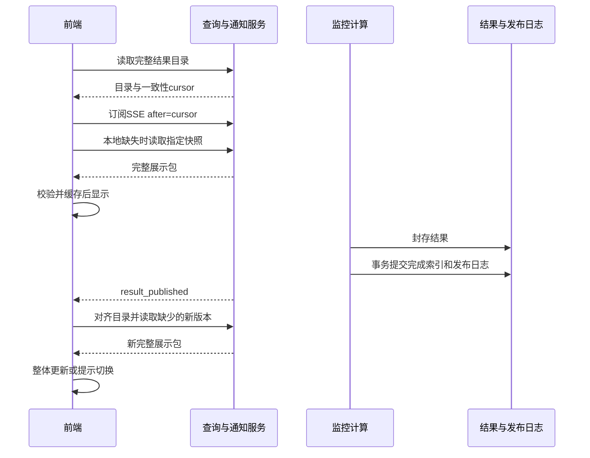

# Token 监控前端与交互设计 v0.1

日期：2026-10-27。状态：供用户评审、后端会话核对的提案，不是已实现接口。用户已选定“推送通知，再读取结果”。仅推进 Token 监控；诊断报告正式接口和详细展示待两类分析器完成设计后继续。当前 HTML 保留为获批视觉基线。

## 1. 依据与发布边界

依据监控 [DESIGN v1.0](../../tasks/monitoring/DESIGN.md) 第 3–5、10–11、14 节、[审批](../../tasks/monitoring/APPROVAL.md)。源码读取身份见[记录](../../../artifacts/reviews/viewer-interaction-v1/source-observations.json)。读取时后端 B005 验证中；本文不是后端测试报告。

保留 J/P/H/C/O、nearest-rank、三种分箱宽度、模型默认参数和规则语义。整文件 run 完整封存后发布，文件对应一个模型；不要求三模型同时完成，不提前发布部分 appid。计算中继续展示上次完整结果。所有浏览 GET 只读已有成果，不调用编码、回放或 explain_encoding。

## 2. 界面与动作

| 区域 | 展示和交互 | 数据约束 |
| --- | --- | --- |
| 范围选择 | appid → 模型；数据范围、生成时间；可展开运行/配置身份 | 目录与完整快照；UTC 转北京时间 |
| 概览 | 请求数、J/P/H/C/O、唯一聚合命中率 | 后端权威值；null 不转零 |
| 三直方图 | 默认5K，可切1K/2K、数量/占比；突出所有并列众数，图外分位数 | 三宽度一次缓存；≥200K为无上限尾桶，三图共享纵轴 |
| 区间下钻 | 点击柱进入请求列表；保留筛选，默认每页50条 | 同一run；左闭右开；尾桶无upper |
| 请求列表/详情 | 时间/hash_id/J/P/H/C/O；按需展开已存原JSON/轻量证据 | request_ref=run_id+source_record_index；hash_id可重复 |
| 辅助降序曲线 | 分段加载已有排名，标明已加载范围；可继续读取 | 不把局部曲线标作全量，不静默抽样；完整导出另读 |
| 参数 | 当前结果配置只读，“下次运行设置”独立编辑 | 服务端校验能力/revision；新设置不重解释旧结果 |
| 阈值/报警 | 冻结规则、比较结果、观察值/阈值/方向/时间；独立编辑未来规则 | 不推断分析器已执行；可变消费进度不混入不可变包 |
| 提交 | 手动放服务器输入目录，填写file_ref和模型，显式启动 | 不把DEMO本地文件选择冒充上传 |
| 导出 | 轻量包本地下载；全量请求明细走只读流式导出 | 包含run、schema、数据范围和配置身份 |

文件有效记录范围与当前组范围分别标明，不保证输入恰好覆盖整两小时。文件级坏行数不冒充appid级；缺少组不生成零流量结果。无有效行的运行在运行记录说明，不替换已有有效组数据。

新结果完整加载后，概览/分布页一次切换整个快照，并提示更新时间；如果正在查看明细、固定历史版本或编辑表单，则保留当前版本并显示“新结果可查看”，用户点击后切换，避免输入和上下文跳变。切换清除旧页码/请求选择，保留合法图宽偏好。这是本稿提出的体验规则。

## 3. 前端组件与状态

采用单页应用，站内切换不重载文档。TypeScript类型与服务契约一致；UI框架及依赖版本实施前固定，不影响本稿HTTP边界。页面与API建议同源，本地构建资源、不依赖外网CDN。

| 组件 | 职责 |
| --- | --- |
| ScopeRouter | appid/model与视图写入URL；固定历史链接携带run_id |
| PublicationClient | 每页面一条SSE连接，游标、断线、重连对齐；不按图表创建连接 |
| SnapshotCoordinator | 请求去重、目标版本选择、完整性/范围校验、原子替换 |
| SnapshotCache | 内存+IndexedDB缓存，按服务实例/schema/run/appid/model隔离 |
| MonitoringViewStore | 当前可见快照和候选新快照；各组件不分别查询latest |
| DetailQueryClient | 有界分页/详情缓存、取消过时请求；取消GET不等于取消后台任务 |
| SettingsEditor | revision校验与冲突处理；结果快照/下一运行设置分离 |
| MonitoringPanels | 格式化/绘图，不重新计算指标、分位数、分箱、来源归因 |

状态流：无本地结果→读取目录/快照→可见完整快照；已有缓存→立即展示其时间→对齐目录；收到通知→后台取得新包→校验/缓存→整体替换或提示用户切换。任何失败保留旧完整快照；切换appid/model不在新标题下继续展示旧范围值。

## 4. 推送、读取和恢复协议

1. 首次GET完整结果目录，响应同时带一致性读取的cursor。
2. 建立SSE after=cursor；此后读取/复用所选run/appid的快照。
3. 后端完成封存，在控制库事务提交completed索引和持久发布日志，提交成功后才发送result_published。
4. 前端收到事件，更新目录定位；只为缺少的新版本读取一次展示包，再原子切换。
5. 重连以Last-Event-ID恢复，页面重开可使用after参数。未知/过期游标触发reset，前端重新读目录。连接恢复时允许核对一次目录；不设置定时指标轮询。
6. 目录和cursor必须来自同一读取快照，避免目录响应与SSE建立之间发布的事件丢失。
7. 重复/乱序通知按持久publish_seq及目录去重；迟到响应只进自身缓存键，不覆盖新版。不要按UUID或浏览器时钟排序。
8. 未选中范围只更新目录，不预取全部租户。已缓存旧包保留，进入该范围才取得新版本。
9. SSE心跳只保活、不带中间指标、不触发GET。建议20秒注释心跳，按部署代理超时调整。慢浏览器不得阻塞任务完成；有界队列满可断开后回放。
10. 服务重启、客户端离线都依持久目录/日志恢复；推送不是历史数据的唯一载体。持续断线显示连接提示、保留旧结果时间、支持手动重连，不悄悄改回轮询。

读取失败、schema不支持、范围不匹配均不替换当前快照。正在更新时禁止出现“新指标+旧图表+另一run明细”。

## 5. 最新结果的定义（需后端共同确认）

建议每appid×模型按组有效数据最大UTC时间、再按publish_seq选择active_run_id；旧CSV晚完成/重跑不抢占更新数据。相同数据范围新配置重跑以发布序号排序。前端以目录active_run_id为权威，不复制latest算法；用户可固定历史run。

目录区分data_range_utc和published_at。publish_seq只表示发布顺序，不表示数据新旧。新run没有出现的appid保留旧结果和真实旧时间，不表示新批次该appid有流量。no_valid_rows不创建虚构组。此机制只发现结果，不新增跨CSV缓存/采集窗口协议。

## 6. 轻量展示包与缓存

每个run/appid/model的包包含：指标、J/P/C全部三宽度分箱、精确分位数/众数、冻结配置及规则比较、固定报警摘要、质量/时间/算法身份。总箱数3×(201+101+41)=1029，与请求量不直接线性增长。不包含全量原始prompt、Token IDs、当前可编辑配置或可变信号消费状态。

建议：
- 内存保留当前和已访问快照；路由卸载不销毁缓存。
- IndexedDB保存轻量包，刷新重开先显示带时间的本地结果，再核对目录；不持久化原始正文。
- 缓存键包含service_instance_id/view_schema/run_id/appid/model_id。同键内容不可变。
- 初始软预算内存32MiB、持久化64MiB，LRU清理非当前项；超额/浏览器拒绝存储降级内存，不阻断当前页面。
- 两小时是数据覆盖范围，不是TTL。固定版本不因聚焦、换页或计时重取。
- 明细按run/appid/筛选/排序/offset/limit缓存，正文按需读取并可释放。
- ETag支持条件读取；格式和内容摘要规则协商。大整数超JS安全范围须十进制字符串或可靠解析，不静默舍入。
- 当前范围的新快照读取完整后一次替换引用；缓存写入失败可用已校验内存结果，不能部分切换。
- schema不兼容禁止混读，回退/清理只影响本地缓存，不删除后端数据。

## 7. 配置、提交和异常

PUT设置/规则等服务端确认后显示保存成功；409保留草稿并重新读取比较，不能自动覆盖。历史快照不失效，只有“下一运行设置”缓存更新。

POST返回202和run_id。前端防双击；响应丢失不能依赖报警event_id幂等重新提交，需后端submission_key去重/查询。任务失败不放业务指标卡，提交抽屉应有真实终态反馈：可通过独立run_status通知或用户显式查询。提交回执不等于计算成功，失败不发布新指标。

读取错误与无结果分开；已有结果可显示“暂时无法更新，当前为……”。沿用后端error.code映射中文，null不转零。GET可有界重试，写请求不盲目重试。首版不扩展RBAC；appid筛选不等于权限隔离。

## 8. 实施、验收与回退

| 阶段 | 产出 | 门槛 |
| --- | --- | --- |
| F001 对齐 | 增补清单、类型/OpenAPI、样例、错误码 | 用户评审及后端核对；不改计量语义 |
| F002 数据层 | 通知、缓存、快照协调；隔离假服务 | 初次/断线/乱序/重复/配额异常验证 |
| F003 页面接入 | 真实监控指标/图/明细/参数/信号 | 同版本切换不重复取指标，值与后端一致 |
| F004 联调 | 实际服务、代表数据、性能和回退证据 | 无批次混用、漏通知或GET触发计算 |

必测：目录读取与订阅之间发布；事务后发送前崩溃；游标过期；多标签/重启；旧文件晚完成；重复和迟到响应；新结果到达时查看详情/编辑；无效组/null/重复hash/200K尾部；文件和组质量范围；配置冲突和提交幂等；大整数与缓存不足；未提供的模板正文不伪造。

建议性能目标（待参考环境确认）：缓存交互100ms内反馈，当前组首次包读取+渲染1s内，50条明细500ms内；记录包大小、浏览器内存和负载，不能先宣称达标。后端新增封存处理仍受单文件<7200s约束。

回退前端资源与view_schema配套版本；清除不兼容本地缓存。通知故障保留显式读取完整结果，不引入隐式轮询。后端新增接口保持旧GET兼容，不删除既有结果。打包/部署需另行取得同意。两类诊断只保留“最近完整结果+分析时间”产品原则，本轮不设计其接口。
