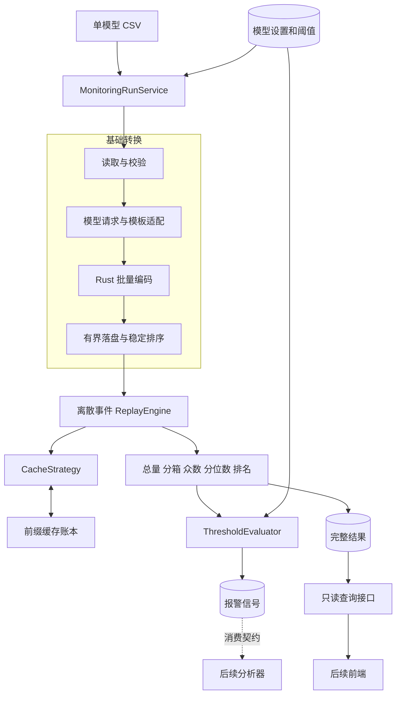
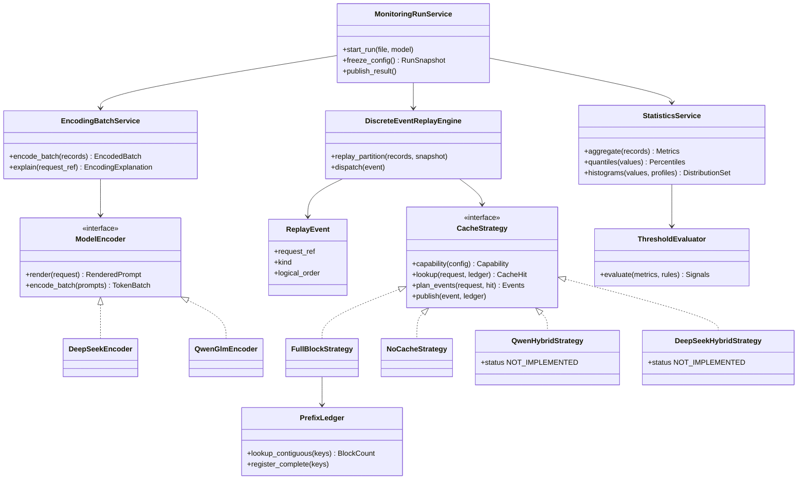
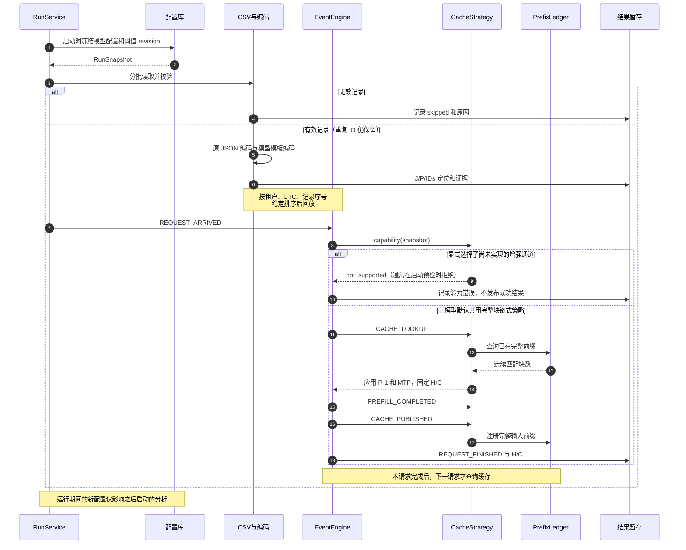
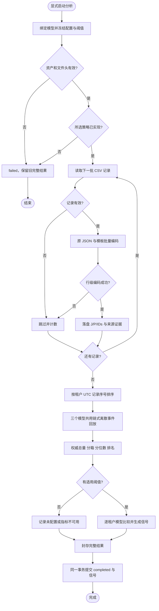

# 第一版 Token 监控设计审批稿

版本：v1.0，第一版最终设计稿，待审批；2026-10-26。

本稿由 [DESIGN.md](DESIGN.md) 生成，以下内容与源设计一致。审批范围包括功能边界、参数与指标口径、四种设计图、组件/接口、逐 batch 闭环、统一测试及回退、代码包/prompt/镜像交付与 V100 首次验收。审批通过后下一轮开始监控代码开发。前端 fork 已存在；本轮未启动业务实现或打包。

源文件 SHA256：`994024d9758cfeb331879f9a3fa21e6a0e9396cbbf311dc2ca173d95b0d4124e`。

---

# TokenScope 第一版 Token 监控设计

版本：**v1.0，第一版最终设计稿，待用户审批**。日期：2026-10-26。负责人：Session 1。用户要求审批通过后下一轮开始代码开发；本轮仅完成设计、版本整理和记忆更新，尚未启动业务实现或打包。前端 fork 已存在并由独立会话维护。

本版保留已确认的三模型链式仿真和 5K 直方图口径，结合[华为 V100 原报告](../../huawei/TOKEN_SCOPE_V100_ENVIRONMENT_REPORT.md)与[设计核对](../../huawei/MONITORING_V100_DESIGN_REVIEW_2026-10-26.md)，补齐资源配置、逐 batch 门槛、健壮性与设计对照、代码包 + prompt + 镜像交付及现场首次验收。公共约定见[首版契约 v1.0](../../contracts/MONITORING_V1.md)，源码/测试入口见 [CODEMAP](CODEMAP.md)，版本和历史入口见 [VERSIONS](VERSIONS.md)。审批副本由本文生成，`v1.0` 是设计版本，不是已发布代码版本。

## 1. 首版范围与交付能力

接收三份用户提供的 CSV，每文件绑定一个模型：GLM-5.2、Qwen3.6-27B、DeepSeek-V4-Flash-0731。每文件空缓存，appid 独立，HBM 无限，前一请求的可缓存输入立即供后一请求使用。只模拟 CSV 可见输入；输出量单独统计。

先说明缩写：**H 是理想命中的输入 Token 数，C 是仍需计算的输入 Token 数**。若模板后输入有 1000 Token、其中命中 600，则 H=600、C=400；输出 Token 另算。下文 P 表示模板后输入数，J 表示原始 JSON Token 数。

**三个模型首版都复用普通链式前缀键与连续匹配，区别由 block size 等参数表达，并都输出命中率和输入重算量。** Qwen/V4 采用用户明确选择的链式近似；只有增强 hybrid 通道保留接口和类，不实现其状态注册/保存/恢复/部分页/COW。

| 首版目标能力（待实现） | GLM-5.2 | Qwen3.6-27B | DeepSeek-V4-Flash-0731 |
| --- | --- | --- | --- |
| 原始 JSON 与模型模板编码 | 计划实现 | 计划实现 | 计划实现 |
| J/P、输出量、请求量、两组长度分布 | 计划实现 | 计划实现 | 计划实现 |
| 默认缓存开启时命中量 H、重算量 C、命中率和重算分布 | 完整块链式路径，B=128 | 同一链式近似，B=1536 | 同一链式近似，B=32 |
| 显式关闭 prefix cache 的对照情景 | H=0、C=P | H=0、C=P | H=0、C=P |
| hybrid 扩展 | 不适用默认路径 | QwenHybridStrategy 占位 | DeepSeekHybridStrategy 占位 |

Qwen/V4 结果标记为 chained_approximation，表达选定参数、无限容量和立即可用假设下的近似上限，不宣称还原真实 hybrid 状态可用性。用户主动选择尚未实现的增强通道时，明确拒绝执行，不悄悄换策略。默认普通路径是已确认的首版功能，不是待定降级方案。

首版不做主动采集、跨 CSV 缓存/窗口协议、生产并发与耗时还原、模型前向、生成 Token 缓存、分析器内部算法、前端页面详细设计和自进化 Agent。华为完整 PrefixLens 不再是完成条件。下文工程接口、存储和 batch 是本次待审批提案，已确认业务决定优先。

## 2. 本轮决定与旧稿调整

| 已确认决定 | 设计落实 |
| --- | --- |
| 离散事件仿真 | 使用逻辑事件推进状态，不伪造 GPU 执行时间 |
| 模型参数可设置，下一次生效 | 任务启动时冻结配置；运行中修改仅影响之后启动的任务 |
| 默认 GLM B=128、Mamba B=1536、V4 B=32 | 三个值直接驱动首版共用的链式近似；不自行替换默认值 |
| 不要求生产镜像、TP/dtype 等身份 | 移除该前置条件；保留本工具使用的参数、算法和编码资产用于复算 |
| CSV UTC，看板北京时间 | 内部 UTC；展示 Asia/Shanghai（UTC+8） |
| 无效行跳过；重复 ID 每行独立 | 跳过无效行并计数；保留重复有效行，hash_id 只作业务标识 |
| 每 appid×model 独立阈值，三天数据后定值 | 建阈值表和比较/信号能力；初始不配置业务阈值，不提前学习基线 |
| 分布使用直方图，区间建议 5K，突出众数 | 默认 5K；0–200K 等宽分箱，≥200K 汇总；所有并列众数高亮，P50/P80/P90 仅在图外显示数值 |
| HTML 作为前端设计起点 | 保存可追溯基线与合成样例，后续正式展示设计由已登记前端 fork 会话继续 |
| 每文件两小时 | 单文件单模型端到端 <7200 秒，三文件可顺序运行 |
| 环境报告已回传 | 采用 40 可调度逻辑 CPU、共享宿主、Docker 26.1.4 / Compose v2.27.1；GPU 故障不进入首版 CPU 依赖 |
| 按 batch 开发、通过门槛再推进 | 每批有方案、问题、测试和闭环记录，增量更新任务记忆；末批统一对照设计和实测 |
| 最终代码包 + prompt + 镜像 | 固定版本与资产后交付，现场 Agent 按 prompt 拉起并完成首次验收 |
| PrefixLens 后续再调研 | 届时写华为 Agent prompt，仅回传一份内嵌关键源码和证据的 Markdown；当前不启动 |

Qwen 固定可配置 prefill 规则及 V4 增强恢复研究保留为后续依据，具体预算和合法边界不再阻塞首版。

## 3. 输入与质量规则

| CSV 列 | 首版规则 |
| --- | --- |
| hash_id | 非空；原样保存；重复不去重 |
| appid | 非空；租户隔离 |
| model_handle_start_time | UTC 日期时间，保留亚秒精度 |
| completion_tokens | 非负整数，仅作为输出数量 |
| request_input | GF 转换后、模板前的完整原始 OpenAI v1 JSON 文本 |

默认 UTF-8/UTF-8 BOM、有表头，正确解析字段内换行和 CSV 引号。JSON 保留 CSV 解码后的原字符串，不 parse 后重新 dumps。输入均为纯文本，包括工具定义、调用和文本工具返回。流式响应不改变输入边界。

接受 ISO 8601 和明确的 UTC 日期时间格式；无时区后缀依用户约定解释为 UTC，有 offset 则规范化至 UTC。纯数字时间戳不猜测秒/毫秒单位。文件→模型显式绑定，文件名只帮助人工区分；请求 model 字段按注册别名核对，冲突行跳过。

内部身份为 `(run_id, source_record_index)`。source_record_index 是表头后从 1 开始的 CSV 记录序号，不是文本物理行；另存物理行范围便于定位。重复 hash_id 的每条有效记录均参与计量、回放和请求数，重复数量仅提示。

行级错误（缺值、JSON/消息格式错误、时间/输出量非法、明确的请求编码错误）跳过，不进入有效指标和缓存。记录序号、错误码和字段定位；常规日志不复制完整请求正文。记录 read/valid/skipped/duplicate 计数，duplicate 指有效记录中相对于首次同 ID 额外的记录数。

缺表头、CSV 破损到无法确定下一记录边界、读文件失败是文件级错误；缺 tokenizer、配置非法、编码器内部异常、磁盘不足是系统错误。这些错误终止运行，不能伪装成大量坏行。全部无效时输出 `no_valid_rows`，分位数/命中率为 null，不报警。

## 4. 指标、命中率和分位数

对有效请求 i 定义 J_i=原始 JSON Token 数，P_i=模板后输入 Token 数，H_i=可复用输入数，C_i=P_i−H_i，O_i=completion_tokens。

| 指标 | 定义 |
| --- | --- |
| 模板前总量 | ΣJ；字段名、标点、空白和参数全部计入，不计 CSV 容器转义 |
| 模板后总量 | ΣP；含实际模板插入的文本和特殊 token |
| 理想命中量/输入重算量 | ΣH / ΣC；仅在策略可用时有值 |
| 输出量/请求数 | ΣO / 有效记录数，与输入重算分别统计 |
| appid×model 理想命中率 | **ΣH / ΣP**，只有这一个聚合值 |

“加权”只是说明聚合方法，不是增加指标。例如两个请求 P/H 分别为 100/0 与 900/900，整体命中率是 900/1000=90%；平均请求百分比得到的 50% 无法表达复用了多少输入 Token。分母为 0、策略未实现时返回 null 和状态。

分位数采用 **nearest-rank（最近秩/经验分布反函数）**，替代旧稿的线性插值建议：升序 `x[1..N]`，`Pq=x[ceil(q×N)]`。N=5 时 P50/P80/P90 分别取第 3/4/5 个值。重复值时保证至少 q 比例的样本“不大于”该值，不能保证恰好 q 比例严格小于。N=0 返回 null。

2026-10-26 用户确认：要观察请求长度集中在哪些区间、是否多峰或长尾。**J/P/C 默认展示直方图：横轴为长度区间（Token），纵轴为请求数或请求占比，一柱代表一个区间。P50/P80/P90 只在图上方或下方显示数值，不在图内画分位线。** 分位数直接从原始长度集合精确计算，不从分箱估计。不假设正态分布；形状用于发现线索，不能单独确定 Agent 行为原因。

默认 **5,000 Token 等宽分箱，1K=1,000 Token**；可选 1,000/2,000 细分。有限区间为 `[0,5000), [5000,10000), …, [195000,200000)`，最后追加 `[200000,+∞)` 汇总桶。这样同时覆盖 <8K 和 >200K，请求恰好等于 200,000 也进入末桶。末桶 `upper=null, overflow=true`，单独标注“≥200K（汇总）”，它没有 5K 宽度，横轴以独立汇总柱表示；不截断更长请求，也不将 200K 作为处理上限。图外额外显示精确的 `<8K` 请求数和 `≥200K` 请求数，前者从原长度统计，不能用前两箱近似。

区间左闭右开、空箱保留、零长度进入首箱。count/N 是请求占比，不按 Token 加权；所有箱 count 之和必须等于有效 N。三图共用当前分箱宽度、有限范围和末桶定义，并共享纵轴刻度。**众数区间是请求数最多的箱**：后端返回零起始 `mode_bin_indices`、`mode_count`、`mode_share`；所有并列最多且 count>0 的箱都返回，前端全部高亮并在图外显示区间、每箱条数与占比。它是分箱众数，不是“最常见的精确 Token 长度”；若末桶最多，须说明它仅是尾部汇总，无法定位 >200K 内部的峰，不能与有限箱比较频数密度。改分箱宽度后众数可能变化，分位数与总量不变。

后端运行时预计算三个分箱配置和精确分位数。前端只读取已有结果并渲染，切换不执行编码、缓存仿真或分析。每柱均可下钻到区间内的请求，末桶查询只有 lower、无 upper；排序和分页不漏掉超长请求。原独立降序序列保留为辅助明细视图，同长按 source_record_index 排序。三个模型均提供 J/P/C 三组分布，使用同一有效集合；N=0 时所有 count=0、share/quantiles/max_length=null、mode_bin_indices=[]、mode_count=0、mode_share=null，显示空态。

用户指定这版 HTML 作为前端设计起点：[当前 DEMO](../../../artifacts/prototypes/monitoring-v1/tokenscope-monitoring-demo.html)、[冻结基线](../../../artifacts/prototypes/monitoring-v1/tokenscope-monitoring-baseline-v1.html)和[基线清单](../../../artifacts/prototypes/monitoring-v1/baseline-manifest.json)。合成样例包含单峰、双峰、长尾及 200K 以上请求。此基线固定已讨论的展示语义与交互参考，不代表正式前端全部设计或监控后端已批准、已实现。

全量保留计数、原始定位、编码配置/IDs 摘要，以及经验证适配器提供的特殊 token 区间和轻量来源索引；详细映射按需重放并校验 IDs 一致。P−J 是原始 JSON 与模型输入长度差，包含 JSON 外壳省略、格式变换、模板插入和分词变化，不称纯模板开销。字段分别编码再相加不是精确归因；混合边界/未知部分单列。原因判断留给长度分析。

## 5. 模型配置与生效时机

| 配置 | GLM 默认 | Qwen 默认 | V4 默认 |
| --- | --- | --- | --- |
| block_size | 128 | 1536 | 32 |
| block_size_unit | simulation_input_tokens | simulation_input_tokens | simulation_input_tokens |
| prefix_cache_enabled | true | true | true |
| MTP | true | true | true |
| cp_world_size | 1 | 1 | 1 |
| hybrid_enabled | false | false（扩展未实现） | false（扩展未实现） |
| cache_mode | full_block | full_block_approximation | full_block_approximation |
| prefill_policy | 普通路径无须逐步预算 | 增强路径 fixed_configurable 预留 | 增强路径 reserved |

三个 B 和 MTP 默认开启来自用户决定；1536 来自用户对启动日志的说明，日志原件未提供。CP=1 是本次工程提案。**128/1536/32 在首版直接表示仿真输入 Token 块长**，不将 V4 的 32 隐式乘压缩率或换成其他默认值。既有 Ascend 源码中的物理存储 block 同名参数可能有不同单位；本稿明确采用用户指定的简化语义，不能据此宣称与生产 page 粒度一一相同。后续增强通道再独立处理真实单位换算。

B、CP 校验为正整数，模式校验为允许枚举。三个模型默认均支持 FullBlockStrategy；hybrid_enabled=true 对应的增强类首版不可执行，应在启动前返回明确配置/能力错误。共用近似规则用 B_eff=B×CP，CP 默认 1，只影响情景的块粒度，不模拟通信。TP、KV/SSM dtype、镜像 digest 不作为首版必填，因为不计算真实物理容量或运行模型。

配置保存为不可变 revision。任务从 queued 进入 running 时冻结模型与阈值快照，全文件所有记录用同一快照。运行中修改只影响之后启动的分析，重跑会使用新配置，历史结果仍保留旧快照。前端可逐模型编辑参数，后端校验并保存；不扩展为首版多用户 RBAC 设计。

编码仍绑定实际选用的 tokenizer/template 摘要、模型参考 revision、适配器版本和有效模式。这是计算输入，不要求生产部署摘要。请求显式模式优先于模型默认值，记录最终模式；J 不因补默认值而被改写。缺省模板模式由所选资产配置明确，不能用 DeepSeek 默认值替代其他模型。

## 6. 组件设计

采用 Python 3.11 编排、成熟 Rust tokenizer 内核、项目内 SQLite 和分片文件。保留基础转换、命中仿真、数据统计三个业务模块，配置和运行服务提供支撑。首版不依赖 GPU 推理，不先重写 BPE。

| 组件 | 职责与边界 |
| --- | --- |
| MonitoringRunService | 文件模型绑定、快照、资源预算、运行状态和完整结果发布 |
| CsvBatchReader / RowValidator | 保留 JSON 原字符串、UTC 解析、坏行跳过、重复提示 |
| ModelEncoder | OpenAI 请求到模型 prompt/IDs；分模型适配，输出 J/P 和轻量证据 |
| EncodingBatchService | 条数与字节双预算批次、复用资产、Rust 批量编码和背压 |
| OrderedRequestStore | appid、UTC、记录序号排序；编码并行不能改变回放顺序 |
| DiscreteEventReplayEngine | 派发生命周期事件，先查询后发布，不模拟时长 |
| CacheStrategy / PrefixLedger | 规则、链式查询与注册；容量无限语义、可落盘存储 |
| StatisticsService | 精确总量/分箱/众数/分位数/排名，统一有效集合与 null 状态 |
| ThresholdEvaluator | appid×model 独立规则比较、路由与幂等事件 |
| ResultRepository / QueryService | 持久化/只读分页，失败不覆盖上次完整结果，页面不触发分析 |

DeepSeek 采用固定 Recipe 的协议转换→Conversation→V4 render/encode：主包负责协议转换，core 提供对话/工具类型，encoding 提供 V4 模板和 Rust 编码。明确将 Flash-0731 别名绑定 V4，不能因 README 示例为 V4.1 而换编码器。仅使用输入路径，不运行推理、工具、图片下载或输出解析。

Qwen/GLM 使用各自固定模板和 tokenizer，完整传递 messages、tools、tool_calls、文本工具结果和思考/模板选项。J 对完整 JSON 按普通文本编码，不加模板或 BOS/EOS；特殊 token 的字面拼写按普通文本处理。P 按模型适配器的特殊 token 语义编码。Recipe special_ranges 不是完整字段归因。

一次运行加载一次资产；模板适配与 Rust 编码共享受控 CPU 预算，避免外层多进程和内层 Rayon 各自占满 CPU。禁用隐式 padding/截断，不任意按字符切单条输入。批次/线程配置只影响性能，不能改变 IDs 或缓存语义；现有绑定不足时才在 crates 增加薄批量接口。

## 7. 类图

图中是拟实现类型。hybrid 占位类明确返回未实现；Qwen/GLM 编码在代码中分别绑定自身资产，图中合并表示共用接口。

CacheStrategy 使用仿真输入 Token 单位，返回结构化 available/disabled/not_supported。三个模型的默认路由都指向 FullBlockStrategy，另存 full_block_rule 或 chained_approximation 语义标记。QwenHybridStrategy/DeepSeekHybridStrategy 仅在显式选择增强通道时被查询，首版拒绝执行。未来 Qwen 可增加固定 prefill/状态发布，V4 可增加组件可用性/部分页恢复，不改共用事件框架。

## 8. 离散事件与完整块算法

### 8.1 事件模型

每分区按 `(time_utc, source_record_index)` 排序，每请求有递增 local_event_seq，逻辑事件键为三者组成的元组。完成当前请求事件后才接纳下一请求；不同租户可独立并行。时间只影响顺序与展示，不用于生成虚构完成时刻/TTFT。

| 事件 | 状态变化 |
| --- | --- |
| REQUEST_ARRIVED | 绑定请求和快照，不改缓存 |
| CACHE_LOOKUP | 查询前序缓存，固定本请求 H/C |
| PREFILL_COMPLETED | 逻辑上剩余输入已算完，没有模拟持续时间 |
| CACHE_PUBLISHED | 批量注册允许缓存的完整输入前缀，不反改本请求 H |
| REQUEST_FINISHED | 保存结果，再推进下一请求 |

普通策略每请求只需常数个事件，一次发布一批块，不产生逐 Token/逐 block 全局事件。队列按需推进，避免预建全部事件。保留 hybrid 未来重复 prefill/publish 子事件的位置。

### 8.2 三模型共用：full-block-mtp-v1

该算法引用已核对的普通完整块源码规则，按用户要求用于三个模型的参数化上限仿真。GLM 使用完整块路径；Qwen/V4 明确是忽略状态限制的链式近似。模型之间不复制三套匹配算法。

1. `B_eff=block_size×cp_world_size`，CP=1 时三个模型分别为 128、1536、32。
2. 链式键包含前块摘要、本块 IDs 和分区/编码资产身份；固定序列化与摘要算法，不用 Python 随机 hash。请求模式通过实际 IDs 影响匹配，不额外用模式标签或 hash_id 拆分相同输入前缀。
3. 查询上限 `L_max=max(P−1,0)`，最多检查 `floor(L_max/B_eff)` 个完整块；从头连续匹配，首次缺失停止，得到 k。
4. MTP 开启则 `k=max(k−1,0)`；`H=k×B_eff`，`C=P−H`。
5. CACHE_PUBLISHED 注册本请求 `floor(P/B_eff)` 个完整输入块，尾部不满块不注册。MTP 影响查询回退，不永久删除最后完整输入块。
6. NoCacheStrategy 显式关闭缓存时 H=0/C=P，不查询或注册账本。

appids 不共享键。相同内容的重复记录仍各自经历生命周期，第二次可能命中。物理 RAM 不足可以使用磁盘索引/有界热查询缓存，但不因 RAM 限制淘汰逻辑缓存。优化须与简单参考实现差分一致。

### 8.3 请求生命周期时序图

NoCacheStrategy 直接返回 H=0，不调用账本；图中正常分支用于三个模型。增强通道的能力检查通常在文件处理前完成，图中保留防御检查，不生成假的 hybrid 状态轨迹。

## 9. 活动图：单文件分析

所有节点的系统异常通道统一进入 failed。零有效行单独输出 no_valid_rows，不执行命中/分位数/报警。无阈值不影响成功运行；显式选择未实现增强通道是启动能力错误，与三个模型均可执行的默认路径区分。

图中的校验和跳过针对批次内的单条记录；有效记录继续累积为有界编码批次，不因一条坏记录丢掉整批。

## 10. 数据、接口与存储

| 记录 | 最小内容 |
| --- | --- |
| RunSnapshot | run_id、来源摘要/模型绑定、配置 revision、编码摘要、算法版本、阈值快照、UTC 范围/质量 |
| EncodingRecord | request_ref/hash_id/appid/UTC、J/P/O、IDs offset/count/digest、轻量证据 |
| CacheReplayRecord | request_ref、strategy/status、H/C、有效 B、匹配/退块数、发布摘要；未实现时 null |
| GroupMetrics | appid/model、请求数、J/P/H/C/O 总量、命中率、三组分位数、能力/阈值状态 |
| HistogramBin / HistogramSummary | metric、bin_width、regular_domain、sample_count；每箱 lower/upper（末桶 null）、overflow、count/share；mode_bin_indices/count/share、under_8k_count、overflow_count、max_length |
| RankedPoint | rank、request_ref、长度，辅助读取完整降序序列 |
| AlarmSignal | event_id、结果引用、appid/model、指标/阈值/方向、规则 revision、route/status |

run_id/源摘要仅用于定位、复算和重试，不新增跨 CSV 采集窗口体系。有效时间范围从文件导出。

存储提案：原始 CSV 放 data/raw，字节不改；外部文件复制与摘要计入运行预算。每次运行在 `data/derived/monitoring/<run_id>/` 保存 SQLite 请求事实/聚合/排序索引，以及分片 uint32 little-endian IDs 文件和 offset/count。超出 uint32 的 ID 显式失败，不截断。配置库保存模型 revision、阈值、任务索引和报警 outbox，无需额外数据库服务。

编码结果落盘后按租户时间回放，不让全部文本/IDs 常驻内存。SQLite 排序索引提供三组排名及只读分页。运行先写临时状态，完成后封存结果；随后在配置库同一 SQLite 事务内提交 completed 索引及报警 outbox。未完成产物不替换旧结果，信号以稳定 event_id 幂等登记。事务前崩溃留下的封存文件尚不可见，可由恢复流程校验后重新提交；不能发布引用未完成结果的信号。

原 CSV、配置、IDs 和轻量证据至少保留至本轮验收及后续分析复核完成；首版不自动删除。详细映射按需生成，不全量保存巨大 Token 来源表；实际数据/生成产物默认不入 Git。

| 首版服务接口（B001 固化类型和错误码） | 行为 |
| --- | --- |
| GET /healthz、GET /readyz | 进程存活；存储可写/编码资产校验和各模型 readiness，缺资产明确未就绪 |
| GET /version | 代码/包、schema、算法、设计与编码资产版本，支持现场核对 |
| GET /models/{id}/settings | 配置、默认值、revision、capabilities |
| PUT /models/{id}/settings | 校验并产生下一运行 revision；expected_revision 防并发覆盖 |
| POST /analysis-runs | 显式提交 file_ref/model_id，后台运行 |
| GET /analysis-runs/{id} | 状态、质量、耗时、快照 |
| GET /analysis-runs/{id}/metrics | 按 appid 读取已存汇总 |
| GET /analysis-runs/{id}/lengths | J/P/C 降序分页；可按长度区间筛选请求 |
| GET /analysis-runs/{id}/length-histograms | 读取预计算 J/P/C 分箱、尾部汇总、众数区间/计数/占比、精确分位数；选择已有 1K/2K/5K 配置 |
| GET /analysis-runs/{id}/signals | 只读该完整结果关联的持久化信号及消费状态 |
| GET/PUT /threshold-rules | 独立规则查改；初始空表合法 |
| 内部 explain_encoding(request_ref) | 固定资产重放，校验 IDs；分析显式调用 |

首版 `file_ref` 是事先放入配置输入根目录的文件的相对引用；服务验证实际路径仍位于该根目录，拒绝路径越界。HTTP 不接收任意宿主绝对路径，不在线下载输入。用户先手动放三份 CSV；上传交互由前端任务另行协调，不作为首版监控链路前提。CSV 复制/摘要在运行计时内执行。CLI 提供同服务层的提交、查询和验收入口，具体参数在 B001 固化。

同一服务层支持 CLI 和轻量 HTTP 包装；页面 GET 不触发分析。模型配置只选项目内已注册资产，不隐式下载远程模型。最终类型/接口 schema 在 B001 固化；前端以本版冻结 HTML 为起点，已登记前端 fork 会话继续正式设计。

## 11. 阈值、报警与分析触发

每 appid×model 独立配置，多指标多行。首版实现表与执行逻辑，真实数值等用户连续分析三天稳态数据后确定，不预设通用阈值或自动学习基线。

| 字段 | 含义 |
| --- | --- |
| appid/model_id/rule_id | 规则身份 |
| metric/comparator/threshold | 指标、lt/le/gt/ge、同单位阈值 |
| enabled/revision | 启用状态和规则版本 |
| route | prefix_analysis / length_analysis / signal_only |
| measurement_signature | 关联计量口径，参数变化后识别是否适用 |

理想命中率默认建议 lt→前缀分析；J/P/C 长度分位数默认 gt→长度分析。Token 总量或请求数默认 signal_only，避免正常业务增长自动被当作长度异常；可在规则中显式选择路由。首版不做相对基线、复杂防抖或分析器内部判因。

无规则=unconfigured，指标不可用=metric_unavailable，不同口径阈值=needs_review，均不生成伪报警。B/MTP/CP 改动使 H/C 相关旧阈值待复核，J/P 不受影响；编码变化使相关 Token/长度阈值待复核，请求数不受缓存设置影响。

event_id 由文件摘要、模型、适用计量配置、appid、rule_id/revision、指标确定；同文件同配置重跑不重复触发，新配置/规则形成新事件。先封存完整结果，再在同一事务中提交 completed 索引及 outbox，重试幂等恢复。首版持久化信号，分析器未接入时 pending_consumer；后续消费者显式消费/确认。不会创建会话或代替分析器实现。

## 12. 目标环境、资源与性能

### 12.1 已取得的现场证据

原报告采集于 2026-10-26 13:02–13:26 UTC。以下是现场 Agent 回传事实，本机会话完成阅读/一致性核对，没有重新执行远程命令；摘要和证据编号见[环境核对](../../huawei/MONITORING_V100_DESIGN_REVIEW_2026-10-26.md)，原件 SHA256 见[来源清单](../../../evidence/manifests/monitoring-v100-environment-2026-10-26.json)。

| 项目 | 采用事实 | 对首版的影响 |
| --- | --- | --- |
| CPU | Xeon Silver 4114，20 物理核 / 40 个 online、affinity 逻辑 CPU；可见 cgroup v1 无 CPU 配额 | 以 40 为可调度上限，不能用 nproc --all=224 或称为 40 物理核；共享资源不等于独占 |
| 内存 | 总计 375.9 GiB，当时可用 352.8 GiB；可见 cgroup 无实际内存限额 | 全量数据仍落盘；容器实际预算单独限制并记录 |
| OS | CentOS 7、x86_64、Linux 3.10.0-1160.119.1；glibc 命令显示带自定义 banner 的 2.42 | 镜像内依赖固定，宿主旧内核兼容性必须用实际镜像验证 |
| Docker | 本地 client/server 26.1.4，可访问 daemon；默认 runc；Compose 插件 2.27.1 | 固定采用 `docker compose` v2；不依赖旧独立 Compose 1.26.0 |
| 存储 | `/` 余约 4.3 GiB，`/home` 约 401 GiB；daemon 数据盘约 3.03 TiB | 工作区、临时文件、数据库、应用日志放 `/home` 下用户可写目录；不直接写 daemon 目录 |
| GPU | proc 确认 2×V100-PCIE-32GB；NVRM 525.105.17 与 NVML 550.163.01 不匹配，nvidia-smi 失败 | 首版 CPU 镜像不请求 GPU、不依赖 nvidia runtime；不在安装流程修复驱动 |
| 工具 | Python 3.11.16、uv 未装、Git 1.8.3.1；CUDA Toolkit nvcc 12.4.99 | 运行镜像自带依赖；现场无需 uv、Git 升级、CUDA 或模型权重 |

报告的低负载/大内存不能替代性能或兼容性结论；GPU 计算和 GPU 容器均未测试。glibc 自定义来源不作推断。首版运行在这台 V100 机器上，实际使用 CPU 完成监控计算。

### 12.2 初始运行 profile（待实施验证的默认值）

| 参数 | 默认与规则 |
| --- | --- |
| active model runs | 1；三文件可排队顺序执行 |
| CPU 计算总预算 | 8；编码、模板处理、租户回放共用预算，不按三份文件推导为 3 个线程 |
| 线程/进程组合 | 优先单个编码工作进程 + Rust 线程池；若绑定不支持并行，由受控进程池替换；外层进程与内层线程乘积不超过预算，按阶段调度 |
| 容器 CPU / 内存限制 | 初始 8 CPU 时间份额 / 32 GiB；实际生效值须从容器配置和 cgroup 读回核对 |
| 读取与编码批次 | 起始 256 条或 16 MiB 解码原文，先到即封批；队列有界、背压。单条超过字节预算独占批次，资源不足明确失败，不能截断或当坏行丢掉 |
| 存储与临时目录 | 用户明确的 `/home` 下工作目录；TMPDIR 和 SQLite 临时目录一并配置，避免默认落到根分区 |
| 模型资产 | 只加载已固定、摘要一致的 tokenizer/template/适配器资源，不加载权重，不在运行期隐式联网 |

上述值是工程起点，不是最优或已达标配置。B002/B005 根据实测调整批次/线程/内存；例如从 8 到 16 的总计算预算必须记录吞吐、峰值资源和宿主干扰，不改变 IDs 或计量语义。无限 HBM 指逻辑缓存不淘汰，不允许把实际 RAM 当成无限。

### 12.3 两小时口径

每文件单模型从任务开始运行到完整结果及信号落盘 **<7200 秒**，含必要导入、复制/摘要、读取、J/P 编码、排序、回放、统计与写盘；另报排队时间，不能把运行阶段移到队列前隐藏耗时。首次安装、镜像加载和预先核验词表资产不计入日常单文件预算。三文件无需合计两小时。

记录每阶段时间、请求数、文件字节、J+P 总 Token、最大长度、appid 数、重复率、CPU 预算、RSS/容器内存峰值、临时/持久化磁盘峰值、实际运行平台与依赖。不同批次/并发与串行结果须精确一致；详细按需来源映射不在全量关键路径。最终是否达标以目标 V100 机器上的代表性三份文件分别实测为准，不能由外部 tok/s、合成万条或本机性能替代。

## 13. 逐 batch 开发与闭环

### 13.1 代码要求

自有代码在 `src/tokenscope` 的 ingestion/encoding/monitoring/api 和必要 adapters；热点薄扩展在 crates。模型差异留在适配器和策略参数，不复制三套链式算法。上游快照只读，必要补丁放 patches；Python/Rust 依赖、源码和编码资产固定身份，禁用 `latest` 运行资产与静默回退。

使用明确类型/单位、稳定序列化和错误码；配置校验与能力检查前置，日志提供 run_id/记录定位/阶段，不默认写完整请求。区分行级输入错误、配置/能力错误和内部/资源异常。批次有界、排序稳定、发布原子、重试幂等；精确计数与 IDs 不因并行改变。HTTP/CLI 共用服务层，查询不触发新分析。构建 CPU 可移植二进制，不以开发机 `target-cpu=native` 产物作为现场兼容性依据。

### 13.2 先通过当前 batch，再进入下一批

设计审批通过后，用户要求下一轮进入开发。批次严格按依赖推进；在已授权范围内，当前批门槛满足且闭环记录落盘后自主进入下一批，无需每批重复请求同意。涉及功能目标、指标口径、公共接口不兼容变更或降低验收标准时，先记录影响并与用户讨论；不能把未通过的测试改名为后续优化后继续。

| Batch | 可检查交付 | 退出门槛 | 回退范围 |
| --- | --- | --- | --- |
| B001 契约与运行骨架 | 正式类型/schema、默认配置/revision、存储/运行状态、CSV 质量、受控文件引用、CLI/API 约定 | 三模型默认值正确；UTC/换行/BOM/坏行/重复保留、配置快照、输入路径边界与失败状态用例通过；schema 与契约无未解释差异 | 本批代码/schema，保留原 CSV 和其他会话文件 |
| B002 输入编码 | 三模型资产清单、官方模板/编码参考、Rust 批量与轻量证据/按需映射 | 三模型真实 tokenizer IDs 与固定参考一致；tools/调用/文本返回/思考/特殊拼写及超长输入覆盖；单条/批量/受控并行精确一致；资产离线可加载 | 编码器与资产版本成套回退；不复用不同资产的 IDs |
| B003 离散事件仿真 | FullBlock/NoCache、无限逻辑账本、租户回放、增强占位类 | 冷/热、B−1/B/B+1/2B、P−1、MTP、CP、重复、同时间戳、租户隔离；先查后写；与独立简单参考逐请求 H/C 和事件语义一致；增强模式明确拒绝 | 策略版本和账本命名空间，历史快照不改 |
| B004 统计与报警 | 总量/三组分布/众数/nearest-rank、阈值表、完整结果与 outbox | 0/5K/200K、超长尾、空集、并列众数及计数守恒；规则为空/失配/改版、事件幂等、提交中断恢复用例通过 | 配置/schema 受控迁移，停用新规则；不删除既有结果/信号 |
| B005 本机整体验证与设计对照 | 完整 CLI/API、三模型端到端结果、健壮性和本机性能记录、需求对照表、交接 | 本节和第 14 节本机用例全部有证据；三模型代表 CSV 跑通；未解决的正确性/数据损坏/结果不完整/资源失控问题为零；逐条对照设计无未获同意的偏离 | 回到最近通过版本与配置，保留失败证据；不全局 reset |
| B006 打包与 V100 首次验收 | 同版本代码包 + prompt + CPU 镜像、Compose/资产/校验清单、现场验收报告 | B005 闭环且打包授权有效；本机离线安装回归通过；目标机旧内核兼容、小样本、三文件功能与每文件 <7200 秒、重启/持久化检查通过 | 专属 Compose 项目停机并切回上一版本及兼容配置/数据副本；不删数据、不影响其他容器 |

B001→B002→B003→B004→B005→B006。当前六批均未开始；B001 前只需读取批准设计、契约、批次规则及本批涉及源码，不再全量重读研究。尚无代表 CSV 时，可做早期确定性用例，但 B005/最终验收保持未通过，不能用合成结果代替真实目标负载。

### 13.3 每批必备文档与增量记忆

批次启动时创建 `batches/Bxxx/`，维护以下五份文档，已有批次规则见 [batches/README](batches/README.md)：

| 文档 | 必须记录 |
| --- | --- |
| CONTEXT.md | 设计/契约/环境版本与摘要、本批直接依赖、阅读入口、上批结论 |
| PLAN.md | 本批代码开发方案、修改路径/行为、明确门槛、测试与回退、授权范围 |
| ISSUES.md | 问题 ID、复现/影响、根因、修复/关联变更、回归证据、未决项及阻断判断；无问题也明确记录 |
| TESTS.md | 实际命令、数据/资产/代码身份、环境、退出码、结果、日志链接；失败和重试保留；计划/未执行/通过严格区分 |
| RESULT.md | 本批闭环：实现对照、门槛逐项判定、问题闭环、允许的遗留项、回退点、下一批是否可进入 |

每批完成后更新批次索引、任务 ENTRY/CODEMAP，以及[监控增量记忆](../../../memory/tasks/monitoring.md)，并按职责更新 SESSIONS 的本会话状态；CURRENT 只保留短状态和入口。阻断或重要决定发生时即记录，不等最后一次性补日志。只有门槛、证据、问题处置和文档/记忆齐备才标 `closed`。非阻断遗留要说明为什么不影响本批门槛；若属于约定必测项，就不能用“后续验证”绕过。

## 14. 统一验收与设计符合性

### 14.1 需求对照矩阵

B005 建立实际验收记录，为每行填实现路径/符号、测试命令、数据与输出摘要、结果和问题 ID；B006 添加目标机证据。此表现在是验收要求，不是测试通过记录。

| ID | 要求与通过标准 | 主要批次 |
| --- | --- | --- |
| M01 | CSV 解析保留 GF 原 JSON；无效行跳过，重复每行独立；质量计数守恒，UTC→北京时间 | B001/B005 |
| M02 | 三模型 J/P 与参考 IDs/模板一致；输出 O 独立；全量轻量证据、详细映射重放一致 | B002/B005 |
| M03 | 共用链式 DES、默认 128/1536/32、空缓存/隔离/立即可用/无限逻辑容量；Qwen/V4 标明近似，增强拒绝 | B003/B005 |
| M04 | 同组唯一 ΣH/ΣP；逐请求 C=P−H、总量守恒；无缓存 H=0/C=P；零分母状态正确 | B003/B004 |
| M05 | J/P/C 三直方图默认 5K、空箱、≥200K 尾桶完整；众数并列全部返回；nearest-rank 精确；图外分位值/区间下钻数据足够 | B004/B005 |
| M06 | 每模型设置可改、下一运行生效、旧结果快照不变；统计和缓存身份可复算 | B001/B005 |
| M07 | appid×model 独立阈值、初始空表；测试规则触发路由正确、幂等；分析器未接入保持 pending_consumer | B004/B005 |
| M08 | CLI/API 完整读取结果；GET 不触发编码/回放/分析；分页/并发读取不破坏发布一致性 | B005 |
| M09 | 边界/故障/重启/资源压力符合 14.2，无静默截断、错误零值或部分成功发布 | B001–B005 |
| M10 | 本机完成统一 E2E、代码质量与实现对照；无未获同意的设计偏差 | B005 |
| M11 | 同版本代码包、prompt、镜像与资产校验一致；离线 Agent 可按步骤启动；现场默认 CPU 路径、内核兼容、数据持久化通过 | B006 |
| M12 | 目标 V100 机器三份代表文件分别 <7200 秒，结果与相同固定输入/配置的本机结果一致；资源峰值可复核 | B006 |

前端页面实现由前端 fork 维护。M05 监控验收验证数据契约和已有原型语义；真实前端联调取得消费者代码后追加证据，不将未接入的 DEMO 视为真实联调。若交付包含前端，manifest 单列前端代码版本与联调状态；不因为前端尚未完工改变监控 HTTP/CLI 的独立验收。

### 14.2 健壮性与统一回归

- 输入/编码：坏表头、CSV 破损、坏 JSON/时间/输出量、空文件/全无效、重复 ID、字段换行、中文/Unicode/特殊 token 字面量、工具定义/调用/文本返回、零长度算法夹具和 >200K 请求。行级坏输入不会杀死同批有效行；内部错误不能伪装成坏输入。
- 仿真/计量：明确的极端块边界、同时间戳顺序、跨 appid 相同输入不复用；多种批次与并发的 IDs、J/P/H/C/O、分箱、分位数精确一致。独立参考算法不能只是复刻待测函数。
- 故障：缺失/损坏资产、磁盘不足/只读目录、worker 异常、进程在结果封存或 outbox 提交边界被终止、重复提交/重跑、配置 revision 冲突、服务重启。运行明确 failed/interrupted 或可恢复状态，旧完整结果不变，未完成结果不可见，信号不重复。
- 资源/查询：长输入与高重复负载下检查队列、RSS、临时磁盘及账本增长，证明有界流水线而非全量驻内存；耗尽预算应可诊断，不能通过截断或逻辑缓存淘汰“达标”。同时分页/读取，查询不能启动分析或暴露未封存记录。
- 工程质量：单元/集成/E2E 与受影响回归、格式/静态检查、类型检查（对既定类型模块）及代码审查；审查聚焦职责、错误分类、资源释放、事务边界、可复算与兼容性。修复后重跑相关检查，不为低价值覆盖率复制实现测试。

测试未执行、跳过和失败均单列；吞吐/通过率必须绑定输入版本。每批做局部验证，B005 统一端到端与健壮性回归，B006 交付物及真实目标环境再验一次。测试规则放隔离配置库，真实阈值仍待三天稳态流量确定；不把测试报警当生产事件。

## 15. 交付：代码包 + prompt + 镜像

### 15.1 发布单元与兼容约束

最终交付是一个版本一致的发布目录，包含下列内容；具体文件名在 B006 固定到 manifest，不能留占位版本：

| 内容 | 必须包含 |
| --- | --- |
| 代码包 | 自有源码、必要补丁/来源与许可证、依赖锁、配置示例、正式 schema、测试与验收脚本、运行说明；剔除原始业务 CSV、密钥和无关研究大文件 |
| 运行资产 | 三模型实际 tokenizer/词表、chat template、适配器配置及 revision/SHA256；离线可加载，不包含模型权重。可置于代码包 assets 中并只读挂载 |
| CPU 镜像归档 | 已本机验证的 linux/amd64 镜像，含 Python 3.11 及锁定 Rust/Python 运行依赖；用 docker save/load 兼容的归档；记录 tag、image ID/适用 digest 与归档 SHA256，不用 latest |
| Compose 和参数 | 固定 image、禁止启动时自动构建/拉取、健康检查、8 CPU/32 GiB 初始限制、数据/资产挂载、持久化、日志轮转；只绑定本机回环地址及可配置端口，首次默认 runc/无 GPU 请求 |
| 现场执行 prompt | 关联此包 manifest，给 Agent 明确预检、校验、load、配置、compose 启动、功能/性能验收、故障处置与报告路径；B006 用实际包演练后交付 |
| 发布 manifest 与校验 | release_id、design/contract/schema/algorithm/source 身份、全部归档与资产摘要、镜像身份、依赖锁、目标 profile、本机验证报告、安装空间要求、迁移/回退说明 |

项目本地开发环境仍在 `.venv`，日常开发测试不靠反复构建镜像。用户已明确最终交付形式；实际构建前记录本轮交付要求和后续实施授权对该次打包的覆盖，遵循已确认的打包同意要求，已有明确授权不重复请求。本轮不构建任何镜像或代码包。

镜像固定用户态不能保证旧内核兼容，禁止现场临时在线安装依赖来掩盖包不完整；若镜像/二进制不适配内核 3.10，B006 保持未闭环，在本机选择兼容构建和依赖后形成新候选版重测。GPU 驱动故障在 CPU 路径中记录即可，不自动修驱动或重启共享服务。

### 15.2 现场 Agent 的首次验收流程

1. 读取 manifest，确认实际交付路径和用户可写工作目录（不假设已存在 `/home/zhangxiyue/TokenScope`；现场尚无该目录）。核对归档摘要、架构、Docker/Compose v2、本地 daemon、端口、资源与磁盘预算；不全局清理、修改 daemon 或干预其他容器。
2. 在 `/home` 下建立本发布专属目录，解包代码/资产，配置数据/临时/日志位置及运行用户权限。输入 CSV 由用户放入约定只读输入目录，显式映射三个模型。镜像 `load` 后按 manifest 核对身份，再检查 Compose 解析结果和挂载路径。需要的模型资源已经随包提供，首次启动不依赖外网。
3. 用专属 Compose 项目名启动服务，检查 healthz、readyz、version、资产摘要和实际 cgroup 限额。这里只能判“启动通过”，还不能判首次验收完成。
4. 运行随包小样本/确定性验收夹具，核对三模型配置与链式近似能力、结果守恒、分布/众数和阈值信号；测试在独立数据/配置目录，不污染真实结果。重启服务后结果仍可查询，重复运行不重复产生同一信号。
5. 运行用户三份代表 CSV，每文件计时并收集阶段耗时、J/P/H/C/O、质量、直方图、分位数、信号与资源峰值；读取已有结果 API。对同输入/配置比较本机基准，排除 run_id/时间戳等非语义差异。三文件逐一满足 <7200 秒后才判性能通过。
6. 回传一份现场首次验收 Markdown，正文嵌入版本/摘要、命令与退出码、检查矩阵、关键输出和问题；较大产物保留在工作目录并给清单/摘要。分别判定“启动、功能、性能、重启/持久化”，任一必需项缺失不得写总体通过。缺 CSV/权限/资源则写明阻断，不用合成数据替代。

现场失败时先保留证据并停止本发布相关动作，不升级宿主、不清理无关容器。若已有上一验收版本，核对 schema 兼容再切回；不兼容时恢复预先备份到独立数据目录再切换。首次部署没有上一版本时，只停止自己的服务并保留数据/日志。禁止 `down -v` 或全局 reset/prune 作为默认回退。

## 16. 版本、交接与本次审批

当前权威设计为本文 v1.0，当前契约为 [MONITORING_V1](../../contracts/MONITORING_V1.md)，[样例](../../contracts/examples/monitoring-v1-illustrative.json)继续明确标注人工构造。rc1/rc2 与早期研究按 [VERSIONS](VERSIONS.md)追溯，不作为并行开发依据。HTML 基线仍是当时的 v1.0-rc2 原型，指标语义与 v1.0 一致，未改写前端会话正在维护的文件。

本次审批对象为第一版完整功能/类/事件/组件、正式契约和接口边界、现场资源默认值、B001–B006 方案、每批闭环要求、统一验收矩阵和交付流程。审批通过后下一轮开始 B001；本轮没有已完成代码 batch、业务测试、镜像或现场运行验收。

| 后续输入/风险 | 处理时点 |
| --- | --- |
| 三模型完整词表/模板资产与参考 IDs | B002 固定并验证，不用当前模板片段测试替代 |
| 三份用户代表 CSV 与确认的模型绑定 | B005 前准备；缺失时统一验收不能闭环 |
| 旧内核下实际镜像与本机/现场差异 | B006 候选包现场兼容验证，失败回到本机修复 |
| 实际安装目录、端口与共享资源预算 | B006 prompt 预检；资源值依据实测可调，不能伪称独占 |
| 前端真实接入与两类分析器 | 独立任务维护，按契约交接；未接入时保留信号，不生成虚假联调结论 |
| 三天稳态流量后的阈值 | 监控能力完成后用户定值；不阻塞空阈值首版 |

前端 fork `01a17811-4c9a-7513-befc-b35723aec96e` 已由用户指派展示，本 Session 1 `01a1682f-956d-7630-afe7-e123ba38dfc0` 继续维护监控设计与后续实施；不再要求新 fork，也不因角色规划创建或通知其他会话。Session 2/3 的设计依赖批准契约和样例，实际联调须真实结果；两类诊断设计和代码均完成后再启动自进化 Agent。下一轮恢复入口见[监控交接](../../../memory/handoffs/2026-10-26-monitoring-v1.md)。
