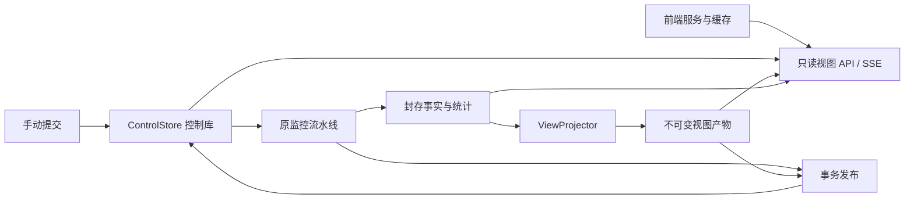
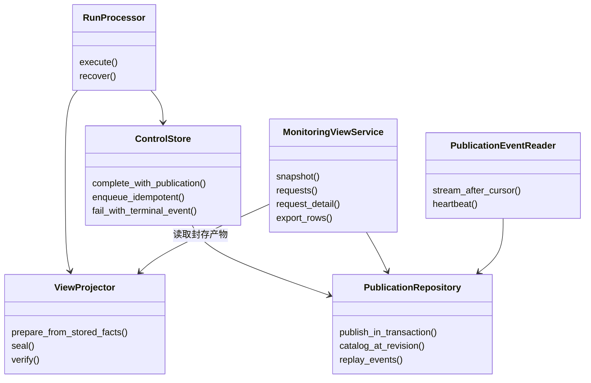
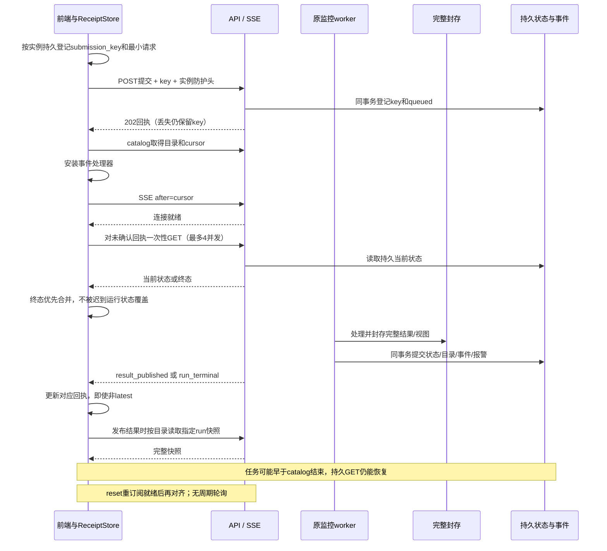
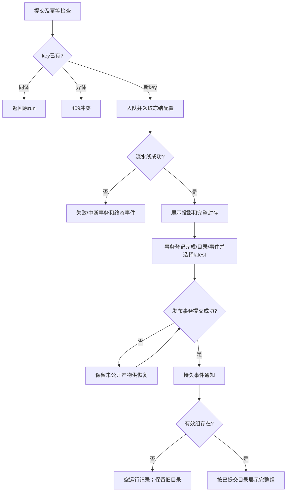

# B005.1 设计 v0.2：面向完整前端服务的后端增补

2026-10-27，**已按用户采用的R1/R2修订；S0契约已固定，新增服务未实现**。这是已批准监控 v1.0 的展示服务增量，原 DESIGN / 计量契约保持原摘要；当前接口以代码生成的 OpenAPI 为准。本稿定义内部设计，跨会话 HTTP 边界以[固定展示契约](../../../../contracts/MONITORING_VIEW_V1_DRAFT.md)为唯一维护入口。

## 1. 目标与范围

首次进入能找到 appid×模型的最新完整结果；正常运行完成和无有效行也能通知；断线/重启后能恢复。所有页面数据固定 run，读取不触发编码、回放、重新统计或 explain_encoding。补齐原 HTML 对应的请求明细、提交、信号和导出动作。

不增加计量算法，不改变 J/P/H/C/O、ΣH/ΣP、nearest-rank、1K/2K/5K 直方图/全部众数/≥200K 尾桶；不扩展增强 hybrid、诊断、自进化或主动采集。B005.1 维护后端及共享契约；前端会话维护实际 UI、缓存、路由和构建资产。首版交付必须包含二者。

## 2. 建议采用的设计选择

| 选择 | 本稿方案与理由 |
| --- | --- |
| latest | 每 appid×model 按组有效请求最大 time_ns，再按 publish_seq 取最大；旧文件晚完成不抢新数据，相同最大时间的新配置重跑由序号决定 |
| 发布粒度 | 一份 CSV 对应一个 run；全部组数据、视图产物封存成功后同事务发布，不提前暴露部分组 |
| 快照 | 写入阶段预生成不含发布字段的展示主体；GET 只把已存主体与不可变发布元数据组合并序列化，不运行 aggregate |
| 时间/质量 | 单独保存组/文件的数值时间边界和质量 scope；文件级未知坏行不分摊给 appid |
| 通知 | 持久日志驱动 SSE；报警 outbox 保持原用途，正常无报警也有 result_published |
| 操作终态 | completed/no_valid_rows 用 result_published；failed/interrupted 用 run_terminal；queued/running 可显式 GET 状态，不推送逐请求进度 |
| 请求详情 | 多列同一 SQL 结果集；只读取原 JSON、已有轻量证据，模板正文 capability=false，不现场重编码 |
| 迁移 | 控制库拟升 schema3，视图 schema 独立为1；旧 sealed 结果原字节不改，维护独立视图 sidecar |
| 兼容 | 旧 GET/CLI 默认行为保留；新的展示 DTO 采用明确十进制字符串规则，避免大整数默默舍入 |

这些是本轮给用户和前端核对的具体方案，不冒称已获设计批准。恢复实施时若改变字段或语义，先更新草案及影响说明。

## 3. 组件设计与代码要求

| 组件/拟建文件 | 职责 | 不承担 |
| --- | --- | --- |
| ViewProjector：monitoring/view_projection.py | 从已存事实构建组元数据、请求展示索引、三宽度快照主体，封存及摘要 | Tokenization、命中或分位算法 |
| PublicationRepository：monitoring/publications.py | 参与 ControlStore 的同一个事务，发布记录、组目录、latest、事件游标、提交幂等 | 独立提交第二个事务 |
| PublicationEventReader：monitoring/events.py | 有界读取持久日志、恢复判定、SSE 心跳和慢连接处理 | 在数据库事务中等待客户端 |
| MonitoringViewService：monitoring/views.py | 只读目录、快照、请求/证据、分页信号、流式导出 | 新建结果或按页面访问补跑迁移 |
| 展示 DTO / wire：view_models.py | 严格类型、整数规则、统一错误、稳定 JSON/ETag | 复制计量模型或推断空值 |
| 既有 pipeline/storage/service/API/CLI | 接入封存→事务发布、迁移/恢复、提交幂等和路由 | 破坏旧接口及 B005 结果 |
| 实际前端（独立会话） | SSE→目录→固定快照，缓存、渲染与交互 | 自算统计或拼接三个不同排名页 |

保持单计算 worker、8 CPU 初值；SSE 和流式导出不得占用 worker 锁，SQLite 操作用短事务/后台线程，不阻塞异步事件循环。排序列只取白名单，值参数化；禁止跨 appid/ref 返回正文。新增模块用可注入的时钟/故障点测试，不加第二套缓存仿真。

## 4. 数据结构与事务

控制库拟新增：
- service_metadata：持久 service_instance_id、view_schema_version、迁移/回填状态、事件高水位和最早可连续恢复水位（即使日志全清也保留）；正常重启身份不变。独立复制部署或恢复会造成事件序号回退时须生成新实例身份，不能共享浏览器缓存身份。
- publications：run_id 唯一，publish_seq 唯一，model_id、published_at、terminal_status、view_manifest_sha256。空结果同样登记。
- publication_groups：主键(run_id, appid)，model_id、min_time_ns、max_time_ns、视图主体定位/摘要和质量元数据。
- active_groups：主键(appid, model_id)，候选 run 与排序字段；仅在新候选的(max_time_ns, publish_seq)更大时更新。
- ui_events：INTEGER PRIMARY KEY AUTOINCREMENT 的 event_seq、run_id、kind、payload_json、created_at；唯一(run_id, kind)确保恢复幂等。publish_seq 取 result_published 的 event_seq；失败事件占序号，所以发布序号允许有间隔。
- submission_receipts：submission_key 唯一、规范请求摘要、run_id 和初次受理时间；与入队同事务。key 不用于租户授权，也不复用报警 event_id。

视图 sidecar 拟在 state/view-artifacts/v1/<run_id>/；路径只用内部 ID，appid 不直接成为路径。一个 view.sqlite3 保存每组主体和 request_projection（ref、hash、time_ns、J/P/H/C/O 等轻字段），配套 manifest。复制已有列值以便索引，不复制原正文或 Token IDs，不改变原统计。建立 appid+各排序列+source_record_index、appid+hash 索引。文件封存后只读。

新 run 的顺序：
1. 原编码/回放/统计/阈值比较完成，ViewProjector 在批次写路径补充元数据和展示主体，记录新增阶段时间。
2. fsync/rename 封存原结果与视图 sidecar，校验 manifest；此时尚不可见。
3. 在 ControlStore 同一 BEGIN IMMEDIATE 内完成：运行终态、completed_results、报警 outbox/run_signals、publication、全部 publication_groups/active_groups、ui_event。
4. commit 后 SSE 才可读取事件。写后通知仅作唤醒优化，日志才是事实来源；提交后发送前崩溃仍可重放。
5. 事务失败不暴露目录/快照。已封存未提交的 run 由既有恢复流程验证两份 manifest 后幂等发布；同一 run 不生成第二个发布序号。缺 sidecar 可由后台从已封存事实补齐，不从浏览 GET 触发。

## 5. 完整结果目录、时间和质量

catalog 是 active_groups 的分页读取，不扫 CSV。catalog_revision 取该读事务内最大 publish_seq，cursor 取同事务内最大 event_seq；一个明确的 SQLite 读事务中取两者及页面，不用多个独立连接拼接。后续页必须传首屏 revision；发生任何新发布则409，客户端丢弃整组分页后重读，不能混入不同版本。分页按 appid/model 二进制稳定排序。保留历史的 publication_groups 支撑固定历史 run 和运行目录。

时间边界取 facts 的 min/max(time_ns)，再统一转 UTC RFC3339（固定9位小数，避免不同文本精度比较）；前端转北京时间。新 run 同时修正原 summary.time_range_utc 的生成；旧已封存 summary 不重写，视图中的 file_data_range_utc 从事实重新提取，标明 metadata_origin=stored_facts_projection。

质量明确分开：
- file_quality 沿用整文件最终 quality，标 scope=file；无法归属的跳过行只留这里。
- group_quality 的 valid_requests 来自该 appid 的 facts；encoding_rejected_rows 只统计已有 request_records.appid 且编码失败的行。
- duplicate_hash_id_rows_within_group 定义为组有效请求数减组内 distinct hash 数，标 duplicate_scope=appid；整文件原重复计数仍是 file 口径，两者不能直接求和互换。
- 不把 CSV 解析失败行猜测归属；group_quality 标 coverage=known_appid_rows_only，skipped_rows=null、unattributed_skips_available_in=file_quality。这些 null 不是0。
- 无有效行有运行记录和发布通知，groups=[]；不创建假 appid、不清除已有 active_group。新文件没有出现的 appid 继续指向旧结果并保留旧时间。

## 6. 通知和请求生命周期

游标定义、心跳、保留上限、reset 和性能默认值见共享草案。目录到订阅之间出现发布也会从 cursor 回放；重复通知可接受，客户端按实例+event_seq 去重。latest 只由目录决定，不能拿事件序号直接覆盖当前范围。

failed/interrupted（包括 claim 时不支持配置的失败）与 run_terminal 同事务登记；只反馈操作终态，不发布业务快照。现有报警重复去重与新 UI 发布重复去重独立维护：同源重跑可以只有一条报警 outbox，却必须有两个运行发布事件。

活动图的 latest 更新属于上述发布事务；图中后续分支表示提交后的可见效果，不是补做第二次写入。

### 6.1 R1：恢复尚未确认的提交终态

用户已采用R1；不能以目录cursor越过终态为“任务仍在运行”。前端ReceiptStore保存实例/key/run_id及最小规范提交字段，不保存正文。处理器安装并确认SSE连接就绪后，对本实例尚未确认回执做一次GET对齐，最多4并发、按key/连接代次去重。首次订阅、重连、reset后的重新订阅、页面恢复及收到提交回执触发，无周期状态/指标轮询。

后端提供持久当前回执/状态；读取不受CSV移动或日志清理影响。终态与事件同事务；查询已结束任务不会重跑。404表示提交未确认，不等于failed。前端终态优先合并，迟到queued/running不能回退，矛盾终态显式协议错误；旧实例回执不查新实例。协议增加可选实例防护头，新UI携带，避免目录读取后实例切换的竞态。

完整字段/状态合并见共享契约第3.1/7节；A04/A05/A12和J05增加首次catalog前结束、cursor跨过终态、过期reset、GET期间终止、事件/GET乱序及丢回执。Session 1统一执行真实浏览器联合证据，不能用单纯事件重放通过替代。

## 7. 详情、信号和导出

请求列表单次查询返回同一行的 J/P/H/C/O 与 request_ref，不能用多个 metric 的排序页按位置合并。固定 run/appid，任意允许排序都用 source_record_index 升序作次排序；区间筛选只作用于指定长度列，尾桶没有上界。完整字段、分页、hash 查询语义见契约。

详情先验证 appid/ref，再读取已有原 JSON/证据；默认正文预览最多64KiB，UTF-8边界截断明确标识，提供单独流式原文读取。不保存的模板正文明确不可用；special ranges/source pointers 是已存轻量证据，不伪称逐 Token 字段归因。可用内部 explain_encoding 保持独立，不注册到浏览 GET。

快照内冻结规则、比较结果和信号摘要；view-signals 单独有界分页并提供可变消费状态，不能污染快照 ETag。关联当前 run 的信号即使复用同一 event_id，也以关联 run 返回，不照抄 outbox 首次产生时的 result_ref 误导详情跳转。

全量导出只读同一投影，明确 filter/sort/export_scope；支持 NDJSON 和 CSV。不默认导出正文/Token IDs。流式游标有界 fetchmany，断线关闭资源，不把整表放内存；不得持有控制库长事务或阻塞发布。正文另有显式按请求读取入口。

### 7.1 R2：导出协议及有界浏览器验证

用户已采用方案A：NDJSON结束清单/原字节SHA，CSV结构/解析记录数验证保留；不能用普通下载链接作为通过。共享契约v0.2第8节固定metadata/request/summary完整顺序、UTF8无BOM与LF摘要覆盖、CSV固定列/CRLF/引用规则、响应头及压缩长度语义。中途后端失败中止流，不补成功summary。投影只读、计数查询和增量序列化，不为Content-Length缓存全量导出。

前端负责能力探测、Worker增量解析/摘要、保存选择器/临时可写流与背压；校验通过才close，错误/取消abort。拟64KiB切片×4在途、1MiB逻辑记录上限；无文件流能力时≤16MiB解码字节且完整校验后Blob，超限明确失败。这些数值已随前端v1.0获批，实际资源/兼容性仍待验证；后端不能将其变成CSV摄入或计量限制。

本轮核对csv_reader：appid/hash_id没有1MiB业务限制，因此导出即使不含正文也可能存在超限长ID；S0/F001比较序列化后字节体量，记录边界风险，UI中止不截断。后端已取行缓冲按行数和字节双限控制，超大单行单独记录资源开销。

完整合成fixture只用于协议可复核；真实正常服务、故障注入代理/夹具及前端假服务分别记证据。联合测试用≥256MiB流检查真实文件写入、close/abort及浏览器增量内存≤64MiB；后端RSS≤64MiB独立测量，不能互相替代。Session 1统一执行J04/J06及R2扩展。

## 8. 迁移、预算和回退

schema2→3 先停 worker 并用 SQLite backup API 保存一致性控制库备份，再做增量建表。旧结果回填只读取已封存事实/冻结规则，创建 sidecar；逐 run 可恢复，按完成时间数值+run_id 排序登记历史发布。回填全部完成前新展示接口503 VIEW_INDEX_NOT_READY，旧接口仍可读；不发布一个看似全量的半截目录。新任务暂不领取，避免迁移与正常发布交叉。原结果 manifest 字节保持一致。空库直接 ready。

每个新文件的展示预处理/封存/发布计入 <7200 秒；启动时历史回填单独计时，不能隐瞒为零成本。SQL元数据按一遍扫描或分组查询，不对每个 appid 重扫全文件；事实/索引随请求数落盘，快照约1029桶/组，不夹带全量请求。正文/证据内存限制按单行最大体量说明；流式导出增量内存目标见 TESTS。

回退使用 B005 原 source-snapshot 和迁移前 schema2 控制库备份，先停服务/worker，隔离 B005.1 新状态后切换；不拿旧代码直接打开 schema3，不删源文件/已完成结果/新产生证据。回退窗口内新增运行和设置单独保留并报告未载入旧库，不能假称无损降级。新视图失效时前端保留旧完整快照/明确错误；不得自动转为指标轮询或现场重计算。B006保持pending。

## 9. 联合验收和交付责任

**Session 1（监控后端）统一完成最终真实前后端联合测试、Docker构建、镜像归档和代码交付包。** 前端会话完成自己的F001–F006并提供ready_for_joint交接：源码/依赖锁、可复现构建入口、静态资源manifest、接口/schema身份、单元/浏览器/E2E/健壮性和R1/R2证据、已知问题/回退、联合测试调用入口；不自行宣布完整服务通过。

后端接收固定前端版本后，在同一候选前后端服务执行J01–J06、R1/R2扩展、统一E2E/健壮性/逐项设计对照；发现前端问题记录并交其维护者修复，不擅自覆盖前端文件。最终报告绑定双方版本/资源/契约/数据/浏览器/环境摘要。

B005.1后端A门槛可先关闭，前端ready_for_joint不是release_ready。统一联合报告通过后，后端准备完整服务B006范围并向用户请求有效打包批准；批准后才构建/导出。当前仅修订文档，B006仍pending；前端最终稿已获批但F001暂停，后端实施及打包授权仍独立。

## 10. S0固定接口先行（2026-10-27）

用户要求先完成S0以支撑前端。当前[S0 1.0.0](S0_CONTRACT.md)已固定完整字段/请求响应/错误/样例和R1R2边界，新增服务实现须以此为准。字段字典、Schema、设计OpenAPI、原字节样例和验证摘要见该入口。前端不必等S1–S5结束才能做契约开发；真实服务能力仍按S5/J门槛验收。
