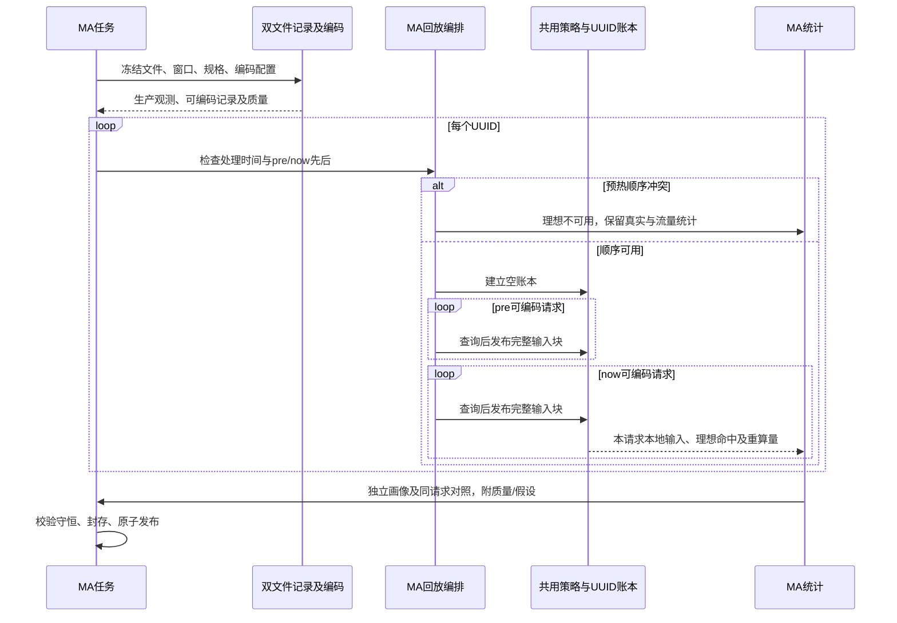
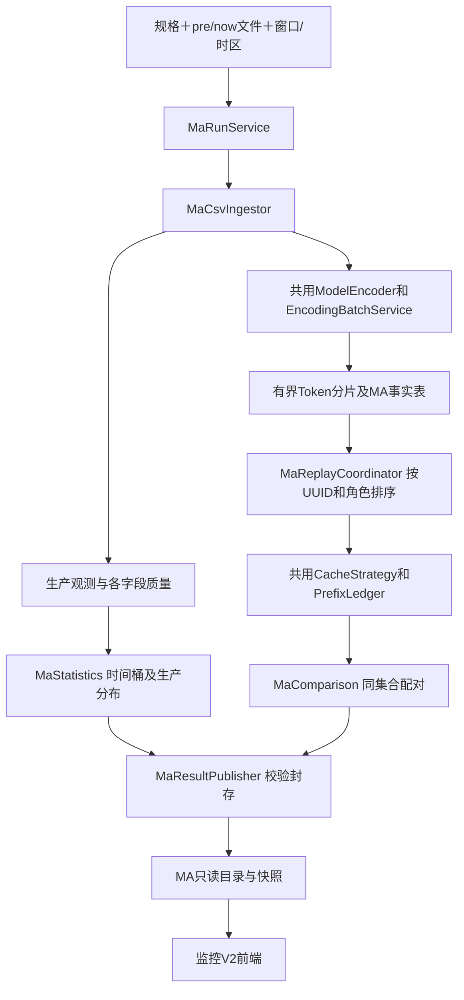
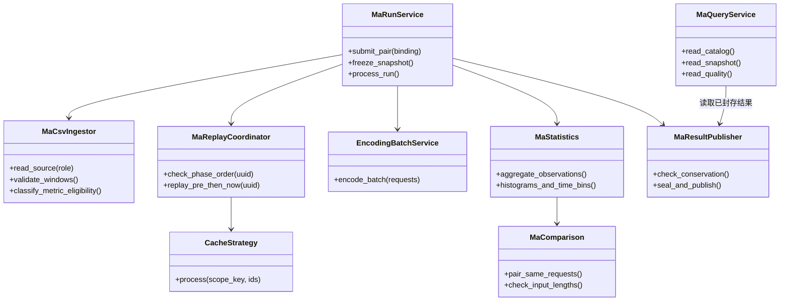

# TokenScope V2 同事侧 MA 监控后端设计

版本：**v1.0，用户已批准，M000–M005本机后端实施与统一验收完成**。日期：2026-10-30。负责人：MA监控后端会话 `01a18ab2-2600-7ae1-8b0e-979dad9ec3be`。文档定稿不代签用户对工程选择的审批；本轮授权为交叉检查、完善设计和batch方案、版本与记忆整理。

用户已授权形成设计文档供审批。本稿区分已确认产品要求与新增工程提案；不是已实现能力、冻结接口、开发启动或打包部署授权。采用[V1设计](../DESIGN.md)的范围、指标、组件/类、生命周期、存储、质量、验收及审批结构；V1能力以[已实现接口](../../../contracts/MONITORING_IMPLEMENTED_API.md)、[现场验收](../../../huawei/MONITORING_V1_ACCEPTANCE_20261030.md)及实际源码为依据。

开发Agent从[ENTRY](ENTRY.md)进入，依次读本文、[交叉核对](CROSS_CHECK.md)、[batch执行方案](BATCH_PLAN.md)、[统一验收](ACCEPTANCE.md)及当前batch四份文件。版本身份见[VERSIONS](VERSIONS.md)。本轮MA v0.1、用户设计v0.1及其随后形成的v1.0核对输入均按字节归档；当前用户设计仅只读核对，不替对方审批或实现。全部MA batch已按用户明确授权闭环；实际实现、235项测试与外部待验收边界见[M005 RESULT](batches/M005/RESULT.md)。下文保留设计时的要求和提案用语，不将其当作当前未获授权。

## 1. 目标、范围与非目标

面向同事，按 **model_standard_name × instance_uuid** 展示当前一小时的理想/真实前缀命中率与流量画像，帮助理解复用潜力、实际复用及观察条件，选择值得进行GF负载均衡策略对照实验的流量场景。

依据[MaaS参考](../../../architecture/MAAS_REFERENCE.md)：一个UUID代表一个MA集群，即GF＋独立motor＋3P3D。该UUID内各appid和P节点共享prefix cache，不跨UUID或规格混算。GB负责跨集群分配，GF/motor负责实例内P路由；两者的优化问题分开表达。

| 用户已确认事项 | 本设计落实 |
| --- | --- |
| MA与用户监控数据隔离、共用仿真基础 | MA独立提交/结果类型；不拿GB服务级CSV生成GF实例对照，不另造编码或前缀算法 |
| 暂不自动采集 | 用户手动提供同规格pre、now两份CSV；名称帮助辨认，角色和规格显式绑定 |
| 每份连续1小时 | pre=[T−1h,T)，now=[T,T+1h)，端点归属规则为本稿提案 |
| pre预热、只统计now | 每个UUID从空缓存重放pre，然后重放now；pre不计入当前画像和命中率分子/分母 |
| 真实输入与时间字段可提供 | 两份CSV均加入prompt_tokens、request_time；instance_uuid准确列名已由用户SQL确认 |
| 首批流量画像 | 请求数、输入长度分布、请求速率、实际未命中输入Token统计 |
| 时间变化与平均 | 5分钟一段，共12段，并保留整小时平均 |
| 两张独立分布图 | 生产输入Token与实际未命中输入Token，不做联合分布图 |
| GF实验支持 | 帮助人工选择实验场景，不推荐“最优算法”、不自动切换路由 |

不包含：数据库连接/定时采集/自动补采、连续多窗口缓存服务、SSD容量或淘汰仿真、真实并发与排队还原、GF/GB算法实现或收益预测、TTFT最低命中率反求、异常原因诊断、hybrid精确仿真、前端实现、部署和打包。UI-01是展示起点，不把其合成TTFT或其他样例自动扩为本轮必做指标。

## 2. V1复用与本轮设计变化

V1已验收发布为monitoring-v1-20261028，包内源码92236ee993974e740d085e22e49b6b93c9487430，dev6/F007、S0 1.0.0、control schema3/view1。发布身份不等于当前工作树HEAD。

| 能力 | V1事实 | MA设计 |
| --- | --- | --- |
| 分组与缓存范围 | appid×模型，同CSV空缓存 | 规格×UUID，跨appid/P共享；pre＋now共用本次账本 |
| 原文编码 | 固定资产、模板和模式，保留原JSON | 直接复用，不静默修复正文后沿用原Token口径 |
| 匹配 | 无限容量、完整块链式近似、前序输入立即可用 | 保持；不模拟P节点执行、传输和缓存淘汰 |
| 统计有效集 | 编码有效集为主，J/P/H/C/O | 生产字段观测和理想回放分开校验，再形成同请求集合对照 |
| 文件/请求身份 | 单CSV、记录序号，重复hash_id保留 | 两源文件角色＋各自记录序号；不靠hash_id覆盖记录 |
| 发布/查询 | 后台分析、完整封存、GET只读 | MA独立结果与目录，沿用完整发布原则；页面不触发回放 |

2026-10-30按问题核查实际源码：

- [simulation.py](../../../../src/tokenscope/monitoring/simulation.py)：`make_strategy`、`FullBlockStrategy.process`和`PrefixLedger`可复用；现有`replay`固定按appid排序，不能原样承担MA流程。
- [csv_reader.py](../../../../src/tokenscope/ingestion/csv_reader.py)：CSV/JSON规则可借用；现有五列`RequestRecord`和整行校验不足以承载MA分指标质量规则。
- [stage.py](../../../../src/tokenscope/encoding/stage.py)、[pipeline.py](../../../../src/tokenscope/monitoring/pipeline.py)：编码批处理、Token分片与封存流程可复用基础组件；现有表结构/阶段不能假称已支持两源与部分有效指标。
- [statistics.py](../../../../src/tokenscope/monitoring/statistics.py)：`distribution`可复用；`aggregate`固定appid和本地P/H/C，不用于生产prompt/cached的直接替代。

本稿拟新增MA编排与投影，不改写V1结果或S0。时间格式兼容、别名、DeepSeek配置和访问入口由[用户监控线](../v2-user/ENTRY.md)维护，本线消费其批准并验证后的公共能力；没有该能力时明确拒绝不支持的格式/配置，不维护第二套修复。

## 3. 输入、绑定与证据身份

### 3.1 一次任务

一次MA运行显式绑定：两份文件相对引用及pre/now角色、model_standard_name、统一编码模型/配置revision、两段窗口、源时间解释。两份文件必须存在；允许只有表头的合法空CSV，不将缺文件当空文件。角色不得只靠文件名推测。

继续采用V1“先手动放入受控输入根目录、再提交file_ref”的方式，不新增HTTP大文件上传、在线下载或数据库权限管理。校验解析后的路径仍在输入根目录内。运行前快照两份原文件、计算摘要，冻结本次元数据和模型资产；运行中修改文件或设置不改变当前结果。

规格标签与编码模型是两个身份：例如64K标签不等于对应单独词表，也不是截断上限。请求正文中的model按公共显式别名验证，不把其服务名强制改成规格名。CSV可额外提供model_standard_name；若存在则逐行校验与显式绑定一致。未提供时，以用户指定的导出范围为依据，结果说明“规格由提交绑定”，不声称逐行独立验证。

发现非空规格列与提交绑定冲突时拒绝文件对，不允许把混规格文件按多数规格计算；空单元格按不可归属记录处理。两份CSV须以不可变已导出文件交付；先后快照并不证明数据库事务快照一致。记录每份复制前后文件身份/大小/时间及流式SHA，检测变化则失败，不混用前后版本。

### 3.2 字段

两份文件使用相同必需表头；缺表头为提交输入错误，单元格无效按第4节处理。

| 列 | 含义/规则 | 使用 |
| --- | --- | --- |
| instance_uuid | 非空集群标识；不改写标识、不从P编号推导 | 分组和共享缓存范围 |
| hash_id | 原始请求标识，非唯一记录键 | 追溯及重复提示 |
| appid | 原始租户标识 | 保留来源；不隔离MA缓存 |
| request_time | 源查询选窗字段，事件含义尚待确认 | 窗口归属及本稿建议的12段时间统计轴 |
| model_handle_start_time | GF发出请求的处理计时起点 | 理想回放排序、时序检查；不是GF接收到达时间 |
| prompt_tokens | 生产模板后的输入Token，非负整数 | 真实输入长度与真实命中分母 |
| cached_tokens | 生产实际命中Token，整数且0≤cached≤prompt | 真实命中及实际未命中量 |
| completion_tokens | 输出Token，非负整数 | 留存/复核，不从输入中扣除，不新增首版输出分布 |
| request_input | GF转换后的原始JSON文本，含文本及工具 | 统一编码和理想回放 |

`model_ttft`、`model_tpot`、P节点、GF策略名与队列/并发暂非必需；本稿不承诺相应统计或从已有字段推造。后续对照实验可以单独记录它们及单位，不阻塞基础画像。

UTF-8/BOM、CSV带引号/换行、原始正文保真及行定位沿用V1。内部记录身份为`(ma_run_id, source_role, source_record_index)`，额外生成稳定内部整数键连接编码分片；真实hash_id/appid保持原样。同文件重复hash_id仍保留，每行独立参与；跨文件重复也不据hash_id自动去重，须结合窗口规则判断。多个UUID出现同hash_id仅给提示，不擅自推断是重试还是同一实际请求。

### 3.3 时间与双窗口：本稿的审批提案

**建议用request_time统一决定文件归属、now统计归属和5分钟分箱；用model_handle_start_time决定缓存回放顺序。** 这样12段与整小时统计属于同一请求集合，不把两个时间轴混算。图表名称为“记录时间请求速率”，附“按request_time分箱”；字段事件确认后再采用相应业务名称。当前不称GF到达QPS、处理吞吐或完成吞吐。

1. 窗口为左闭右开，pre/now连续、均3600秒。恰好T的记录只属now；恰好T+1h不属本次。保留请求数为零的段，不用首末请求间隔代替3600秒或300秒。
2. 有效request_time落在对应文件窗口外时拒绝该文件对并返回定位，不静默迁移到另一文件或删掉边界行；避免原SQL的BETWEEN双闭边界把同一记录重放两次。源文件不改写，用户可重新导出。字段非法的行则作为不可归属行记录。
3. 每个UUID、各角色内部按`model_handle_start_time`及源记录序号稳定排序。处理时间相同按确定性顺序，跨角色同刻先pre；标明同刻顺序是回放约定，不证明线上先后。
4. **若某UUID有效pre的最晚处理起点晚于有效now的最早处理起点，首版不强行“全部pre在前”回放。** 该UUID的理想/配对结果标`warmup_order_conflict`不可用，仍发布其生产统计、时间范围与冲突计数；其他UUID继续。这样不引入未来缓存、不暗中减少预热集。若现场频繁出现，后续另行批准交错回放或改选窗语义。
5. 交叉核对用户线已获“CSV时间为UTC”的澄清，本线统一采用**无offset按UTC**的可见输入约定，提交元数据明确记录source_timezone=UTC，不从显示北京时间推断。带offset转UTC；源文件声明其他时区/混用不相容声明时拒绝，首版不另建任意时区推断。两时间字段及窗口端点同样处理。复用公共ISO/DD/MM解析能力，DD/MM不猜MM/DD，保留亚秒，展示Asia/Shanghai。DD/MM公共修复未接入前仅可声称ISO路径可用，不能靠静默预处理假称支持。

request_time具体是哪一层事件仍未知。“按UTC解释CSV”是跨线统一的产品约定，不证明源系统实际导出正确，也不把request_time改称GF到达。若现场与约定冲突，记录输入错误并调整显式导出声明，禁止自动猜测时区。

公共解析接口由用户线维护：保留旧parse_utc(value)行为，提取能力时允许调用方明确无offset策略及错误字段；MA分别报告request_time或model_handle_start_time错误，不能把两个字段的失败都记成后者。M000与用户U000记录接入签名/版本，旧wrapper兼容。

## 4. 有效集合、缺失与质量

不因request_input解析失败而丢掉仍可信的生产Token观测，也不把生产字段缺值当作零。每个UUID分别记录pre和now的读入、可归属、编码成功及各观测字段有效量；无法确定UUID/窗口的行仅归文件质量，不摊给各UUID。

以下集合均属于now，字母只用于说明，不要求前端展示缩写：

| 集合 | 条件 | 产出 |
| --- | --- | --- |
| A 可归属记录 | instance_uuid非空、request_time合法且在now范围、规格无冲突 | 请求数与记录时间速率；这是导出记录口径，非已验证全量生产请求 |
| P 输入有效 | A中prompt_tokens合法 | 生产输入分布、总量 |
| R 真实Token有效 | P中cached_tokens合法、0≤cached≤prompt | 真实命中率、实际未命中分布及时间序列 |
| E 理想有效 | A中hash_id/appid/处理起点/原文和编码合法，且该UUID时序通过 | 独立理想命中；使用该UUID全部可回放pre及now历史 |
| Q 对照集合 | E与R的交集 | 同请求集合的理想/真实命中率及输入量一致性检查 |

completion_tokens错误只影响其保留字段的可用性，不阻断本轮输入/缓存画像；hash_id/appid缺失不影响A/P/R，但会排除理想回放并留原因。有效输入量或cached缺失不阻止其他可编码记录进入模拟缓存。**对照集合筛选只影响结果聚合，不重新用Q回放或删掉E中其他历史请求。**

若pre对应UUID无有效回放记录但now有，则继续从空缓存回放now，标“无有效预热历史”及pre覆盖；不冒称线上冷缓存。仅pre出现的UUID也列出“now无记录”，命中率为null；从两份文件之外无法知道的UUID不制造零行。

对每项指标携带有效数/可归属数；命中对照还显示Q相对R的请求覆盖及生产输入Token覆盖（分母为0则null）。编码失败可能损失前缀历史，即使Q中本地长度等于生产长度，也不能称完整线上复现。缺失、负数、溢出和cached>prompt不钳制或补零；行错误按原因独立计数，原因可重叠但集合计数不得重叠冒充总跳过数。

CSV无法辨认记录边界、编码资产缺失、磁盘不足、内部异常是运行失败，不伪装为坏行。一般行错误不阻止完整发布带质量说明的结果。真正空输入与全坏行分别显示，不因“有效样本为0”显示0%命中。

Token单元格接受与V1一致的十进制非负整数，单值上限2^63−1；空白、负数、浮点、NaN、无穷和溢出分别记录原因，不能round成整数。跨请求累计用精确整数，避免SQLite SUM有符号64位溢出；输出按十进制字符串编码。非法时间/UUID等基础字段导致无法归属时，文件层可归属＋不可归属数量守恒。空CSV产生空结果；有记录但全部不可归属为质量不可用，两者共享终态形式但reason不同，不冒称无生产流量。

对pre单独统计可归属、可编码、错误及预热覆盖；理想值注明基于“可回放历史”，不是全部历史。公共模型配置/资产错误、未解决的DeepSeek模式沿用公共错误语义，不将其当作行级坏JSON批量跳过；这些情况终止任务，避免输出选择性样本的假成功。

## 5. 缓存回放语义

一个运行内每个规格×UUID有独立逻辑缓存。pre开始为空；通过pre/now时序检查后，顺序回放两段，切换角色时不清缓存。pre只改变本次账本；now也依次查询和发布，所以后续now可复用前面的now。运行结束不把账本续接到下次任务。

复用现有`make_strategy`及完整块实现，MA编排给策略传入含规格和UUID的规范化缓存范围键。该参数在V1接口中名为appid，但本质参与链根命名空间；MA使用独立适配器表达范围，**不得修改原记录appid、伪造V1租户结果或建立UUID假租户**。不同任务账本隔离，V1调用路径及键字节保持不变。若实现需要调整公共参数名/接口，先登记并做兼容回归，不复制核心算法。

沿用`B_eff=block_size×cp_world_size`；连续完整块查询限制为`floor(max(P_local−1,0)/B_eff)`，开启MTP时按V1退一匹配块；查询后再发布`floor(P_local/B_eff)`个完整输入块，余块不发布；关闭缓存时理想命中为0。三模型默认block为128/1536/32；实际采用冻结配置，不以GF物理page同名值替换单位。

Qwen/DeepSeek普通链式近似及GLM CP/GF编码资产限制保留；不模拟hybrid状态、不模拟SSD/HBM容量、不把本地磁盘账本称为生产SSD仿真。前序输入“立即可用”仅为理想情景，不产生真实完成时间或并发轨迹。仅缓存CSV可见输入，不自行加入completion_tokens对应的不可见输出Token序列。

DeepSeek有效模式来自**同一公共配置快照**：用户线计划的新安装thinking_disabled可在其实现获认可并接入后成为本线可见配置，必须标“现场假设”；已有未决default不被MA覆盖。请求显式选项优先，保存最终生效模式和资产摘要。运行内配置不切换；回放缓存键包含规格、UUID、编码身份，不因appid、hash_id或文件角色分裂。共用编码函数产出的J可留证但不新增MA原JSON长度图。

## 6. 指标、分布和时间展示

### 6.1 命中与未命中量

对请求i：生产输入为`P_db`、实际命中为`H_real=cached_tokens`、实际未命中为`U_real=P_db−H_real`；本地编码输入为`P_local`、理想命中为`H_ideal`。**U_real与V1的C=P_local−H_ideal不是同一指标，不复用C的字段名表示实际量。**

| 指标 | 计算集合与公式 |
| --- | --- |
| 请求数 | A的记录数 |
| 实际输入总量 | P上ΣP_db，标该字段覆盖 |
| 实际未命中总量 | R上ΣU_real |
| 真实命中率（全部有效生产观测） | R上ΣH_real/ΣP_db |
| 理想命中率（全部可回放记录） | E上ΣH_ideal/ΣP_local |
| 配对真实/理想命中率 | 分别在同一Q上使用上述各自分子、分母 |

零分母/空集返回null及原因，不平均逐请求百分比，也不平均各5分钟或各UUID的命中率。概览中并排的理想/真实使用Q；详细信息另显示R、E的独立值及各自覆盖，避免将全生产真实与编码子集理想并列暗示同口径。

Q上逐请求记录`P_local−P_db`、不一致请求数和两种输入总量。若不一致，两个配对值仍各自可追溯，但标“输入计量不一致，不能直接解释差距”，不强行用P_db作理想分母、不删除不一致请求来提高一致率。不一致为0只说明长度一致，不能证明Token IDs或生产模板完全等价。首版不自动输出“缓存损失/可提升百分点/SSD收益/路由收益”，理想小于真实也不自动判异常。

### 6.2 5分钟与整小时

now固定12个左闭右开300秒桶，按第3.3节request_time归属。每个桶提供：A内请求数、请求数/300秒；R内未命中输入总量、该量/300秒，以及该桶R/A的字段覆盖。

整小时提供A请求数/3600秒和R未命中总量/3600秒；同时保留两个整小时总量。未命中速率单位为Token/s，含义是“归属于该记录时间段的未命中输入量”，不是计算吞吐。12段计数/Token总量应分别与小时总量守恒；小时均值不是只对非空桶平均。

| 状态 | 显示 |
| --- | --- |
| 合法文件、某桶没有可归属请求 | 请求0；未命中0，注释仅指提供的文件未出现记录，不证明采集完整 |
| 桶有请求，但真实字段全部无效 | 请求速率有值；未命中量null，不能显示0 |
| 只有部分真实字段有效 | 展示有效子集量及覆盖；不能叫完整流量的未命中总量 |
| 整份文件丢失、解析中断或未完成 | 不生成已完成12段零流量曲线 |

处理起点可能位于request_time窗口之外，本稿保留其范围和窗外计数，但不把它偷偷纳入12段或当作GF到达时间；如改用处理起点分箱，需重新确认请求集合和完整性。

### 6.3 两张独立直方图

图一为P集合的生产输入长度，图二为R集合的实际未命中输入长度。两图各自显示样本数与覆盖，不强迫二者同N，不将两张边际分布解释成逐请求联合关系。

复用V1默认5,000 Token等宽箱、1K=1000、左闭右开、保留空箱、`[200000,+∞)`开放尾桶；200K是展示分箱边界，不截断实际请求。复用1K/2K/5K预计算能力，默认5K；同宽度对比，不新增联合图。纵轴为请求数或各图有效请求占比。全部并列众数按V1返回；P50/P80/P90使用最近秩，从原始整数集合精确计算，图外显示，不能从直方图插值。零未命中请求进入首箱，并带“U_real=0的请求数”避免与1–4999混淆。≥200K是尾部汇总柱，不能据其较高计数断言长尾内部的峰。

用户线为“理想C众数均值排行”另增开放等宽分箱，与这里的两张生产观测图不同；它不能更改公共`distribution`的既有200K尾桶行为。本线不读取其排行均值作为MA长度，也不因统一函数而统一业务语义。此边界须在公共统计回归用例中固定。

## 7. GF路由实验线索与展示边界

首版提供人工观察所需的图表、确切窗口、UUID、样本覆盖和可复核计数，**不增加自动场景评分、推荐算法、阈值告警或实验执行器**。以下为阅读说明，不是自动分类规则：

| 观测现象 | 可选择的对照场景 | 不得据此断言 |
| --- | --- | --- |
| 5分钟请求量有明显高低变化 | 高请求量段与平稳段 | 秒级突发已被捕获、系统已拥塞 |
| 请求量相近，未命中输入量不同 | 相似请求速率、不同输入工作量段 | 未命中Token等同执行时间 |
| 输入/未命中独立分布宽或多峰 | 请求成本异质的候选流量 | 两种请求同时竞争同一P，或必需短优先 |
| 请求量高点与未命中量高点不同 | 计数压力与工作量压力不同的片段 | 仅凭两图决定哪个GF算法更好 |
| UUID间画像不同 | 同规格的不同实验负载样本 | GF导致跨UUID不均衡；跨集群分配由GB参与 |

5分钟会平滑短时波动，不输出“符合泊松”标签或从均值直接生成排队结论；泊松模型仅保留为将来的实验基准假设。没有P级数据时不能诊断实例内负载不均衡。对照实验应固定可比的流量、部署、预热及测量口径，再观察TTFT/TPOT等结果；事后cached不视为决策时可用的oracle，也不假定换策略后保持不变。

页面保持同一规格下全部UUID可见，可展开各实例图表；按确定性UUID顺序呈现，不新增用户侧搜索排行能力。实验线索是说明文字，前端详细交互由独立会话承接。网页只读既有分析结果，切图/切箱/切UUID不重新编码、回放或访问数据库。

## 8. 组件与类设计

拟在`src/tokenscope/monitoring/ma/`维护MA专属编排、记录、投影与只读查询；图中类型均为提案，不声称文件已存在。

MA记录/生产字段入库与可编码记录筛选分开；调用共用编码器时不要求通过V1五列整行入口。公共时间/JSON校验以函数复用，不复制解析器或模板。统计调用共用`distribution`，MA自行组织查询集合和事实表。旧V1与用户线的appid分组、原文计量及既有阈值事件均保持原语义；MA不向旧低命中报警通道自动发信号。

## 9. 任务、存储、读取与兼容

### 9.1 运行状态及发布

MA任务使用独立身份/命名空间及专属结果目录。生命周期为queued→running→completed/failed/interrupted；无可归属now的完成任务使用completed＋empty_scope及原因（空文件/全部不可归属），不发明与V1混淆的同名状态。completed允许个别指标/UUID不可用，但必须返回质量和原因；系统失败时不把部分成果作为完整结果覆盖上次成功运行。

任务中先快照双文件及设置，流式校验/编码并落盘，再按UUID回放，完成生产与配对统计，检查守恒，封存后一次发布目录。发布失败但封存完整时按摘要恢复提交；未封存运行中断时标interrupted，显式新任务重跑，不从残余账本猜测恢复。重跑从本次pre开始，既有历史结果不变。

同一提交键＋相同绑定恢复原任务，不因响应丢失再次回放；相同键不同绑定返回冲突。文件重复提交防重和CSV内部重复hash_id保留是两件事。

幂等绑定包含显式角色file_ref、规格/编码模型、时间端点及规范化UTC声明；**先查回已接收提交键再验证文件是否仍存在**，文件移动不破坏回执恢复。设置在claim时冻结，之后同键查回不因最新设置revision变化重新提交。需要新数据/新设置的重算使用新键；文件SHA在快照完成后写入运行身份，不拿当下文件内容推翻已有回执。

### 9.2 持久化提案

MA任务索引、回执、窗口/绑定及发布目录使用**新增MA控制存储**，首版不把旧V1 schema3的单文件/租户字段扩写为双文件/UUID。运行目录保存两份输入快照、不可变配置/资产身份、记录定位与生产字段、编码及回放事实、预计算分布/时间桶、质量/配对状态、封存摘要。大正文及Token序列沿用流式和分片策略，不全量放入内存或HTTP快照。

MA控制库版本和结果格式单独版本化；这是与旧control3/view1隔离的设计，不预先占用旧S0 schema号。停止MA后旧V1仍只读取自己的存储。新接口只读MA结果，不修改旧seal，不回填旧结果为MA数据。原CSV、Token和运行产物默认不入Git，不自动清理，日志不打印正文。

物理边界固定为共享state_root下`ma/control.sqlite3`及`ma/runs/<ma_run_id>`；模型设置唯一来源仍是旧公共配置服务，MA库仅保存运行快照，不建第二套可编辑模型表。MA发布终态、目录revision与结果引用在**MA控制库同一个事务**提交，不要求与V1库做跨库事务。封存摘要涵盖双源SHA、绑定、配置、编码/算法版本、结果文件及质量；已有seal不可在恢复时改写。恢复后相同run只发布一次，损坏seal失败并保留上次成功结果。

明确区分三类ID：`service_instance_id`为TokenScope服务身份，`ma_run_id`为一次任务，`instance_uuid`为被观察的生产MA集群。MA复用公共服务身份校验，不用集群UUID代替X-TokenScope-Instance-Id。客户端缓存键至少含服务身份、MA类型、run及UUID；不得与用户侧appid键混用。

### 9.3 服务边界提案，尚非冻结契约

在现有服务中增加独立MA命名空间，HTTP和CLI共用MA服务层；共享端口不等于共享数据类型。拟操作为：

| 操作 | 数据边界 |
| --- | --- |
| 提交MA任务 | 两file_ref、角色、规格/模型绑定、窗口/源时间解释、提交键 |
| 查询回执/状态 | 固定MA任务，包含阶段、快照、失败原因；不触发重算 |
| 读取MA目录 | 指定规格，显示历史运行及完成的UUID集合 |
| 读取MA展示快照 | 固定run与UUID，含窗口、质量、命中对照、两图、12桶/小时均值 |
| 读取质量明细 | 分文件角色、记录位置、字段和原因分页，不默认发送正文 |

路径、完整DTO、错误枚举、Schema/OpenAPI及合成样例在设计认可后作为独立MA契约固定；本轮不生成虚假运行OpenAPI或修改[S0](../batches/B005.1/S0_CONTRACT.md)。展示整数沿用精确十进制字符串原则，比例/速率明确单位和null状态。首版不自动承诺MA请求正文导出、SSE推送、阈值配置等旧UI全功能；若前端需要，应在MA契约范围确认时明确，不能假借旧S0已实现。

本设计约束M000必须固定以下读取行为：固定MA命名空间、schema身份；带提交键的受理/查回；目录分页绑定revision；显式run快照无后台计算；运行未完成、UUID不存在、无结果与字段无值分别可识别；支持读取任务状态，不自动新增周期轮询前端行为。不得沿用旧S0的“completed必有非空组”断言约束MA仅pre UUID。前端开始正式对接前必须有冻结MA契约/样例，设计正文不代替Schema。

公共文件修改拟由本线维护新增MA接口装配与任务执行入口；时间/别名/模式保持用户线负责。实施前在SESSIONS记录具体文件及唯一维护方；本轮没有取得共享文件的永久独占权，也没有通知或唤醒其他会话。

## 10. 资源、性能与运行限制

目标仍为已有环境报告的华为V100，分析使用CPU，不要求GPU推理。复用既有受控线程、条数/字节双预算、磁盘排序和SQLite账本。默认一个分析任务执行，UUID逐个回放并释放句柄，不按UUID数量无界增加进程。

**共用现有`state_root/worker.lock`，不新造第二份互不相知的锁。** 核查V1的`RunProcessor.process_next`已在该文件上持有进程级flock；MA处理器必须在claim、恢复、回放和发布整个范围持同一锁，HTTP后台与CLI/work-once都走这个入口。失败/进程退出依OS释放；不能靠超时删锁文件抢运行，也不持锁等待另一个队列。同一个新服务dispatcher交替尝试旧队列和MA队列，一边无任务可尝试另一边；每次最多claim一个完整任务，不在持锁入口内嵌套调用另一`process_next`。保留旧SSE维护和停止语义，shutdown后的未封存任务走中断恢复。

同一个state_root协调执行资源，初始CPU预算沿用8、批256条/16MiB，允许已支持的显式配置；批次不是单记录截断上限。不同state_root的独立进程不在这把锁的保护范围，本版不声称宿主全局调度能力。旧V1单独服务无需改schema；本线只新增MA支持及可选dispatcher装配，由M004验证双队列真实进程互斥/可推进。

用户最终设计新增了独立用户索引/大规模回填任务，它们也占同一重任务额度。dispatcher采用可注册处理器列表，接入后按V1基础任务、MA任务、用户索引/回填轮转；用户线实现自己的process_next适配器并在U000固定签名，MA线负责装配与共享额度。每个入口独立持同一个worker.lock，禁止基础任务持锁直接嵌套索引入口；基础任务完成仅通知/入索引队列，后续轮次构建。索引无需读正文不代表可绕过CPU/磁盘额度。用户适配器未实现时可用协议夹具验证注册，真实用户-MA联合项仍pending；V1-MA真实进程门槛必须通过。

无限缓存是逻辑语义，不等于无限RAM：索引/前缀可落盘，但不能为节省内存淘汰逻辑缓存改变理想值。单条长请求不截断；磁盘不足和资源中断明确失败。预热文件每次随任务处理，本版不建设跨运行编码缓存或持续状态服务，避免依赖未冻结的数据复用协议。

性能记录覆盖两份文件快照、校验、编码、回放、聚合、封存直至控制提交，不把读取GET视为分析耗时。记录字节、各集合请求数、UUID数、pre/now比例、CPU/内存/磁盘峰值及各阶段耗时。

V1现场每文件22–55分钟仅适用于当次数据和有效子集；每UUID较少不意味着一个规格两份CSV整体一定更快。**首版MA不新增未经校准的完成时限或分钟级时效承诺**；功能验证后用同配置、同数据记录端到端成本，现场性能验收需用户指定代表文件规模和目标，不能直接沿用V1单文件7200秒作为双文件保证。

## 11. 验证与设计符合性

下表是未来实施验收要求，当前没有运行业务测试或生成通过记录。正式前端、容器和现场验证分别记录，不用合成数据代替现场有效率和性能。

| ID | 要求及有意义的验证 |
| --- | --- |
| MA01 | 同规格两UUID、跨appid相同前缀：同UUID可复用、跨UUID不复用；原appid原样保留；V1同样输入仍按租户隔离 |
| MA02 | pre预热能影响now命中，pre不进now分子分母/两图/12桶；now依次复用now；重跑不携带上次账本 |
| MA03 | 两个1小时半开窗，T/T+1h、跨日、亚秒、offset、同刻顺序；窗外行拒绝，非法时间可追溯，不重复计边界 |
| MA04 | pre处理起点晚于now时，仅该UUID理想不可用且真实/流量仍发布；无预热/空now/仅pre UUID分别可见 |
| MA05 | R、E、Q构造与覆盖：非法JSON但真实Token可用、缺cached但可编码、输入不一致、零分母、全部无效；对照筛选不删除回放历史 |
| MA06 | 聚合采用总命中/总输入，例如100/0与900/900得到90%而非50%；P_db=H_real+U_real及P_local=H_ideal+C_ideal守恒；缺失不变0 |
| MA07 | 12桶分别汇总回小时请求/未命中总量；含零桶、全缺失桶、部分有效桶；整小时除3600，不按首末记录跨度或非空桶数除 |
| MA08 | 两图独立有效集、5K及可选宽度边界、0/200K/超200K、并列众数、最近秩与箱总数守恒；不将U_real误用成理想C |
| MA09 | 复用V1仿真核对128/1536/32、MTP、短输入/完整重复、禁用缓存和未实现hybrid；调批大小或并行度不改结果 |
| MA10 | 双文件记录序号碰撞、重复hash_id、CSV字段换行/大正文/畸形JSON；保持原文摘要；路径越界、缺表头、文件变化可控失败 |
| MA11 | 响应丢失幂等、发布中断、封存恢复、未封存中断、磁盘不足；GET不改数据库、不编码、不回放；未完成结果不替代已发布结果 |
| MA12 | V1/S0及用户线受影响接口回归、旧结果与配置可读；不迁移或覆盖旧发布；MA公共入口改动与拥有方对齐 |
| MA13 | 记录两文件全过程资源和性能；同数据/配置重复运行数值一致；原始数据不离现场，回传单份md内嵌脱敏证据/必要源码 |
| MA14 | 前端后续对接真实MA契约验证：规格下UUID全部可见、now/pre身份明确、质量/不可比较/无预热状态可见；本轮不代签前端验收 |

代码阶段严格按[M000–M005执行方案](BATCH_PLAN.md)和每批PLAN/ISSUES/TESTS/RESULT推进，完成当前batch并达到全部必需门槛、更新增量记忆后才能开始下一批。最终按[统一验收](ACCEPTANCE.md)逐条对照本设计、真实后端HTTP/CLI、故障恢复和V1兼容。当前只形成batch文档，全部未启动；设计整理不等于业务测试已通过。

## 12. 最终设计审阅、未决事实与后续交接

已确认：手动双文件、每份连续1小时、pre预热/now统计、规格×UUID隔离且跨appid/P共享、加入prompt_tokens/request_time、实际未命中统计、5分钟＋整小时、两张独立分布图、辅助选择GF对照实验场景。

**请重点审批本稿新增的五项选择：**

1. **时间轴**：request_time用于归属/12桶，先称记录时间速率；处理起点仅控制回放。两段处理顺序冲突时保留生产画像、暂停该UUID理想对照，不引入未来缓存。
2. **有效集合与对照**：生产观测与编码有效性分开；并排命中使用同一Q，保留各自分母及覆盖；输入不一致不强行对齐或输出收益差值。
3. **图表细节**：复用V1的5K默认/200K尾桶/最近秩/可选细分箱；两图各有样本数；12桶按固定时长计算并保留零桶。
4. **功能边界**：图表和条件说明支持人工选实验场景，初版不做自动推荐/评分/泊松判定/告警，不默认纳入TTFT/TPOT展示。
5. **工程隔离**：新增MA编排、控制存储及只读结果接口，复用编码/匹配/分布函数，旧S0/V1结果保持不变；具体MA契约随后单独固定。

| 未决事实或后续依赖 | 处理与影响 |
| --- | --- |
| request_time的实际事件与源导出是否遵守UTC | 统一按已说明的UTC约定解释并留声明，不猜成GF到达；现场有矛盾则作为输入问题，不静默转换 |
| 生产与本地编码等价、GLM CP、DeepSeek有效模式 | 沿用已知限制和冻结配置；未知等价不承诺生产上限；模式由显式配置/请求决定，不独立静默默认false |
| 源导出是否完整，失败/重试如何呈现 | 结果只称提供文件覆盖；保留重复提示，不要求本工具建设记录系统 |
| 实际数据中两种时间轴是否交叉 | 按上述保守策略呈现；影响理想可用性而非偷偷改变用户的pre/now约定 |
| 正式MA接口及代表性性能目标 | 设计认可后固定协议、样例和性能验收输入；前端正式接入以冻结契约为依赖 |

本稿批准不表示上述现场事实已证实，也不批准更改V1运行配置、生产路由、自动采集或构建交付包。维护本稿与[本线记忆](../../../../memory/tasks/monitoring-v2-ma.md)；新前端依[工作流](../../../architecture/TASK_SESSION_WORKFLOW.md)独立推进，审查打包会话在另行授权后交付。

开发Agent不得在M005结束时只写“测试通过”：必须给设计需求→源码符号→测试ID/命令→证据→偏差/结论的逐条矩阵，区分本机后端、前端联调、现场性能和发布四种完成度。当前暂不部署或打包；现场/前端缺依赖时保留pending，不能因此把本机后端失败豁免或宣布整体交付完成。

## 13. 参考与本次核查范围

- 产品事实：[MaaS结构](../../../architecture/MAAS_REFERENCE.md)、[讨论记忆](../../../../memory/tasks/monitoring-v2-ma.md)、[UI-01](../../viewer/PROTOTYPE_V2_UI_01.md)。MaaS参考的旧窗口候选/UUID列名未决描述由本稿和最新用户决定更新，不修改历史SQL为已验证接口。
- 本地只读参考：`/home/zhangxiyue/llm-slo-scheduler/docs/traffic/CLUSTER_FLOW_PROFILE_ANALYSIS_20260924.md`与`FINAL_WAITING_AND_ADMISSION_REVIEW_20261021.md`；前者为单UUID5,549条处理起点画像，后者区分历史g2路由实验与后续Motor。没有复算现场CSV，不套用其规则/性能结论到本项目。
- 前轮已核查的公开来源：[BurstGPT](https://arxiv.org/abs/2401.17644)支持真实流量波动需观察；[Dynamo v1.2.1路由](https://docs.dynamo.nvidia.com/dynamo/v1.2.1/components/router/routing-concepts)提供缓存与活跃负载权衡参考，不证明本MA的适配或性能。本轮没有新增来源结论。
- 本轮只读源码时HEAD为`6042a05bb469dd806f32beb04a4fb6894a521ce0`，不是本设计提交号。核查文件SHA256：simulation.py=`10e6d20ee0b8e2886e57d241a80bae69a1f0aa607896f484827df47550a0be17`；statistics.py=`f4a5e60b3650912f3b27c5c7ee2f82420231f509b40a253f7ccff5d97386feff`；csv_reader.py=`5f7ecf3872080bcdbb46d87e3286bcc0b589bf065788dffc6fe9ea2a94c52232`；stage.py=`0a3d8fe0211a31c09a645a6dbd779b31b2d4d6ed202ec245e8591275bd4530d8`；pipeline.py=`aea7775692c04353811a2a17b2d05c1d28d932f74449655c1e1aad3db6992216`。

本轮验证仅为设计与实际入口的对照、文档链接及语义自检；没有业务测试、性能测试或现场执行结果。
