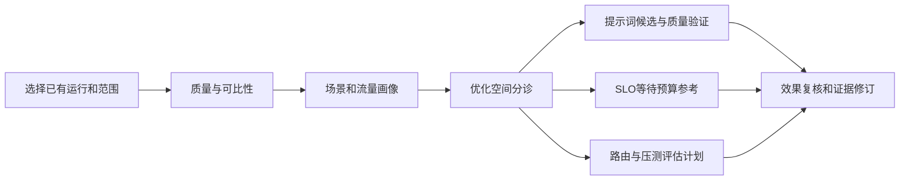

# TokenScope V3 产品设计初稿 r0

2026-11-04，待用户审阅。本文是讨论方案，不是冻结接口或实施授权。[研究依据](RESEARCH.md) · [七项矩阵](EVIDENCE_MATRIX.md) · [分期](ROADMAP.md)。不新增产品入口，保留用户监控、搜索与排行、异常分析、MA集群监控及已认可L4/L5；UIR-03仅列待讨论。

## 1. 产品目标与使用流程

业务负责人需要知道“我的业务是否值得改提示词，改哪里，是否影响结果”；平台运维需要知道“指标可信到什么程度，资源浪费/慢在哪里，哪个候选值得验证”；性能工程师需要可复现的负载、对照和通过条件。TokenScope输出证据与决策建议，自动改变生产流量、配额和实例数不属于MVP。

用户监控展示范围、质量、资源画像、高命中剩余工作量和SLO参考；搜索与排行按可改善绝对量/证据覆盖排序并显式标记估计；异常分析承接场景分诊和适配探测器，不替换L4/L5；MA承接来源可信度、可比性和路由损失评估。未知字段显示原因和补证方。点击页面只读已发布结果，计算通过独立显式任务提交。

## 2. 信息模型与状态

以下为概念对象，不创建JSON契约或数据库迁移：

| 对象 | 最小信息 | 兼容原则 |
| --- | --- | --- |
| Scope | run/源文件身份、appid或授权群组、模型服务/制品revision、Tokenizer/Template摘要、窗口/时区、共享域、算法/配置版本 | 不把Trace与MA别名模糊合并；复用既有身份 |
| Evidence | 来源/定位、观测时间与读取时间、样本/总体、分母、可用性、支持/反证、置信说明、被替代记录 | 原证据追加，不改写历史 |
| QualityFacet | 字段完整性、合法性、语义、关联、时间顺序、引擎校准、适用指标 | 各维度独立，缺失不补0 |
| Profile | 输入/输出分布、时间/突发、前缀与结构摘要、群组、漂移、标签来源 | 业务标签与结构猜测分开 |
| Assessment | 结论、证据、适用/已扫描分母、潜力区间、不可判定原因、下一步与责任方 | 无发现不直接输出低潜力 |
| EvaluationPlan/Result | 候选与基线、冻结输入、参数、预算、观测/代理指标、质量约束、停止/回退、版本 | 计划不冒充实验结果 |

结果可用性沿用现有生命周期，不用新的“已完成”掩盖partial。建议层增加语义状态：candidate、low_potential_supported、no_candidate_observed、not_applicable、insufficient_evidence、budget_limited；这些只是设计词汇，未来需公共层维护方统一评审，不直接写入冻结契约。

## 3. 七个候选功能的决策契约

### F1 数据质量与协议审计（MVP，覆盖V3-05）

**谁使用/决策**：采集负责人、MA运维；决定哪些指标能用、上游哪里补数据、是否允许跨来源比较。

**输入与可得性**：已发布quality/availability、来源清单、原字段定义可复用；注册协议、引擎计数语义及可靠关联ID待现场补充。当前DS旧数据cached缺失只能作为该版本历史事实，新报告后复核。

**输出与范围**：行数守恒、字段问题、逐指标有效分母、来源映射链、可比性检查表；cached“合法且语义未核验”不会升级为真实物理复用。可选逻辑上下界只在缺失P已知且同口径时提供。质量规则只阻断依赖该字段的结论，其他画像可继续。

**成本/成功/回退**：B0/B1预算；所有报告数可追溯到分母与排除集合，守恒误差0，合法0/缺失/无请求可区分，语义未知不得显示“已确认复用”。未来验收覆盖空列、超范围、重复重传、单位错、冲突时间、模型混配；无新增字段时读取原V2资源并展示“不支持此审计”，不重写旧结果。

### F2 场景与行为群组画像（MVP描述层，覆盖V3-01/03/07）

**谁使用/决策**：应用负责人、容量/路由工程师；判断业务混合、稳定性以及需要拆开的负载群组。

**输入与可得性**：现有P/H/C、输出数、appid/模型/时间可部分获得；模板族/工具密度需有界结构任务，语义标签需业务确认；真实并发需开始/结束端点，仅到达时间不推算。旧10appid标记为选择样本，不扩为总体。

**输出与范围**：资源、前缀、语义三轴画像；分位数/CDF/尾部/时间漂移；请求与Token权重并列。MVP使用透明分桶与人工标签，复杂聚类放后续，避免强行给每个用户分组。未知、低样本、混合保留；按模型/租户策略限制可分组范围。

**成本/成功/回退**：B1，结构采样B2。描述统计与既有数值一致；群组建议至少两个不重叠时间窗各200有效请求才进入稳定性候选（草案筛选值，不能证明长期稳定）。报告每组留出漂移与置信区间；无法满足时只展示观测窗。后续聚类需优于不分组的配方代表性或运营可解释性；仅轮廓系数好不算业务成功。过期画像降为历史，路由继续原策略。

### F3 优化空间分诊与探测器适配（MVP选择/解释层，覆盖V3-01）

**谁使用/决策**：应用开发者；决定继续提示词诊断、转SLO路径还是先补证。

**输入与可得性**：既有L1–L5/T2–T4结果、扫描遥测和结构摘要可复用；业务保留约定、会话关联、标注集未知。只在用户指定异常appid后处理相应正文。

**输出与范围**：适用探测器清单、覆盖/预算、候选和合法负例、未命中绝对量。低潜力需业务核验和有界上限证据；缺少候选不是低潜力。MVP不增加生产detector/recipe；下表定义未来候选验证材料。

**成本/成功/回退**：B2；每项建议可回到最小证据，误报可由合法负例复核，限额只截保留不伪报全量覆盖。试点中任何语义不明确改写不得标“可安全节省”；候选计量必须复用统一Tokenizer/Template。适配未知时保留现有结果和原诊断入口，页面明确未判断。

### F4 高命中剩余工作量与收益优先级（MVP代理层，覆盖V3-02）

**谁使用/决策**：业务/性能负责人；决定高命中应用是否仍值得投入，选择待校准场景。

**输入与可得性**：同口径P/H或prompt/cached可做对应来源的剩余量；逐请求TTFT/TPOT、队列和GPU/搬运指标未确认。两类命中不得拼成同曲线。

**输出与范围**：绝对剩余输入、目标提升情景、相对降幅、可校准范围。性能栏分成“未校准”“观测相关”“对照验证”；没有实测仅显示工作量，禁止95%绿线或自动memory-bound标签。评估优先看业务质量、绝对量与可实现性。

**成本/成功/回退**：B0/B1。算术边界及加权一致、样本数/缺失明确；把示例数据标成情景。后续曲线验证要求同硬件/模型/缓存层级对照，置信区间与重复测量，不以拟合拐点强制结论。无性能字段时仍可输出工作量卡片，旧命中指标保持原定义。

### F5 现有命中下的SLO/等待预算参考（MVP证据分级，覆盖V3-01/02）

**谁使用/决策**：SRE与应用负责人；判断目标与固定情景是否矛盾，选择下一项测量，后期才讨论准入率。

**输入与可得性**：现有W/SLO、K/τ用户参数可用；逐请求残余量是否已发布需接口核实。实际cached缺失时不得用ideal冒充actual。已测服务曲线、队列/端点、输出长度和到达过程当前不保证可得。

**输出与范围**：层A为用户假设下敏感性/等待预算，层B为校准范围内观测估计，层C才是受约束准入候选。MVP默认A；保留τ来源和K变更不缩放τ。不能从聚合命中、P90输入单点或相加分位数宣称P90 TTFT达标。预算<0输出“此情景无余量”；预算>=0也不保证排队可实现。

**成本/成功/回退**：B0/B1；无排队证据不得输出安全QPS/并发数。未来B/C在时间留出数据上验证分位数误差与区间覆盖，达标率同时计入失败/超时；阈值由目标SLO确定，不先写固定准确率。缺数据时回到现有V2参考计算，不要求重新输入已默认参数。不会自动生成限流配置。

### F6 可比性、路由损失与候选策略评估（分期，覆盖V3-03/06）

**谁使用/决策**：MA平台路由负责人；判断差距能否归因，选择少量KV-aware参数候选进入后续验证。

**输入与可得性**：现有MA UUID/时间/本地Token及availability部分可用；跨源ID、共享域、实际路由版本/队列/缓存事件缺口较大。没有可靠关联不比较用户80%与MA60–70%。

**输出与范围**：MVP只交可比性/缺口。后续同集合G/R/A分解和策略Pareto比较：复用代理、分配偏斜、迁移/冷启动、租户公平与真实SLO证据等级。基线包含当前策略、负载均衡、纯亲和、负载约束亲和；不只与故意弱的随机基线比。

**成本/成功/回退**：B3。离线按原时间顺序，预热和节点集合固定，只有过去信息参与决策；未知完成/驻留时延只能报乐观代理和敏感性。先要求原策略重放能解释已观测数据，否则停止推荐。后续真实性能试点的草案价值门槛为goodput增益下置信界>0且点估计≥5%，重点租户SLO不退化超过约定容忍度、失败不增；不是当前通过结果。失衡、漂移、索引过期或上下文边界触发原路由回退；策略版本与回退由平台维护。

### F7 真实负载配方、代表性与实例配比（配方MVP，覆盖V3-04/07）

**谁使用/决策**：压测、容量团队；选择测试负载和必要压力场景，有曲线后比较部署配比。

**输入与可得性**：已有长度/到达统计可给配方框架；当前压测脚本、输出/缓存联合分布、硬件服务曲线待补。8K为待验证观察，模板填“未知”而非造权重。

**输出与范围**：常态、峰时、长尾/冷启动三类配方；冻结时间/前缀关系和随机种子；逐维差异向量及遗漏说明。无服务曲线只输出覆盖与计划，不输出台数/成本节约。原请求复放和合成结构均需保留授权范围；脱敏展示无法重算真实Token时明确标注。

**成本/成功/回退**：B1/B3生成和校验配方，GPU实验预算另行测定。草案代表性筛选为关键分位数相对误差≤10%、联合桶总变差≤0.1，并强制保留P99+/突发；数值只是起始讨论，过线不等于性能等价。最终要求配方在同服务配置上复现实际SLO/负载曲线。缺资料时保留现压测并标覆盖局限；新配方不得删除极端压力用例。

## 4. 场景适配候选与质量约束

下列D编号仅为研究标签，不新增L/T生产编号，也不承诺改写可用。正负例均为设计用合成结构，非现场样本。

| 候选/适用分母 | 最小疑似正例 | 合法负例/不可判定 | 需要的验证 |
| --- | --- | --- | --- |
| D1 前部动态字段；同模板可解析请求 | 固定任务指令前有每次变化且业务声明不使用的请求追踪号 | 时间决定答案、权限/用户身份决定结果；字符串相似不证明可移除 | 标注字段必要性，比较改写前后模板Token、任务质量和时间留出前缀复用 |
| D2 工具集合/排列；含tools且版本/权限可对齐 | 相同工具定义集合无意随机排列 | 顺序影响模型选择；不同租户权限、tool_choice或版本 | 保留工具可用性及调用参数一致性；重排是实验变量，不能默认语义等价 |
| D3 Schema变体；同名工具同业务版本 | 自动生成器产生无意描述/格式漂移 | 描述更新修复错误、必填约束或类型改变 | 比较结构与源字节两个视角，业务确认后量化Token和任务通过率 |
| D4 messages组成/重复；可解析消息，跨轮需可靠关联 | 同一结果被拼接器重复加入且任务无需重复 | few-shot、引用、回顾、必要历史；无session时不可判断历史改写 | 标注角色、顺序、因果依赖；摘要/删减另设质量实验，不从重复字节直接算节省 |
| D5 非工具JSON/检索片段；普通消息含结构化内容 | 非工具接口把同文档包装层重复序列化 | JSON字符串为任务原文、字段顺序/转义是待处理内容 | 先统计结构，不能冒充tool_result；是否可改由任务语义决定 |

标注建议：业务方与分析方独立判断“结构事实、是否业务必需、候选改写是否允许”，分歧留unknown，不能强标正负。每候选目标至少120个确认候选和120个合法负例，若数据不足保留探索状态；按appid/模板族分组并按时间留出，不能把同一会话近邻随机拆成训练/测试。补充随机未触发样本估计漏检；人为富集样本的precision/recall不能直接推广总体。可讨论的候选上线门槛为留出precision的95%下置信界≥90%，同时报告适用分母、覆盖与召回；高风险删改需更严格业务标准。

质量不退化按场景定义：分类用任务准确率/混淆，抽取用字段精确率召回与格式合法率，文本整理需事实/保留约束，工具链用任务成功及权限/调用有效性。设定非劣界、功效/样本量后才做改写对照；本轮不调用模型、不实现recipe。Token减少、缓存增加和输出质量是三个独立结果。

## 5. 成本预算与可恢复性

以下为未来试点的**候选硬上限**，并非已实测资源需求或本轮执行授权。先由实际余量和小批成本修订，不得因表格数字自动扩大数据范围。

| 档位 | 工作/上限草案 | 停止及输出 |
| --- | --- | --- |
| B0 已有汇总 | 每任务最多1000个scope，1 CPU核、峰值RSS512MiB、墙钟2min、结果20MiB；新增Tokenizer调用0 | 范围过大分页/分批；返回已处理scope和余量 |
| B1 流式画像/质量 | 每批最多100万条既有数值/元数据或2GiB读入，2核、RSS2GiB、30min、派生产物1GiB；不重新编码正文 | 任一限额触发partial；分位数注明近似误差；按稳定游标续做 |
| B2 结构与候选 | 单批最多10个已授权scope，每scope≤200结构样本、20MiB正文；总≤2000条/200MiB；2核、RSS2GiB、20min、输出100MiB；每候选≤2万比较，总≤10万；单条>1MiB单列超限 | 扫描/候选/比较/保留分别计数；证据每候选≤50条，不因保留满即声称全覆盖；新增编码默认0，未来改写验证另限≤2000次 |
| B3 离线回放/配方 | 原时间窗内≤10万请求，≤4策略×3参数候选（含基线），2核、RSS4GiB、60min、磁盘4GiB；复用现有token shard | 保存策略/输入/seed/游标；预算耗尽不外推全量；实际账本过大则缩小预先声明范围 |

规模先估计 `N×每行成本`、`总Token×每Token成本`、`候选数×比较成本` 和账本增长，报告小批统计的范围与峰值；相关性/长尾可能使线性外推失效。B1需要读取原正文才能产出的字段自动转B2，不能藏在元数据任务中。GPU压测不在上述预算内，需要模型装载、时长、并发、成本和停止标准独立计划。

缓存派生结果的身份至少包含源摘要、模型/模板、算法/配置、窗口和共享域。失效只创建新结果；旧运行继续可读。预算不足、取消、崩溃恢复不能把部分分母当总体。MVP先复用现有异步任务/结果发布机制，是否新增公共字段由未来公共层评审决定。

## 6. 无新增现场数据时的首版展示样例

以下是产品文案示例，数值为空且不对应任何真实appid：

> 范围：应用A × 服务M × 模板族未知 × 窗口W。结构证据：不足。已报告缓存：来源语义未核验。优化结论：尚不可判断。下一步：确认模板与字段来源；如已有授权的异常样本，再核查前部变量和工具/消息差异。SLO栏：沿用用户τ假设，可查看等待预算敏感性，暂不能给准入率。

对已确认低潜力的范围，显示“本窗口、已覆盖规则下可改善输入量较小；业务必要字段已核验”，附置信范围和复核时间，提供SLO评估路径。对高命中范围展示剩余绝对量与85→95等用户选定情景，不把情景当可实现目标。

## 7. 本轮待用户审阅的产品取舍

建议MVP先做F1、F2描述层、F3适配解释、F4工作量层、F5假设/证据分级、F6可比性、F7配方框架。重点审阅：这是否符合当前业务决策优先级；“低潜力”的业务确认责任；是否接受性能证据不足时只给补证/实验方案；预算起点是否适配现场。UIR-03另行讨论其具体用户问题和验收，不作为上述能力的先决阻断。
