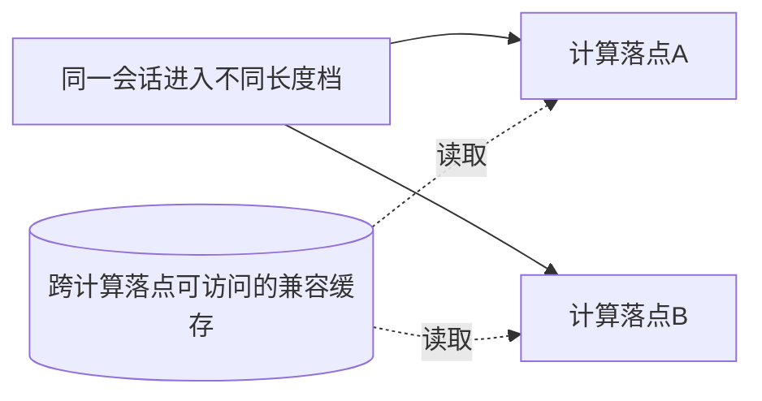

# DeepSeek长度调度、共享KV与独立MA的边界

2026-11-14，V4产品研究补充；本人session `01a1d3e3-0c34-7320-bf6f-14438c120aed`。范围为机制解释与适用条件，不形成实现方案、试验指令或新任务分派。接续[六类供应商调研](MAAS_ROUTING_RESEARCH_20261114.md)。

**核心判断：当缓存可访问范围覆盖多个计算落点，长度分档可以调整计算落点而保留前缀复用机会。我们当前同一MA内具备池化基础，跨独立MA没有同等共享条件。** “保留机会”不等于每次全命中、零读取成本或无须重算。

## 公开事实及版本边界

本轮主依据是DeepSeek官方DeepInfer的V4.1 Flash部署Q&A，按2026-11-14访问的main内容；旧V4报告及DualPath研究分别标注，不能合并冒充一套已在华为0731运行的系统。官方链接的知乎文章本轮返回403，未作为已读依据。

| 来源 | 本轮提炼及定位 |
| --- | --- |
| [V4.1部署Q&A](https://github.com/deepseek-ai/DeepInfer/blob/main/doc/inference_deployment_qa.md) | Prefill按上下文分四档并随计算需求调配引擎；块KV放3FS，SWA状态另走内存目录与远程读取。路由前查前缀元数据，数据读取与入显存异步衔接；状态缺失仍可能重算。详见Data-parallel load balancing、KV cache storage及KV cache hits and recomputation。 |
| [3FS官方仓库](https://github.com/deepseek-ai/3FS) | SSD与RDMA组成共享存储，公开资料明确将KV缓存作为用途。文件系统能力不等于完整推理缓存服务；它不能单独提供模型前缀匹配和引擎恢复语义。 |
| [DeepSeek-V4报告§3.5.2](https://arxiv.org/html/2606.19348v1#S3.SS5.SSS2) | 对压缩块与SWA采用不同缓存管理，未完成压缩的尾部仍需处理。这是旧V4材料，用于解释缓存结构并非单一连续对象，不代替V4.1状态路径。 |
| [DualPath论文§4–6](https://arxiv.org/html/2602.21548v1) | 作者含DeepSeek团队，研究共享存储读取饱和问题，允许经P侧或D侧读取再传递，并结合计算/读队列调度。说明缓存命中之后仍有I/O瓶颈；不据此断定V4.1所有生产请求均走该双路径。 |

## 机制解释：分档不必切断缓存

下列为依据公开机制构造的说明性例子，不是现场测量：某会话上一轮在计算节点A处理，本轮追加内容后进入更长的长度档，由节点B处理。

- 若旧前缀数据只存在A所属的独立缓存域，B不能读取，迁移就可能导致重复计算。
- 若A、B都能查到并读取同一份兼容缓存，换档改变的是计算资源分配；B仍可以恢复旧前缀，再处理需要新增或恢复的部分。
- 新增长度、当前完整上下文、缓存读取和状态恢复均可能产生开销，不能把“命中长度”直接换算成等比例的耗时下降。

这是原理图，不是DeepSeek的完整部署拓扑。**长度档位、P/D计算节点、缓存可访问范围是三件事。** 多档请求可以共享缓存；一个档也可能跨多个节点。公开Q&A所述的prefill调度档不能直接对应我们GB的整套MA规格。

还需区分跨请求的前缀复用与同一次请求的P→D状态传递：前者让下一轮少算旧输入，后者让本轮生成可以继续。具备其中一种传输路径，不能推定另一种已覆盖跨MA。

## 与GB、GF、motor、MA逐层对照

以下本地事实来自[MAAS_REFERENCE](../../architecture/MAAS_REFERENCE.md)的用户说明及本轮用户补充；当前配置和量化影响仍须由实际证据支持。本文不改写原架构参考。

| 当前位置/边界 | 已知条件 | 可借鉴的判断原则 | 不能据此推出什么 |
| --- | --- | --- | --- |
| GB选择MA UUID | GB负责规格分流、排队和集群路由；跨MA缓存不互通 | 跨MA改变落点时，把复用损失和拥塞共同纳入价值判断 | 不能因DeepSeek无需前缀亲和，就让GB忽略缓存落点 |
| GF与独立motor | 两者承担MA内部路由，具体接口顺序不在参考中冻结 | 同一缓存域内，可把计算均衡与前缀是否存在分开理解 | 不能把motor写成GF内部模块，或认为GF能修复其他MA的负载不均 |
| 一个MA内的P节点 | 同UUID内P可通过池化复用前缀，跨appid也可共享 | 这是与共享缓存思路最接近的现有基础；保持缓存域不必固定某个P | 不能保证所有P任意时刻读取延迟相同或每次都命中 |
| 各MA的D资源 | 各MA包含自身P/D资源 | 区分输入复用收益与生成负载；P轻不代表D有余量 | 不能只比较请求数或输入总长就判断整套MA承载能力 |
| 32K/64K/128K规格 | 历史说明为同部署方案、不同流量长度；GB用模板前JSON长度 | 分清服务标签、计算压力与实际模型输入长度 | 不把历史标签当当前物理上限，也不直接套DeepSeek长度阈值 |

因此，现有MA内部与跨MA之间应分别分析。将两层都理解成普通负载均衡，会遗漏跨域重算；将两层都强制固定同一节点，也可能放弃已有池化带来的调度空间。

## 可借鉴与条件不足

**现在可以借鉴的是分析方法：**先确认缓存域，再讨论路由；分别看prefill计算、decode压力与数据读取；把连续上下文的跨档迁移作为潜在损失来源；以业务成功任务/卡分钟判断总体收益。以上不要求本轮选择算法或部署方式。

**已明确不具备的条件：**按用户描述，独立MA之间没有可直接复用的共享KV数据路径。GB掌握请求、长度或缓存位置索引，都不能自动让另一个MA取得实际KV数据。仅把Redis信息汇总起来也不等于共享缓存。

**尚未证实、不能按已具备处理的条件：**跨MA网络与存储能否承受读取压力；是否有统一且兼容的缓存身份/目录；不同实例的模型、精度、布局和状态恢复能否一致；计算侧是否支持相应数据读取；是否存在跨独立P/D资源的协调能力。MA内部使用高速互联不自动证明跨MA也具备同等条件。

机房不同不是逻辑上绝对不能共享的证明，但真实互通、带宽、延迟和故障条件决定共享是否划算。用户指出的物理隔离应作为具体约束，不能凭厂商架构图忽略。

“减少MA、扩大MA内部资源”可能扩大已有可复用范围，但同时改变容量分配与故障影响，不等同于完成计算与存储解耦，也不能推出10P5D最佳。

## 对场景分流的进一步判断

场景标签可以帮助识别复用关系和不同服务目标；在没有跨MA共享时，把相关上下文保留在可承载的同一缓存域内，具有明确的探索理由。是否需要硬分池、怎样退让负载、能改善多少，仍取决于真实流量。

agentic/chat不代替输入、输出与真实前缀证据；混合appid仍可能需要细分。同一模板跨场景共享时，硬分池也可能复制缓存。DeepSeek提供的启发是将业务策略、计算调度、缓存边界分开判断，不能将其简化为“应该取消长度分流”或“应该完全不看亲和”。

本轮不定义实现接口、权重、长度阈值、XPYD配置或重放步骤，不调整正在执行的四份探索prompt；prompt-3仍按用户决定待报告讨论。
