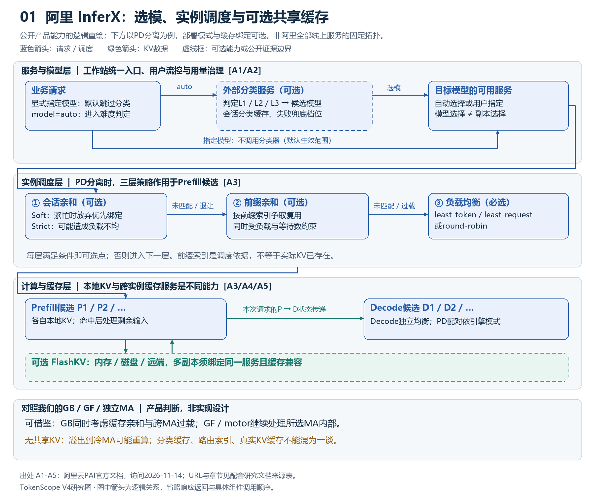
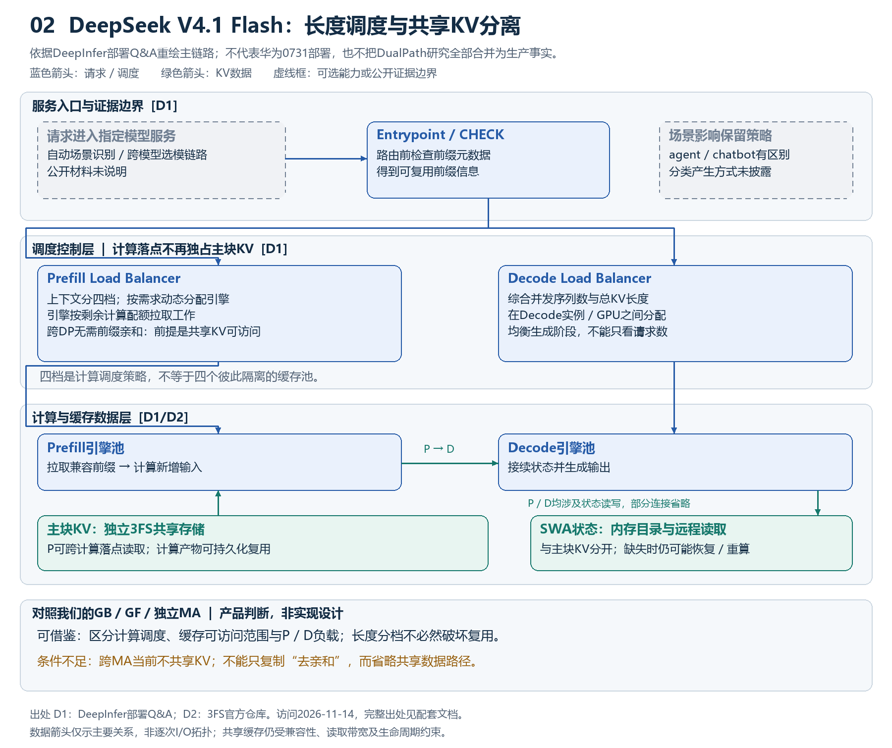
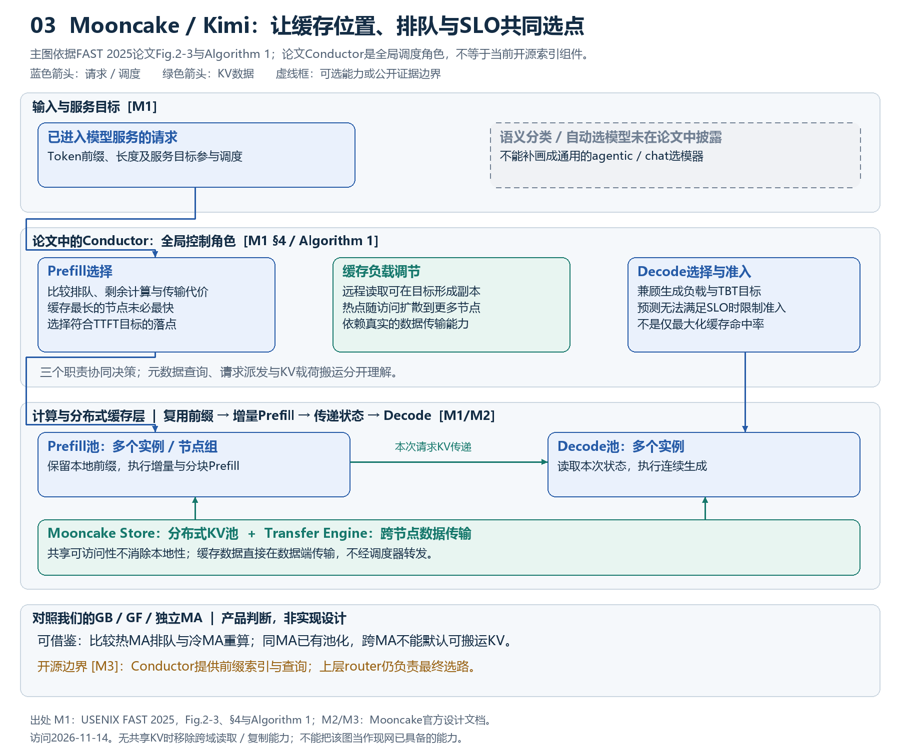

# InferX、DeepSeek、Mooncake／Kimi：架构调研与现网MaaS对比

2026-11-14｜读者：AI Infra／MaaS服务提供方｜V4产品研究

2026-11-15按用户新分工，本正文由[MaaS架构与试点副本](maas/ENTRY.md)维护：先讨论简单试点，有初步结果后形成场景分类MaaS网关待同事粗评材料。旧暂缓判断的依赖条件按[三线协作](SESSION_COLLABORATION_20261115.md)衔接，Tokenization仍pending；主会话负责审核与汇报整合，不据fork启动实施。

本人session：`01a1d3e3-0c34-7320-bf6f-14438c120aed`，已从本机环境复核。本文完成用户指定的第一份准备材料：三种整体架构、三张架构图、无共享KV时的热点问题，以及与GB、GF、独立MA的对照。**用途是为后续架构设计建立依据，不是实施方案。** 不选定算法参数、模型替换名单、资源池边界、MA数量或XPYD比例。

用户已认可的判断作为共同前提：**保留场景大标签，同时识别重要工作流步骤；让场景表达服务需求，让缓存位置和实时工作量参与实际承载决策。** 2026-11-15用户确认本文与[现网流量研究](PRODUCTION_TRAFFIC_STUDY_20261114.md)为高优先级长期正文，原始证据与专题研究为重点支撑，§7–8保留直接链接；[长期资料路由](V4_REVIEW_PACKAGE_20261115.md)已固化。[P2核对](HUAWEI_P2_REVIEW_AND_PILOT_INPUTS_20261115.md)是次高优先级先行试点，不代表整体架构。下一项仍优先简单试点设计，未来MaaS形态与Tokenization成本讨论暂缓，prompt-3未生成。已有分桶／选模／编码判断保存在§9。

## 1. 结论与阅读方式

三种架构分别解决不同层次的问题，可以互相补充，不能简单选择其中一张整图照搬。

| 参考对象 | 最值得理解的整体思路 | 对当前独立MA最直接的启发 | 不能顺带假定 |
| --- | --- | --- | --- |
| InferX | 企业统一入口、任务难度选模、模型内实例调度、可选共享缓存分别承担职责 | 亲和有边界，过载可以退让；业务指定模型与自动选模可以并存 | 所有部署都有FlashKV，或分类档位能代表完整业务场景 |
| DeepSeek V4.1 Flash | 用可访问的共享主块KV，使计算落点主要围绕计算需求调整 | 计算池边界和缓存域边界应分开分析；同MA内池化已提供部分基础 | 在跨MA不共享时也可以去掉缓存亲和；0731具备V4.1全部机制 |
| Mooncake／Kimi | 将缓存位置、传输、排队和计算共同纳入服务目标 | 热节点不一定最快；要分清计算热点和缓存读取热点 | 当前开源组件就是论文中的完整生产调度器，或有目录就能跨MA搬运KV |

图中蓝线表示请求或调度关系，绿线表示KV数据关系，虚线框标识可选能力或公开证据边界。图是依据原始资料重绘的逻辑图，省略响应返回、逐次I/O和非本问题核心模块；不是厂商提供的部署蓝图。图内来源编号对应第8节，图旁提供PNG与可编辑SVG。

必须分开的四个问题是：**场景/步骤需要什么服务，哪些模型被允许执行，哪个缓存域能复用，哪里有足够承载能力。** 场景相同不保证前缀相同；模型名相同不代表同一场景；共用缓存服务不代表不同模型权重可以共用KV张量。

## 2. 阿里InferX：从企业策略到实例调度

[原尺寸PNG](figures/maas-architecture-20261114/inferx.png) · [可编辑SVG](figures/maas-architecture-20261114/inferx.svg)。依据[A1](https://help.aliyun.com/zh/pai/inferx-overview)、[A2](https://help.aliyun.com/zh/pai/inferx-smart-model-selection)、[A3](https://help.aliyun.com/zh/pai/inferx-config-center)、[A4](https://help.aliyun.com/zh/pai/inferx-kv-cache)、[A5](https://help.aliyun.com/zh/pai/create-and-manage-inference-services)。图以PD分离为例，不表示InferX只支持PD分离。

### 2.1 服务策略与模型选择怎样衔接

InferX以工作站统一入口管理推理服务、用户流控与用量；模型服务也可保留独立入口。智能选模是其中一项可配置能力，不能把整个工作站等同于分类器。[A1](https://help.aliyun.com/zh/pai/inferx-overview)、[A5](https://help.aliyun.com/zh/pai/create-and-manage-inference-services)。

选模功能调用外部分类服务判断L1/L2/L3难度，再选择该档候选模型。默认仅`model=auto`触发，指定模型沿原路由。会话分类结果可以复用，支持周期重判与不降档；失败可落到默认档位。[A2，功能概述／高级设置／异常处理](https://help.aliyun.com/zh/pai/inferx-smart-model-selection)。

**产品判断：**这为企业共享服务提供了渐进空间——明确依赖指定模型的业务保留其约定，允许代选的任务再进入选模。但L1/L2/L3表达的是能力需求档位，不是我们的完整业务标签；“合同审查”“员工助手分类步骤”“Agent规划”仍需自己的业务证据。复用分类结果可以减少额外开销，却可能错过同一会话内任务难度的变化，不能无条件保持。

还有三个不同的“缓存”：分类结果缓存减少分类调用；路由前缀索引帮助估计落点；引擎或FlashKV保存真正的KV张量。前两者命中，都不能直接记为生产KV命中。保持同一分类档位，也不保证永远选择同一个候选模型或同一实例。

### 2.2 实例选择与无共享KV时的热点

配置文档的主策略为会话亲和、前缀亲和、负载均衡逐层处理；前两层可选。Soft会话亲和可因繁忙退出，Strict可能失衡；前缀层也受负载与等待数约束。兜底可按Token负载、请求数或轮询选择。PD分离时主策略用于P，D独立均衡。[A3，调度策略](https://help.aliyun.com/zh/pai/inferx-config-center)。

**对无共享KV的解释：**请求优先回到有缓存的实例，但这份优先权不是无限的。若热实例排队代价过大，去其他兼容实例可能更快；目标没有前缀时需要重算。这样牺牲部分单次命中，换取热点缓解与整体完成效率。它不是缓存无损迁移，也不保证每次都获得最高命中。

对我们的对应关系是：GB不能把全部跨MA负载问题留给GF。只有在GB已经选择了合适的MA以后，GF／motor才有机会利用该MA内部资源。场景标签有助于明确请求的等待容忍度和服务目标，但尚不能代替这层负载判断。

### 2.3 有共享KV时有什么变化

InferX可选绑定FlashKV，将KV分层保存并供绑定服务跨副本复用；这是独立的缓存服务能力，不是默认具备的路由属性。[A4，工作原理](https://help.aliyun.com/zh/pai/inferx-kv-cache)、[A5，缓存服务选项](https://help.aliyun.com/zh/pai/create-and-manage-inference-services)。

**产品判断：**有可读取的兼容缓存，离开原计算节点的重算代价才可能降低，调度自由度随之扩大。但还要付出读取、传输及恢复代价；同一存储服务里的多模型对象仍有兼容边界，不能解释为不同权重之间共享同一份KV。

文档总览用“四级”概括缓存调度能力，而配置中心明确列“三层主策略”；本文的具体流程以配置中心为依据，将FlashKV画为独立数据能力，未自行增加一个未经说明的第四级路由算法。[A1](https://help.aliyun.com/zh/pai/inferx-overview)、[A3](https://help.aliyun.com/zh/pai/inferx-config-center)。

## 3. DeepSeek：共享可访问性怎样改变长度调度

[原尺寸PNG](figures/maas-architecture-20261114/deepseek.png) · [可编辑SVG](figures/maas-architecture-20261114/deepseek.svg)。主链路依据[D1](https://github.com/deepseek-ai/DeepInfer/blob/main/doc/inference_deployment_qa.md)，存储背景依据[D2](https://github.com/deepseek-ai/3FS)。范围是公开的V4.1 Flash说明，不套作华为DeepSeek-V4-Flash-0731。

### 3.1 场景与模型层：已知和未公开的部分

官方Q&A区分agent与chatbot的缓存保留策略，但未说明这些标签如何自动识别，也未披露一个通用的“先分类、再跨模型选择”入口。因此图中保留这层证据空白；不能补成已实现的两类场景物理分池。[D1，KV cache storage](https://github.com/deepseek-ai/DeepInfer/blob/main/doc/inference_deployment_qa.md)。

**产品判断：**场景可以影响数据生命周期，而不必直接划断计算资源。这是一个有用的反例：场景分流不只有“把请求发给另一个池”这一种表达方式。其具体保留时间是DeepSeek自身负载的选择，不直接作为本项目要求。

### 3.2 从请求到计算、再到缓存

Entrypoint先检查前缀元数据；P按上下文档位和计算配额调度，档位内引擎数随需求变化；主块KV在独立3FS池，P可读取共享前缀，因此跨DP不要求前缀亲和。D单独考虑并发序列与总KV长度。SWA状态另有内存目录及远程读取／恢复机制。[D1，Data-parallel load balancing、KV cache storage](https://github.com/deepseek-ai/DeepInfer/blob/main/doc/inference_deployment_qa.md)。

3FS是支撑共享读写的分布式存储基础，结合SSD与高速网络；它本身不是业务分类器，也不是完整的模型前缀语义管理器。[D2，项目介绍与KV cache用途](https://github.com/deepseek-ai/3FS)。

**机制解释：**某请求从一个长度档进入另一个档，改变的是计算落点；只要新落点仍能读取兼容的前缀，旧计算结果就不必因换档失效。它把“谁计算”与“谁拥有唯一缓存”之间的绑定放松了。命中仍有读取和恢复成本，不能称为零开销，也不能将命中率直接折算成同等比例的任务收益。

共享KV不会自动消除热点，只会改变热点可能出现的位置。DeepSeek团队参与的DualPath研究讨论了共享存储读取路径饱和，研究如何利用P侧、D侧的读取资源。这说明网络／存储仍可能成为瓶颈；本文不把该论文所有机制当作V4.1全部生产请求的既成路径。[D3，§3–6](https://arxiv.org/html/2602.21548v1)。

### 3.3 如果没有跨MA共享KV，哪些结论不再成立

这属于针对现网约束的推演，不是DeepSeek公开的另一套无共享生产方案。

- 计算落点不能再无视缓存归属。把有前缀的请求交给冷MA，可能需要重新Prefill；去掉亲和的关键前提已不存在。
- 同MA内部已有池化时，仍可借鉴“在共享范围内灵活选计算节点”的原则；不必把亲和固定到一个P节点。
- P与D的负载应该分开理解。P因为命中变轻，不代表D能够接受更多长输出，或整个MA还有容量。
- 不共享的原因可能涉及部署边界、网络与物理隔离；有全局缓存目录不代表数据能跨域读取。

因此，对DeepSeek最值得借鉴的是**先确认缓存可访问范围，再决定哪些计算调度可以自由移动**。单独复制“按长度调度、不做前缀亲和”，不能获得相同结果。

## 4. Mooncake／Kimi：缓存、计算与排队共同决定落点

[原尺寸PNG](figures/maas-architecture-20261114/mooncake.png) · [可编辑SVG](figures/maas-architecture-20261114/mooncake.svg)。主图是[M1，FAST 2025 Fig.2–3与Algorithm 1](https://www.usenix.org/system/files/fast25-qin.pdf)的机制重绘；现有开源组件边界另据[M2](https://kvcache-ai.github.io/Mooncake/design/architecture.html)、[M3](https://kvcache-ai.github.io/Mooncake/design/conductor/conductor-architecture-design.html)说明，不混成同一版本。

### 4.1 论文里的完整服务链路

论文Conductor协同选择P/D：结合前缀位置、排队、Prefill与传输成本评估落点，并检查TTFT/TBT目标。P读取可复用KV、完成增量计算，再将状态交给D；热点KV可复制到其他节点。预测不能满足SLO时涉及准入限制。论文未披露通用语义分类或跨模型选模链路。[M1，Fig.2–3、§4、Algorithm 1](https://www.usenix.org/system/files/fast25-qin.pdf)。

**机制解释：**缓存最多的节点可能排队最长，空闲节点也可能重算最多。需要判断的是整个请求获得服务的代价。除了计算热点，保存热门KV的节点也可能因为大量读取而拥塞；把请求分散出去但仍全部读取同一来源，并没有消除读取热点。

这与一个完全独立的中央SSD池不同：Mooncake论文展示由节点侧CPU／DRAM／SSD资源组成的分布式池，跨节点传输使这些缓存能被复用。共享是可访问范围的性质，不要求所有数据物理放在同一处。

### 4.2 现有开源组件各自做什么

当前官方架构将控制与数据分开：Store Master维护对象位置与状态，载荷通过Transfer Engine在数据端直接传输；这些组件与vLLM/SGLang等引擎组合，并不替代引擎全部调度。[M2，Design principles、Core components](https://kvcache-ai.github.io/Mooncake/design/architecture.html)。

当前开源Conductor接收缓存事件、维护按上下文区分的前缀索引，回答各实例／层级的可复用前缀；上层router查询后负责最终选点。[M3，Overview、Data model、Query flow](https://kvcache-ai.github.io/Mooncake/design/conductor/conductor-architecture-design.html)。

**产品判断：**“知道缓存在哪里”“能够读到缓存”“结合负载决定去哪”是三项能力。我们的MA内部使用Mooncake，不能自动证明GB拥有论文中的全局调度能力；部署Conductor索引也不能自动获得跨MA数据传输或完整SLO策略。

### 4.3 无共享缓存时如何看热点

需要先把“没有共享KV”说清楚：

| 真实条件 | 能做的缓存动作 | 热点问题的性质 |
| --- | --- | --- |
| 没有统一存储，但节点间可读取／复制对方KV | 可进行远程复用、在目标保留副本 | 逻辑上已有跨节点共享能力；仍需权衡源节点带宽、复制成本与计算负载 |
| 只有统一目录，MA之间不能传输KV | 只能选持有者，或者到其他MA重新计算 | 全局可见不等于全局可用；目录本身不能解除热MA瓶颈 |
| MA内共享，跨MA独立——当前讨论前提 | MA内可跨P复用；跨MA只有目标已有缓存时才可能直接命中 | 两级调度面对不同代价，不能把所有P与所有MA当成同一种实例 |

在后两种情况下，仍能借鉴Mooncake的决策思路：比较热MA等待与其他MA重算后的完成代价。但不能宣称通过“复制热点KV”解决跨MA热点，因为相应数据路径不存在。冷MA独立重算后也可能形成新的热副本，那是以额外计算与容量换取分散，不是搬运已有KV。

**资料核对说明：**M1的§4.2文字对一次传输／重算比较的方向表述与直观解释存在歧义；本文以Algorithm 1明确展示的传输＋排队＋Prefill评估及前缀阈值分支理解机制，不提炼成未经澄清的单一不等式或实现规则。原论文不改写。

## 5. 三种架构怎样回答同一组问题

下表是对前述来源的比较归纳；“未披露”不表示厂商没有该能力。

| 维度 | InferX | DeepSeek V4.1 | Mooncake／Kimi |
| --- | --- | --- | --- |
| 场景如何进入策略 | 难度分类、企业配置；难度不等于完整业务语义 | 场景影响缓存保留；自动识别方式未披露 | 服务目标与负载参与调度；语义分类方式未披露 |
| 模型如何选择 | 指定模型与可选智能选模 | 所读部署材料针对既定模型，不证明通用选模 | 所读论文针对推理调度，不证明通用选模 |
| 缓存亲和与负载怎样协同 | 亲和层受负载约束，不能满足时向均衡退让 | 主块KV跨P可读，计算调度可减少对原持有者的绑定 | 综合本地/远端前缀与排队、传输、计算代价 |
| 共享缓存的位置 | FlashKV是可选能力；路由不能替代数据服务 | 独立3FS主块KV＋单独的状态路径 | 分布式池与跨节点传输，保留局部性和副本 |
| 长度怎样参与 | 文档不证明统一的长短硬分池；引擎容量仍需满足 | 计算按长度分档，资源随需求调整 | 对长上下文有分块流水等处理，不能据此称为固定长短MA池 |
| 缺少跨域KV数据路径时 | 亲和退让仍可用，但可能增加重算 | 去亲和的前提不成立 | 远程读取与复制热点不可直接使用；代价比较思路仍有用 |

三者共同启发是让**业务目标、计算调度和缓存范围分别有清楚的含义**。它们并未提供“按appid分为agentic/chat后即可同时解决命中与均衡”的证据。

## 6. 与现有GB、GF、独立MA的对照

现网基准来自[MAAS_REFERENCE](../../architecture/MAAS_REFERENCE.md)，为2026-10-30用户提供的架构与字段说明，加上用户本轮对独立MA及物理隔离的补充。不是本轮重新读取生产配置所得。逻辑链是：**AI鉴权入口 → GB的限流／排队／规格与MA选择 → 某MA的GF＋独立motor → 该MA内P/D与Mooncake池。** GF与motor的准确调用顺序未在该参考中冻结。

| 当前位置／能力 | 三架构带来的比较视角 | 值得借鉴的原则 | 当前证据或条件的限制 |
| --- | --- | --- | --- |
| 企业多appid共用模型服务 | InferX有企业治理和选模层；另两者主要回答选定模型后的执行 | 区分租户、业务场景、工作流步骤、模型约定 | appid不是天然单场景；不能仅凭输出短认定可降模型 |
| GB负责跨MA路由 | InferX把亲和与过载放在同一调度范围；Mooncake关注完整选点代价 | 选MA时同时看复用机会与承载压力 | GF不能解决另一个MA空闲而当前MA拥塞的问题；GB当前可用的实时信号需证据 |
| 32K/64K/128K规格 | DeepSeek说明长度调度与共享KV可并存 | 分清引擎硬容量、服务标签、计算分档与缓存域边界 | GB原始JSON分词与模板后输入Token口径不同；旧“相同部署”描述不能代替当前配置 |
| 同MA内跨P池化 | DeepSeek／Mooncake在共享范围内灵活分配计算 | 亲和的对象可以是缓存域，不一定是具体P | 同MA可共享不代表各P读取代价完全相同；历史3P3D不是本轮确认的全部配置 |
| 跨MA缓存独立 | InferX无共享时的过载退让，及Mooncake的成本判断 | 识别跨域后是命中、重算还是实际搬运，分别计价 | 目前不能假设跨MA兼容KV通路；Redis路由信息不等于共享张量 |
| GF／motor与P/D | 三架构都区分执行阶段或实例内调度 | 输入复用收益、生成负载、KV占用不能压成一个req/s | GF不等于motor；本轮不重定义其接口／职责，不给出P/D配比 |
| 热点治理 | 计算队列、缓存源读带宽、容量淘汰是不同问题 | 先确认热点类型，再判断亲和、分散或共享是否有帮助 | 缺少现场分项证据时不能将全部低命中归因于GB，或承诺共享池必然改善时延 |
| 服务结果 | InferX的企业SLO与Mooncake的有效吞吐提供参照 | 目标仍是满足质量与SLO的任务／卡分钟，命中率解释重复计算 | 现有请求hash不等于任务ID；GF口径TTFT不包含GB排队；论文TBT不等同现网TPOT |

### 6.1 对“无共享KV热点”的共同判断

在既定兼容与服务约束内，至少存在三种不同选择：继续等热MA；去另一台已经有相同前缀的MA；去冷MA重新计算。三者的优劣会随队列和工作量改变。若全体候选都已饱和，路由只能重新分配压力，不能创造容量；还涉及租户公平、排队和准入，但本轮不决定具体策略。

场景标签可以说明业务对质量、时延与连续性的要求；缓存关系说明哪些请求值得集中；实时负载说明集中到哪里、何时必须退让。这些是后续方案需回答的问题，不是本轮要求开发实现的路由流程。

### 6.2 当前可借鉴与尚不具备的条件

可以先借鉴：服务策略与选模分开；缓存亲和保留负载退出条件；分别理解P/D与读缓存成本；观察同一上下文跨长度档、跨MA时的复用变化；明确调度索引与实际KV的区别。

不能按已具备处理：跨MA统一且兼容的KV数据路径、足够的网络／存储读带宽、跨域状态恢复、完整的全局实时负载视图。物理距离或隔离意味着必须按实际网络条件判断，不能只根据厂商拓扑图推断。

扩大单MA内部资源或减少MA个数，可能改变可共享范围，也改变故障影响和容量分配；它们都不是“共享缓存”或“场景路由”的同义词。本轮不据此选择10P5D等配置。

## 7. 材料状态与后续讨论顺序（2026-11-15更新）

| 材料／活动 | 当前状态 | 用途与边界 |
| --- | --- | --- |
| 本文：三架构调研与对比 | 用户确认高优先级正文；3张PNG/SVG及已有讨论记录 | 长期架构参照，不作为实施批准 |
| [现网流量研究](PRODUCTION_TRAFFIC_STUDY_20261114.md) | 用户确认高优先级正文 | 三份华为回传＋四象限HTML，解释企业业务、调用需求、占比与治理候选 |
| [P2核对与试点输入](HUAWEI_P2_REVIEW_AND_PILOT_INPUTS_20261115.md) | 用户确认次高优先级，作为架构演进先行试点 | 支撑简单试点设计，不代表整体MaaS；引用与容量推断缺口仍保留 |
| [长期资料入口](V4_REVIEW_PACKAGE_20261115.md) | 已按用户评审意见固化层级、路由和内容 | 两份正文＋重点证据／专题支撑＋次高优先级试点，不再待同项批准 |
| 未来MaaS形态／资源池／Tokenization成本 | **pending**，保留结论，不继续展开设计 | 不由研究自动推出分池、选模、容量或编码实现决定 |
| MaaS prompt-3 | 未生成 | 数据整理、重放与采集安排等下一轮试点设计讨论后再定 |

证据入口保持原件：[阶段1混合场景](../../huawei/HUAWEI_V4_P1_STAGE1_MIXED_SCENARIOS.md)、[阶段2长尾](../../huawei/HUAWEI_V4_P1_STAGE2_LONG_TAIL.md)、[阶段3输出分布](../../huawei/HUAWEI_V4_P1_STAGE3_OUTPUT_HISTOGRAMS.md)、[四象限HTML](../product-v3/promotion/quadrant-detail/dist/index.html)。此前的数字与引用边界见[综合研究第7节](ENTERPRISE_MAAS_ARCHITECTURE_RESEARCH_20261114.md)，后续仍需区分理想H、实际命中、时延、样本与全量。

[MA流量画像HTML](../../huawei/MA_TRAFFIC_PROFILE.html)已接收为**高优先级证据**，页面范围为Qwen-V3.6-27B、32K/64K/128K、2026-10-20 08:00–09:00 UTC的UUID画像与探索性聚类。文件摘要及原回传／附件缺口见[接收记录](../../../artifacts/reviews/v4-doc-review-20261115/ma-profile-receipt.json)。本轮仅登记来源范围，尚未据其形成架构结论，不与DeepSeek试点混为同一集合。

## 8. 来源、版本与图中依据

统一访问日期：2026-11-14。仅使用官方产品文档、官方仓库／设计文档、作者论文。商业文档说明公开能力，不证明所有客户的默认生产配置；论文描述当时架构，不自动等于2026年Kimi全量现网。在线main/文档后续可能变化。

| 编号 | 一手来源 | 具体定位／支持范围 |
| --- | --- | --- |
| A1 | [InferX概述](https://help.aliyun.com/zh/pai/inferx-overview) | 核心功能：工作站、路由、用户、存储与观测；整体平台边界 |
| A2 | [InferX智能选模](https://help.aliyun.com/zh/pai/inferx-smart-model-selection) | 功能概述、高级设置、异常处理；选模范围、会话分类缓存、兜底 |
| A3 | [InferX配置中心](https://help.aliyun.com/zh/pai/inferx-config-center) | 调度策略、前缀索引、PD分离；三层策略与过载保护 |
| A4 | [InferX KV Cache服务](https://help.aliyun.com/zh/pai/inferx-kv-cache) | FlashKV工作原理与绑定共享；不证明跨权重KV兼容 |
| A5 | [InferX推理服务管理](https://help.aliyun.com/zh/pai/create-and-manage-inference-services) | 缓存服务可选、PD可选、工作站与独立调用入口 |
| D1 | [DeepInfer部署Q&A](https://github.com/deepseek-ai/DeepInfer/blob/main/doc/inference_deployment_qa.md) | V4.1 Flash；Data-parallel load balancing、KV cache storage、状态恢复；部分调度／缓存代码尚未完整开源 |
| D2 | [DeepSeek 3FS](https://github.com/deepseek-ai/3FS) | 分布式文件系统与KV用途；不将存储能力等同完整推理控制面 |
| D3 | [DualPath论文v1](https://arxiv.org/html/2602.21548v1) | §3–6，读取带宽瓶颈与路径调度；研究背景，不作为所有V4.1生产路径的证明 |
| M1 | [Mooncake FAST 2025论文](https://www.usenix.org/system/files/fast25-qin.pdf) | Fig.2架构（印刷p156／PDF第3页）、Fig.3请求链路、§4与Algorithm 1（印刷p162／PDF第9页）；已核对原图与算法 |
| M2 | [Mooncake Architecture](https://kvcache-ai.github.io/Mooncake/design/architecture.html) | 当前开源组件分工、控制与数据分离、与推理引擎的关系 |
| M3 | [Conductor Architecture](https://kvcache-ai.github.io/Mooncake/design/conductor/conductor-architecture-design.html) | 当前开源前缀索引、事件、查询与上层router边界；与M1论文角色分开 |
| H1 | [本机MaaS架构参考](../../architecture/MAAS_REFERENCE.md) | 2026-10-30用户说明；结合用户本轮独立MA／物理隔离补充，当前部署仍以实际回传为准 |

以下重点专题支撑是高优先级资料体系的一部分，保留到原始一手出处的追溯链，不仅作为历史备查：

| 专题资料 | 与本文的分工 |
| --- | --- |
| [主流MaaS调研](MAAS_ROUTING_RESEARCH_20261114.md) | 保留三架构之外的供应商实践、场景策略及广泛比较依据 |
| [DeepSeek共享KV专项](DEEPSEEK_ROUTING_AND_SHARED_KV_20261114.md) | 细化长度调度与缓存可访问范围、同MA池化与跨MA隔离的区别 |
| [扩展企业架构研究](ENTERPRISE_MAAS_ARCHITECTURE_RESEARCH_20261114.md) | 保留企业多业务、选模和负载比较、业务回传引用与勘误 |

DeepSeek Q&A所链的[知乎架构文章](https://zhuanlan.zhihu.com/p/2095560295930508953)本轮访问返回403，未作为已读证据。没有从社区二手转述补齐未公开的场景识别／选模实现。

图的源数据与渲染脚本、本地PDF核对页及文档检查记录在[本地核验目录](../../../artifacts/reviews/v4-three-architectures-20261114/)。本轮只研究与整理文档，未修改产品、锁文件、V3 HTML/PPT或现场prompt，未执行服务、现场分析、构建或Git提交/push。

## 9. 分桶选模与Tokenization讨论保留记录

2026-11-15整理；技术依据沿用11月14日已核对的一手来源。**本节保存已有研究与用户判断，不恢复暂缓讨论，也不是试点设计。**

### 9.1 DeepSeek：高命中为何仍按上下文分档

[DeepInfer Q&A](https://github.com/deepseek-ai/DeepInfer/blob/main/doc/inference_deployment_qa.md)公开说明：Prefill按总上下文分为<16K、16–64K、64–256K、≥256K四档，按计算配额动态分配引擎；单步成本估计同时涉及本步处理Token数q与已计算前缀长度c，并受Token预算与时间配额约束。Decode另外均衡请求数与总KV长度。分档关注的不是只有“这次需要重新编码／计算多少Token”。

缓存命中减少重复Prefill，但不消除新Token计算、历史状态访问、读取和传输缓存以及后续生成。同样的命中比例也可能对应不同的绝对剩余工作量。文档没有给出可引用的“全平台命中率均在95%以上”统计；该观察不能作为厂商全量事实。文档还明确其V4.1 Decode不受KV容量约束，因此不能把其分档原因简单归为KV显存不足，也不能把稠密注意力的一般复杂度直接当作V4.1稀疏结构的实测成本。

它能减少长度调度造成的缓存位置约束，是因为各Prefill引擎可访问共享3FS中的主块KV，配合缓存元数据查询与异步读取／传输。**“可跨引擎复用”不等于缓存零代价、无淘汰或保证每次命中。** 现有独立MA缺少跨域KV数据通路时，不能照搬其去亲和前提；同MA内部池化与跨MA共享仍需分开。

### 9.2 InferX：模型映射、智能选模和模型结构分开

[配置中心](https://help.aliyun.com/zh/pai/inferx-config-center)中的模型路由按请求model名称匹配服务；这本身不等于按业务语义自动分类。[智能选模](https://help.aliyun.com/zh/pai/inferx-smart-model-selection)是另一项能力，默认以model=auto等配置条件进入，由分类模型判断难度L1/L2/L3，再结合档位内候选优先序与可用性选择。会话分类缓存保存分类结果，不是KV张量。模型能力、质量允许范围与部署规格应分别解释。

公开文档未证明InferX“完全没有长短调度”，并有least-token等负载策略。InferX是多模型平台，不能推断其架构选择由某一种GDA模型决定。若用户所称GDA指Gated DeltaNet一类结构，[作者论文](https://arxiv.org/html/2412.06464v1)中的固定大小递推状态也不意味着所有层、全部会话与检查点总缓存恒定。[Qwen3.5官方模型卡](https://huggingface.co/Qwen/Qwen3.5-35B-A3B)的混合线性／Attention层仅作结构例证，不外推本项目尚未核实的Qwen3.6／3.8资产。

### 9.3 本项目分桶判断：保留观测，先做简单试点

**用户2026-11-15已确认：** 先验证缓存集中与服务表现，暂不叠加多个长度物理池；未来MaaS先建立长度观测桶，重点寻找计算耗时、KV占用、批次干扰或SLO出现明显变化的位置。8K/32K/64K/128K尚未获确认为最优阈值。未来是否形成物理分池、边界在哪里，均为pending，依据自身业务证据再讨论。

P2中的128K／32K服务标签不能代替模型模板后的准确长度和引擎硬上限，详[P2核对§3](HUAWEI_P2_REVIEW_AND_PILOT_INPUTS_20261115.md)。高理想命中也不能证明真实服务成本低、MA一定空闲或业务无损。长度观测用于解释负担变化，与选定路由算法和划分资源池是不同阶段。

### 9.4 Tokenization：保留成本问题，不推进实现

已有研究区分GB可能重复进行的输入处理与模型执行最终需要的准确编码。[DeepSeek Recipe](https://github.com/deepseek-ai/deepseek-recipe)说明请求归一化、模板渲染与编码路径；[vLLM输入处理说明](https://docs.vllm.ai/en/stable/configuration/optimization/#input-processing)说明CPU输入处理可能成为瓶颈，但没有本项目实测CPU成本，因此不能给出固定毫秒数、核数或节省比例。

**用户最新判断：** 由于尚不了解GB代码设计与通信，当前不优先考虑复用编码结果；这不是技术不可能结论。“粗估用于软调度”是更可行的候选，但也留待以后讨论。未来MaaS形态与Tokenization成本均暂缓。

保留的正确性边界是：原JSON字符数或Token数不等于实际Chat Template后的输入；软调度估计不直接替代硬上下文准入、计费和精确KV匹配。编码复用若未来重启，仍需模型／Tokenizer／Template／模式身份一致性及通信支持；增量BPE计数不能简单相加。本轮不设计GB缓存、协议、分词服务或粗估算法。
