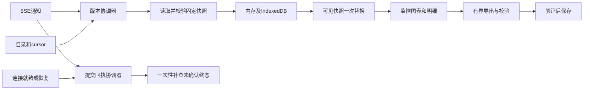
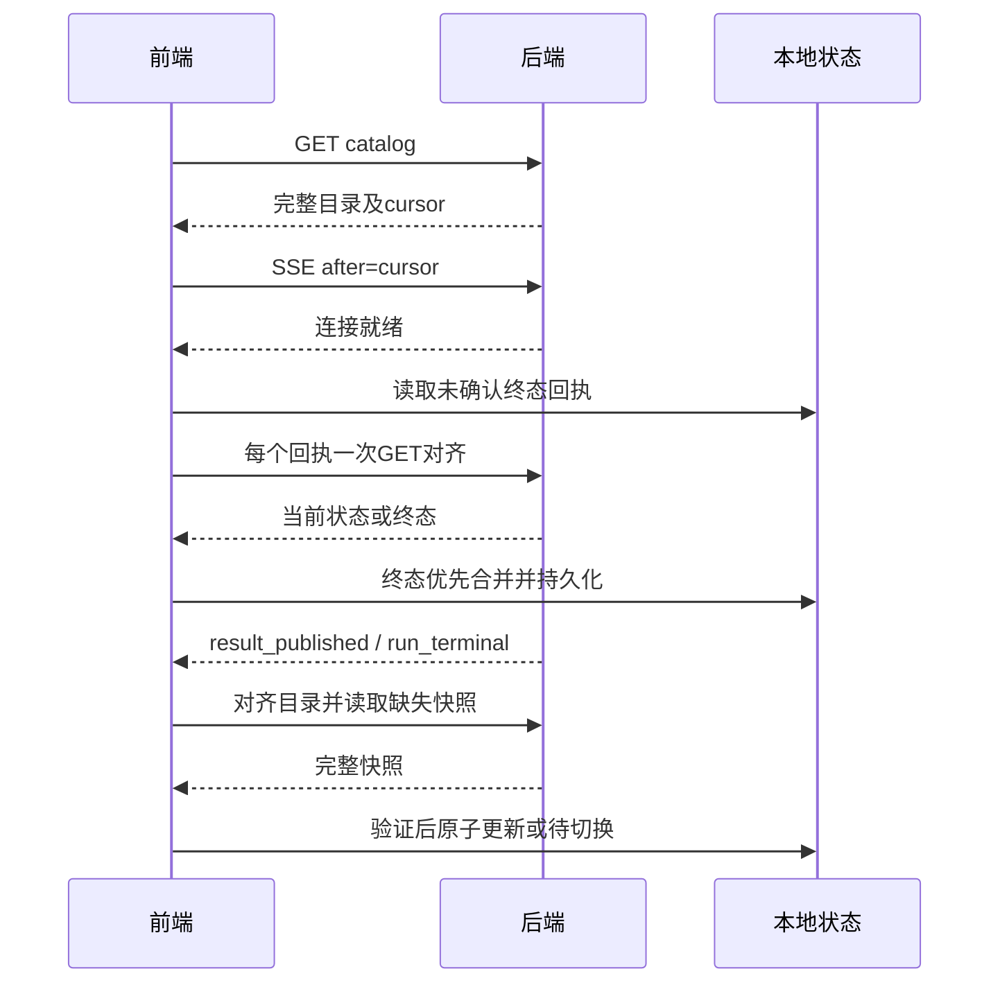

# Token 监控前端设计 v1.0：最终评审稿

日期：2026-10-27。状态：**设计已获用户批准，实施状态以ENTRY和各批RESULT为准**。用户已采用R1终态恢复、R2完整性要求及2026-10-27导出内存修订；审批记录见APPROVAL。本稿替代[交互v0.1](../../archive/viewer/MONITORING_INTERACTION_v0.1.md)。批准后按[开发批次](batches/README.md)逐批推进。

## 1. 输入、职责和范围

依据：[监控批准设计](../monitoring/DESIGN.md)、[B005.1设计](../monitoring/batches/B005.1/DESIGN.md)、[PLAN](../monitoring/batches/B005.1/PLAN.md)、[TESTS](../monitoring/batches/B005.1/TESTS.md)、[展示服务契约](../../contracts/MONITORING_VIEW_V1_DRAFT.md)。后者历史文件名保留DRAFT，但后端S0已冻结1.0.0；F001已锁定双方版本，不以本稿覆盖其共享契约。

首版仅实现Token监控页面和操作：范围选择、统计、分布、明细、固定信号、模型设置/阈值、手动file_ref提交、导出。现有HTML为视觉起点，正式页面不夹带合成业务数据。两类诊断和Agent不接入；既有报告HTML保留参考，未来按appid×模型×类别显示最近完整分析及时间，不在本次设计接口。

前端会话维护apps/viewer、前端文档/测试/记忆。本地前端构建不等于交付打包。**最终真实前后端联合测试、Docker构建、镜像归档和代码交付包由后端session统一完成**；前端提供确定版本、构建入口、测试证据和修复支持。后端增补验收、前端本地验收都不等于完整服务已通过。镜像/交付包仍遵循用户明确审批要求。

## 2. 不变的业务语义

- CSV单文件对应一个模型run；全部组完成、封存和事务发布后才可读。不等三个模型同时完成，不提前发布appid中间值。
- 显示appid×模型范围内J/P/H/C/O、请求数、ΣH/ΣP；所有权威值由后端提供，不重新编码、计算分位数或分析。
- J/P/C三直方图默认5K，可选1K/2K；≥200K单独开放尾桶，所有并列众数高亮；分位数只在图外显示。数量/占比切换读取同一包。
- 组/文件实际UTC范围分别展示，北京时间格式化；不把输入近似“两小时”补成虚构整点窗口。
- request_ref=(run_id,source_record_index)，hash_id可重复；文件级坏行不分摊至组；null不变零。
- 参数/阈值只影响下次启动运行；当前结果永远绑定原冻结配置。
- 页面GET不触发encode/render/replay/aggregate/explain或新分析。

## 3. 技术与目录

采用React + TypeScript + Vite单页应用；样式迁移既有HTML的浅灰蓝/白色体系，使用普通CSS变量，不引入重型UI主题。原生fetch/EventSource负责数据层，不引入默认自动刷新的查询库。使用可订阅的集中Store（React useSyncExternalStore接入）管理可见快照。直方图使用SVG，辅助排名曲线使用有界分段Canvas；大整数格式化与绘图缩放分离。

F001选择兼容Node/浏览器的依赖精确版本并提交package-lock.json，记录Node/npm/测试浏览器版本；禁止运行时CDN或浮动latest。不承诺尚未安装的版本。建议Vitest/Testing Library作逻辑/组件测试，Playwright作浏览器测试；增量SHA256采用固定版本@noble/hashes，不自创密码学实现。浏览器目标为实际验证的桌面Edge/Chrome；390px视口验证响应式，不等于全部移动平台通过。

维护目录（实际实现以CODEMAP及批次记录为准）：
- apps/viewer/src/api：生成DTO类型、运行时边界校验、路径/错误封装。
- src/domain：整数/时间格式化、范围/版本与事件类型；不放监控算法。
- src/state：catalog、snapshot-store、publication-client、receipt-store、query-cache。
- src/storage：IndexedDB、配额/LRU、schema迁移。
- src/features：overview、distributions、requests、signals、settings、submissions、exports。
- src/workers：export-validator；src/styles：原型样式与响应式规则。
- apps/viewer/tests：unit/component/browser/fixtures；scripts：契约/构建/验证入口。
- artifacts/validation/viewer/Fxxx/<run-id>/：实际测试及身份/截图/网络/性能。
- docs/tasks/viewer/batches/Fxxx：每批CONTEXT/PLAN/ISSUES/TESTS/RESULT。
- memory/tasks/viewer.md：增量决定、问题与下轮入口。

前端构建输出apps/viewer/dist，由后端最终统一挂载/集成；路由使用hash避免额外服务器重写依赖。开发服务器代理API同源；生产静态资源和现有根API路径同源，不擅自给所有后端接口加/api前缀。部署访问方式及secure context由最终联合验收确认。

## 4. 界面规格

| 页面/动作 | 行为与数据 |
| --- | --- |
| 顶部范围 | appid优先、模型其次；模型枚举用/models，仅取ID/标签，精确整数编辑用新视图接口 |
| 版本与时间 | 当前数据范围/生成时间常显，run/配置身份可展开；可选历史完整run，URL固定run |
| 概览 | 请求量与J/P/H/C/O、唯一命中率；Qwen/V4近似语义就地说明，不伪装真实生产命中 |
| 分布 | 三图统一纵轴，1K/2K/5K本地切换；众数、P50/80/90及<8K/≥200K图外显示 |
| 区间明细 | 同run/appid、左闭右开、尾桶无upper；默认50行；单次返回所有Token列，不能拼三组排名 |
| 搜索/排序 | hash exact/prefix保留重复；允许字段按契约，次排序source_record_index升序；搜索约250ms防抖，Enter立即执行 |
| 请求详情 | 默认64KiB UTF8安全预览；已存轻证据分页；模板正文capability=false则不提供入口；原文按需读取不持久缓存 |
| 辅助排名图 | 每段最多1000点，显示排名区间/总数；切段并缓存，不累计无限点或标为全量；全量数据走导出 |
| 信号 | 固定run的view-signals分页，读当前消费状态不污染快照；不轮询，不把pending_consumer解释为分析已运行 |
| 设置/规则 | 当前结果只读；下一运行编辑走整数适配接口，CAS冲突保留草稿，重新读取比较 |
| 提交 | 手动放CSV、填写file_ref和模型；显式确认提交，随机submission_key；无浏览器上传承诺 |
| 导出 | 轻量快照可直接下载；全量/筛选请求走R2校验流程；明确范围、格式、时间与完整性结果 |
| 状态 | 无数据、无效组、读失败、连接中断分别表达；不在业务卡片显示计算进度，不以零替代未知 |

概览/分布页收到新完整包后一次替换指标与图；正在看详情、固定历史或编辑时提示“新结果可查看”，用户切换后清除旧页码/选择，保留合法图宽。后台失败不会替换旧结果。操作抽屉展示任务终态，不改变业务报告不显示任务状态的原则。

## 5. 协议适配与无损表示

复用B005.1路径：/monitoring/catalog、/monitoring/runs、/monitoring/events；/analysis-runs/{id}/view-snapshot、requests、view-signals；/monitoring/models/{id}/settings、/monitoring/threshold-rules；POST /analysis-runs与GET /analysis-submissions/{key}。

view_schema=1的新DTO：计数/Token/边界/rank/index/seq/revision/offset等整数始终十进制字符串，负delta允许负号；ratio/share为有限number或null；bin_width、limit是有界number枚举。原样持久化字符串，比较/精确格式化用BigInt，不先Number化。像素绘图可用BigInt比例缩放至固定整数刻度后转Number，tooltip保留精确原值；不根据像素反推权威数值。时间保留RFC3339纳秒原串，显示精度可缩短，但排序不靠Date丢失精度后的值。

快照同instance/schema/run/appid不可变，ETag按后端声明完整响应字节规则校验。旧API数值响应仅用于run_id/status等必要回执，不能用于编辑大整数设置或显示无损统计。未支持schema显式拒绝，不自动填零或猜字段。

## 6. 通知、目录和一致性

- 首次取目录及同事务cursor，随后建立EventSource after=cursor；目录分页绑定catalog_revision，409丢弃该轮分页并重读，旧可见快照不动。
- 每页面一条SSE；处理result_published/run_terminal/reset。重连Last-Event-ID按服务规则；cursor视为不透明字符串，seq用BigInt。
- 新结果事件只触发目录对齐和缺少版本的GET，不直接用事件序号选latest。后端latest=(组max time_ns,publish_seq)；历史文件晚完成不覆盖新时间范围。
- 同一快照键只保留一个in-flight Promise。迟到响应只能写自身缓存，只有仍匹配当前目标版本的包才能变为可见。
- 目录变更处理合并短时重复事件；完成通知不丢弃，快照可直接取最终active版本，不逐个加载无关旧版本。
- reset关闭旧连接、取消旧连接代次的回调，再取目录/新cursor、重新订阅。服务实例变化停止旧请求和事件处理，隔离旧缓存/待确认提交。
- 心跳不触发GET。断线按SSE重连机制恢复并一次性对齐目录；没有定时指标轮询。不能用只存于内存的通知代替持久结果。
- 包完整性/schema/范围验证通过后，Store一次切换可见引用；读取失败保留旧包和真实时间。新范围标题下不冒用另一appid的旧值。
- 首次刷新可显示“上次缓存结果，待确认连接”的旧范围；目录确认实例不同立即撤下，不标作当前服务结果。离线缓存仅代表上次已读，不保证服务现状。

## 7. 展示缓存与资源

每组轻量包含metrics、全部三宽度分布共1029桶、冻结设置/规则/信号摘要和时间质量；不含全量正文/IDs或可变消费状态。

内存软预算32MiB，IndexedDB轻包软预算64MiB，LRU清理非当前项；这是应用管理目标，不是浏览器绝对内存保证。路由切换共享缓存，不因卸载、聚焦或定时TTL重取同版指标；两小时是数据范围。持久化失败降级内存并说明跨刷新无法保留，当前页面仍可用。

明细页缓存键包含run/appid/filter/sort/offset/limit，不持久保存正文；大型原文使用只读流或有上限预览，取消时释放。cache/schema/实例不兼容时只清理对应本地缓存。规则/设置变化只失效编辑缓存，不改历史包。

## 8. R1：提交终态恢复（用户已采用）

提交前生成key，连同service_instance_id、规范请求最小字段、local_submitted_at写入ReceiptStore；不保存CSV正文。POST响应丢失时保留该key，通过回执查询或用户显式重试同key恢复，不创建新key重复运行。IndexedDB不可用时仍允许内存提交，但必须显示回执/key及跨刷新恢复限制。

恢复协调顺序：
1. 使用目录确认实例并建立SSE，处理器先安装；onopen标记该连接代次可接收事件。
2. 对本实例所有未确认终态回执各GET一次，最多4并发，按key去重。同连接代次重复onopen或恢复事件合并。
3. 首次订阅、重连、reset后的新订阅、页面恢复及提交收到回执后触发对齐。页面恢复时若连接不可用先重建；已打开状态下先接收事件再查状态。
4. key未知404可能是POST根本未受理，标“提交尚未确认”，允许用户同key重试；不能伪造failed或自动用新key提交。
5. run仍queued/running则继续等已建立SSE；对齐失败保留未确认项并提供重试，无周期轮询。
6. completed/no_valid_rows/failed/interrupted为终态。终态优先于迟到的queued/running，互相矛盾的终态视协议错误，显式对齐，不自行挑选。
7. 终态持久记录后移出待确认集合；收到result_published也更新相应提交回执，即使该run不是业务latest。
8. 旧实例回执不会发送给新实例；可留作历史说明。服务重启身份未变时正常恢复。

这补齐“任务在首次catalog之前已结束”与“离线超过7天日志保留期”的缺口。后端只需提供持久正确的回执/状态和事件，不需要新增轮询任务。R1测试见F004和统一验收表。

## 9. R2：有界导出校验（采用方案A）

正式导出默认推荐NDJSON；CSV保留。**验证通过之前不显示导出成功。** 支持具有showSaveFilePicker/createWritable且运行在secure context的桌面浏览器；启动时按能力检测，不只按UA判断。标准监控阅读不依赖文件写入权限。

### 9.1 支持流式文件写入时
- 用户点击导出时立即调用保存选择器，保留用户激活；选定后发起fetch，写入临时可写流。F005验证实际Edge/Chrome版本、HTTPS或受信任本地访问能力。
- response.body以ReadableStream读取，主线程每次最多向校验Worker投递64KiB应用切片；在途最多4片。等待校验确认与文件write完成后才继续拉取，以背压限制队列，不把所有chunk存入数组。浏览器内部网络分配无法由应用绝对控制，纳入实测RSS。
- Worker流式解析、维护计数/增量SHA256和UTF8状态。处理完的字节交由文件写入后释放；不收集全量行/文本，不用response.text()/blob()/arrayBuffer()读取大文件。
- EOF且完整性通过后才close提交文件；取消/错误执行abort并释放reader、worker和句柄。新建文件在某些环境可能残留空占位，提示未完成，不自动删除用户文件。覆盖已有文件的行为用实际浏览器测试。
- 同一页面一次只允许一个活动导出；离开页面提示正在导出并允许取消，不自动保留无限后台任务。

### 9.2 验证规则
NDJSON：先metadata、后request行、最后唯一summary；验证run/appid/model/筛选身份。按收到的原始request行UTF8字节（包含后端定义的换行）增量SHA256，不能parse后重新序列化再哈希。比较metadata预计行数、summary实际行数、解析行数、summary摘要；缺summary、顺序错、额外request、非法UTF8或截断均失败。空导出也必须有metadata+summary。

CSV：读取X-Export-Row-Count和预期列，流式处理引号、双引号转义、字段内CR/LF及跨chunk字符；按完整记录计数而非换行数，EOF必须处于合法字段结束状态。比较记录数后才能通过。CSV这里只验证结构与条数，不能宣称字节级摘要校验；精确保真/摘要校验选NDJSON。按后端声明处理公式安全前缀，不悄悄恢复为公式。

为防单条极端记录破坏内存边界，本UI解析单记录上限1MiB UTF8，超过时中止并明确“该导出记录超出浏览器处理上限”，不截断、不宣称全量完成。此为展示导出限制，不改变CSV摄入/Token计算允许的长度。F001与后端核对实际字段体量；调整该限额需保留内存证据，不强加新的摄入限制。

### 9.3 不支持流式文件写入时
只允许**总解码字节≤16MiB**的完整校验后Blob下载。先检查可信Content-Length（有压缩不能当解码长度），再在读取中硬性计数；超过立即abort，保留原结果，不产生部分下载文件。建议用户缩小已支持筛选范围或改用支持文件流的浏览器/访问方式；不自动拆成若干文件却称单个完整导出。
校验通过后提示“文件已校验，已发起下载”，不宣称已知道系统磁盘保存成功。此有界备用路径的复制峰值也需测试。不支持能力不是无验证下载的理由。

### 9.4 R2验收与依据
F005用≥256MiB且单记录≤1MiB的合成流、慢磁盘、超长记录、取消、截断、坏summary/SHA、CSV引号换行和UTF8跨chunk测试。应用管理缓冲上界以队列和记录限额断言；2026-10-27用户批准修订：流式校验/导出增量浏览器内存以64MiB为优化目标、256MiB为验收上限，和页面基线分开实测，不能用后端RSS代替。256MiB及1GiB导出分别至少3次测量，确认文件体积增加4倍时内存不出现近似线性增长；保留应用队列和单记录上限。为使该检查可复现，记录各规模中位增量，1GiB中位增量须小于256MiB中位增量的3倍（小基线按32MiB计），且每次均≤256MiB；属于保守检测规则，不宣称数学证明常数内存。工具/浏览器版本、峰值方法和全部试验落证据；未达标不得静默提高门槛。

官方依据：[保存选择器能力/用户激活](https://developer.mozilla.org/en-US/docs/Web/API/Window/showSaveFilePicker)、[可写文件流关闭后提交](https://developer.mozilla.org/en-US/docs/Web/API/FileSystemFileHandle/createWritable)、[ReadableStream](https://developer.mozilla.org/en-US/docs/Web/API/ReadableStream)、[noble-hashes增量摘要](https://github.com/paulmillr/noble-hashes)。以上只支持技术可行性，不是本项目实现或性能证据。

## 10. 六个开发batch与门槛

F001 → F002 → F003 → F004 → F005 → F006，详见各[PLAN](batches/README.md)。本稿批准后才开始F001；每批关闭后在已授权范围推进下一批，不用反复请求开始。目标/接口不兼容或降低验收标准需用户裁决。

| Batch | 内容 | 关闭门槛 |
| --- | --- | --- |
| F001 | 契约锁定、精确类型、React/TS/Vite工程、测试工具 | R1/R2协议/样例确认；构建/静态检查、DTO边界和离线资源检查通过 |
| F002 | 目录/SSE/缓存/原子快照/路由 | 断线/reset/竞态/实例变化/迟到响应/配额测试；无轮询和混版本 |
| F003 | 概览/分布/明细/信号/历史 | 权威值逐项一致；所有交互与空态、窄屏、缓存命中通过 |
| F004 | 提交/R1恢复、参数/阈值CAS | 订阅前终态、过期reset、乱序、丢回执、冲突与无损写入通过 |
| F005 | R2导出校验与有界保存 | 两格式正确性、256MiB流、失败/取消/备用路径和浏览器内存门槛通过 |
| F006 | 前端统一E2E/健壮性/设计核对、交接 | 所有前端用例与回归、可复现构建、设计矩阵无未批准偏差；交接完整 |

F001须取得后端修订契约/完整样例的确认；尚未提供真实服务时F002–F005可用契约假服务作前端层验收并明确标记。F006中可执行已就绪后端的开发联调，缺少则如实记录integration=pending；后端统一J01–J06未通过前，完整V1保持未完成。前端ready_for_joint不是release_ready。

## 11. 统一验收、代码质量与回退

所有batch维护CONTEXT/PLAN/ISSUES/TESTS/RESULT，实际结果和计划分开；增量写memory/tasks/viewer。TypeScript strict、lint、单元/组件/浏览器和构建都须按批范围验证；网络/文件错误用真实边界模拟，不以实现函数自比证明正确。

[统一验收矩阵](ACCEPTANCE_V1.md)将要求映射F001–F006与后端A/J；F006逐行填代码入口、命令、版本、数据和结果。缓存交互p95≤100ms、参考环境首个组读取+渲染p95≤1s、50条请求页p95≤500ms为待实测目标；≥30次冷/热记录，后端延迟影响单列，不能假服务成绩代替真实联合表现。首次渲染与首次全目录加载分开计时。安全异常覆盖服务端字段作为文本展示，不执行原prompt中HTML。

每批闭环保存源码版本或源码摘要清单、依赖锁、测试与配置。失败保留证据回退最近关闭批次；不全局reset、不删除后端数据。客户端schema升级只迁移/丢弃兼容缓存；ReceiptStore采用独立schema保护未确认提交，不随结果缓存清空。实例/协议不兼容停止新写入，旧结果标明历史。

前端交给后端：源码/构建脚本/锁、静态资源manifest、依赖/浏览器与view_schema身份、测试/网络/性能证据、已知问题和回退步骤、R1/R2验收数据、联合测试调用入口。后端统一执行最终J01–J06及扩展项、打包与现场验收；本会话不生成Docker/镜像/代码归档。

## 12. 本次审批对象

请审批本文v1.0、六批开发计划、统一验收和R2明确兼容/大小边界。用户已批准的是R1/R2修订方向，具体16MiB备用限制、1MiB记录限额、目标技术栈/浏览器与资源目标纳入本稿本次审批。批准后开始F001；本轮没有新增业务代码、安装依赖、运行应用测试、打包或跨会话发送消息。

## 13. 后端交接与技术依据

可直接粘贴的[后端交接prompt](../../../achieve/2026-10-28/prompts/sessions/MONITORING_BACKEND_FRONTEND_V1_HANDOFF.md)包含统一交付责任、R1/R2修订及验收动作，未自动发送。

技术选型参考：[React TypeScript](https://react.dev/learn/typescript)、[Vite](https://vite.dev/guide/)。实际版本由F001锁定；官方能力说明不等于本项目已验证。

## F007：审批DEMO视觉还原补充（2026-10-27）

用户批准直接恢复审批HTML的页面骨架与样式，覆盖本文“仅作为视觉起点”的宽泛表述；具体代码修改、验证、测试和单独视觉验收以[F007 PLAN](../../../achieve/2026-10-28/docs/tasks/viewer/batches/F007/PLAN.md)为准。HTML冻结摘要见CONTEXT。六卡三列、输入Token去向条、紧凑元信息、左侧导航及三直方图按原型还原；真实状态/功能差异显式记录，不引入模拟业务。原数据交互、计量语义、后端契约不变。

本批纯展示修复不重复整套联合review；前端回归、agent视觉对照、用户人工验收分别记录。后端在Docker构建与镜像打包前统一检查代码、闭环和设计；打包授权独立。当前F007已实施、前端验证通过，2026-10-28用户人工验收通过、F007 closed，见[闭环入口](../../../achieve/2026-10-28/docs/tasks/viewer/batches/F007/RESULT.md)。
